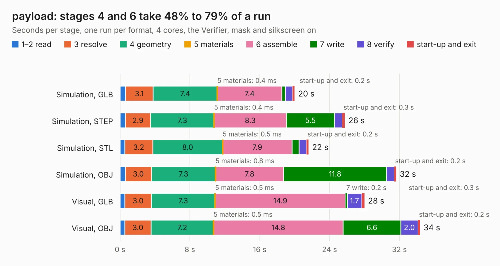

# 2261. payload

Board 2,261 of the 3,139 of [Corpus Testing](../Corpus-Testing.md), on [Corpus Page 21](../CorpusTestingPages/Corpus-Testing-21.md#2261-payload).

| Mode and format | 1–2 read | 3 resolve | 4 geometry | 5 materials | 6 assemble | 7 write | 8 verify | start-up and exit | Total |
|---|---:|---:|---:|---:|---:|---:|---:|---:|---:|
| Simulation, GLB | 0.6 | 3.1 | 7.4 | 0.4&nbsp;ms | 7.4 | 0.4 | 0.8 | 0.2 | 20.0 |
| Simulation, STEP | 0.6 | 2.9 | 7.3 | 0.4&nbsp;ms | 8.3 | 5.5 | 0.9 | 0.3 | 25.8 |
| Simulation, STL | 0.5 | 3.2 | 8.0 | 0.5&nbsp;ms | 7.9 | 0.8 | 0.8 | 0.2 | 21.6 |
| Simulation, OBJ | 0.6 | 3.0 | 7.3 | 0.8&nbsp;ms | 7.8 | 11.8 | 0.9 | 0.2 | 31.6 |
| Visual, GLB | 0.6 | 3.0 | 7.3 | 0.5&nbsp;ms | 14.9 | 0.2 | 1.7 | 0.3 | 28.0 |
| Visual, OBJ | 0.5 | 3.0 | 7.2 | 0.5&nbsp;ms | 14.8 | 6.6 | 2.0 | 0.2 | 34.4 |

<table align="center"><tr><td valign="top">

| Board | Repo: [osusat/cubesat](https://github.com/osusat/cubesat) Board: `payload.kicad_pcb` |
|---|---|
| Folder | payload / v1 / hardware |
| Complexity | 387&nbsp;/&nbsp;1000 (size&nbsp;247, features&nbsp;140) |
| KESE&nbsp;features | through vias, custom pads, rounded, trapezoid or chamfered pads, arc tracks, filled zones, copper drawings, copper text, knockout text, stack-up, dielectric εr and tanδ |
| Tested | 9th November 2026 |
| Copper&nbsp;layers | 4 |
| File&nbsp;format | KiCad 10 (20260206) |
| Parts,&nbsp;tracks,&nbsp;vias | 55, 844, 641 |
| Triangles,&nbsp;simulation | 2,501,626 in 225 parts |
| Verifier | PASS in all six runs |

</td><td valign="top">

<table>
<tr><th>File type</th><th>File size</th><th>Peak memory used</th></tr>
<tr><th colspan="3" align="left">Simulation</th></tr>
<tr><td>GLB</td><td align="right">84&nbsp;MB</td><td align="right">1.0&nbsp;GB</td></tr>
<tr><td>STEP</td><td align="right">236&nbsp;MB</td><td align="right">1.2&nbsp;GB</td></tr>
<tr><td>STL</td><td align="right">125&nbsp;MB</td><td align="right">1.0&nbsp;GB</td></tr>
<tr><td>OBJ</td><td align="right">259&nbsp;MB</td><td align="right">1.7&nbsp;GB</td></tr>
<tr><th colspan="3" align="left">Visual</th></tr>
<tr><td>GLB</td><td align="right">49&nbsp;MB</td><td align="right">968&nbsp;MB</td></tr>
<tr><td>OBJ</td><td align="right">153&nbsp;MB</td><td align="right">1.1&nbsp;GB</td></tr>
</table>

</td></tr></table>

| Previous | Next |
|:---|---:|
| [2260. obc](b2260b_cubesat_obc.md) | [2262. usb_c](b2262b_cubesat_usb-c.md) |
