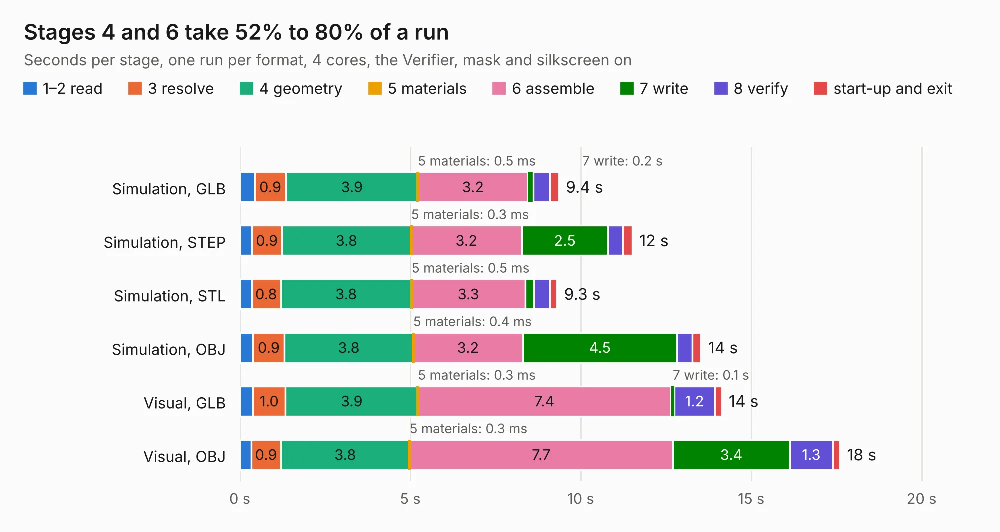

# 2262. Bad Thing of the Edge Keyboard

Board 2,262 of the 3,127 of [Corpus Testing](../Corpus-Testing.md), on [Corpus Page 21](../CorpusTestingPages/Corpus-Testing-21.md#2262-bad-thing-of-the-edge-keyboard).

| Mode and format | 1–2 read | 3 resolve | 4 geometry | 5 materials | 6 assemble | 7 write | 8 verify | start-up and exit | Total |
|---|---:|---:|---:|---:|---:|---:|---:|---:|---:|
| Simulation, GLB | 0.4 | 0.9 | 3.9 | 0.5&nbsp;ms | 3.2 | 0.2 | 0.5 | 0.3 | 9.4 |
| Simulation, STEP | 0.4 | 0.9 | 3.8 | 0.3&nbsp;ms | 3.2 | 2.5 | 0.4 | 0.3 | 11.5 |
| Simulation, STL | 0.3 | 0.8 | 3.8 | 0.5&nbsp;ms | 3.3 | 0.3 | 0.5 | 0.2 | 9.3 |
| Simulation, OBJ | 0.4 | 0.9 | 3.8 | 0.4&nbsp;ms | 3.2 | 4.5 | 0.5 | 0.3 | 13.5 |
| Visual, GLB | 0.4 | 1.0 | 3.9 | 0.3&nbsp;ms | 7.4 | 0.1 | 1.2 | 0.2 | 14.1 |
| Visual, OBJ | 0.3 | 0.9 | 3.8 | 0.3&nbsp;ms | 7.7 | 3.4 | 1.3 | 0.2 | 17.6 |

<table align="center"><tr><td valign="top">

| Board | Repo: [Pakequis/Bad-Thing-of-the-Edge-keyboard](https://github.com/Pakequis/Bad-Thing-of-the-Edge-keyboard) Board: `Bad Thing of the Edge Keyboard.kicad_pcb` |
|---|---|
| Folder | Hardware / Main-board |
| Complexity | 267&nbsp;/&nbsp;1000 (size&nbsp;167, features&nbsp;100) |
| KESE&nbsp;features | through vias, rounded, trapezoid or chamfered pads, drill offsets, filled zones, TrueType text, stack-up, dielectric εr and tanδ |
| Tested | 9th November 2026 |
| Copper&nbsp;layers | 2 |
| File&nbsp;format | KiCad 7 (20221018) |
| Parts,&nbsp;tracks,&nbsp;vias | 53, 397, 99 |
| Triangles,&nbsp;simulation | 1,024,866 in 65 parts |
| Verifier | PASS in all six runs |

</td><td valign="top">

<table>
<tr><th>File type</th><th>File size</th><th>Peak memory used</th></tr>
<tr><th colspan="3" align="left">Simulation</th></tr>
<tr><td>GLB</td><td align="right">35&nbsp;MB</td><td align="right">510&nbsp;MB</td></tr>
<tr><td>STEP</td><td align="right">165&nbsp;MB</td><td align="right">573&nbsp;MB</td></tr>
<tr><td>STL</td><td align="right">51&nbsp;MB</td><td align="right">466&nbsp;MB</td></tr>
<tr><td>OBJ</td><td align="right">104&nbsp;MB</td><td align="right">756&nbsp;MB</td></tr>
<tr><th colspan="3" align="left">Visual</th></tr>
<tr><td>GLB</td><td align="right">26&nbsp;MB</td><td align="right">647&nbsp;MB</td></tr>
<tr><td>OBJ</td><td align="right">77&nbsp;MB</td><td align="right">631&nbsp;MB</td></tr>
</table>

</td></tr></table>

| Previous | Next |
|:---|---:|
| [2261. fpx](b2261b_fpx_fpx.md) | [2263. panel](b2263b_Bad-Thing-of-the-Edge-keyboard_panel.md) |
