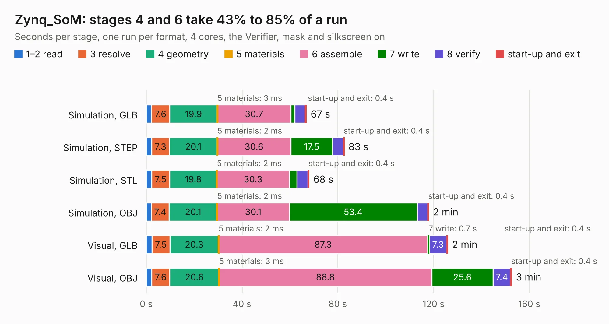

# 2262. Zynq_SoM

Board 2,262 of the 3,109 of [Corpus Testing](../Corpus-Testing.md), on [Corpus Page 21](../CorpusTestingPages/Corpus-Testing-21.md#2262-zynq_som).

| Mode and format | 1–2 read | 3 resolve | 4 geometry | 5 materials | 6 assemble | 7 write | 8 verify | start-up and exit | Total |
|---|---:|---:|---:|---:|---:|---:|---:|---:|---:|
| Simulation, GLB | 2.2 | 7.6 | 19.9 | 3&nbsp;ms | 30.7 | 1.7 | 4.4 | 0.4 | 66.9 |
| Simulation, STEP | 2.3 | 7.3 | 20.1 | 2&nbsp;ms | 30.6 | 17.5 | 4.4 | 0.4 | 82.7 |
| Simulation, STL | 2.3 | 7.5 | 19.8 | 2&nbsp;ms | 30.3 | 3.2 | 4.6 | 0.4 | 68.0 |
| Simulation, OBJ | 2.2 | 7.4 | 20.1 | 2&nbsp;ms | 30.1 | 53.4 | 4.4 | 0.4 | 118.0 |
| Visual, GLB | 2.4 | 7.5 | 20.3 | 2&nbsp;ms | 87.3 | 0.7 | 7.3 | 0.4 | 125.9 |
| Visual, OBJ | 2.3 | 7.6 | 20.6 | 3&nbsp;ms | 88.8 | 25.6 | 7.4 | 0.4 | 152.6 |

<table align="center"><tr><td valign="top">

| Board | Repo: [pinguz97/zynq-som](https://github.com/pinguz97/zynq-som) Board: `Zynq_SoM.kicad_pcb` |
|---|---|
| Complexity | 476&nbsp;/&nbsp;1000 (size&nbsp;321, features&nbsp;155) |
| KESE&nbsp;features | through vias, custom pads, rounded, trapezoid or chamfered pads, arc tracks, filled zones, copper drawings, curved board outline, TrueType text, stack-up, dielectric εr and tanδ, copper finish |
| Tested | 9th November 2026 |
| Copper&nbsp;layers | 8 |
| File&nbsp;format | KiCad 9 (20241229) |
| Parts,&nbsp;tracks,&nbsp;vias | 267, 7,394, 941 |
| Triangles,&nbsp;simulation | 8,423,948 in 612 parts |
| Verifier | PASS in all six runs |

</td><td valign="top">

<table>
<tr><th>File type</th><th>File size</th><th>Peak memory used</th></tr>
<tr><th colspan="3" align="left">Simulation</th></tr>
<tr><td>GLB</td><td align="right">280&nbsp;MB</td><td align="right">2.1&nbsp;GB</td></tr>
<tr><td>STEP</td><td align="right">866&nbsp;MB</td><td align="right">2.6&nbsp;GB</td></tr>
<tr><td>STL</td><td align="right">421&nbsp;MB</td><td align="right">2.0&nbsp;GB</td></tr>
<tr><td>OBJ</td><td align="right">900&nbsp;MB</td><td align="right">5.2&nbsp;GB</td></tr>
<tr><th colspan="3" align="left">Visual</th></tr>
<tr><td>GLB</td><td align="right">133&nbsp;MB</td><td align="right">2.4&nbsp;GB</td></tr>
<tr><td>OBJ</td><td align="right">447&nbsp;MB</td><td align="right">3.2&nbsp;GB</td></tr>
</table>

</td></tr></table>

| Previous | Next |
|:---|---:|
| [2261. carrier_template](b2261b_zynq-som_carrier-template.md) | [2263. everestCM4](b2263b_reference-hardware_everestCM4.md) |
