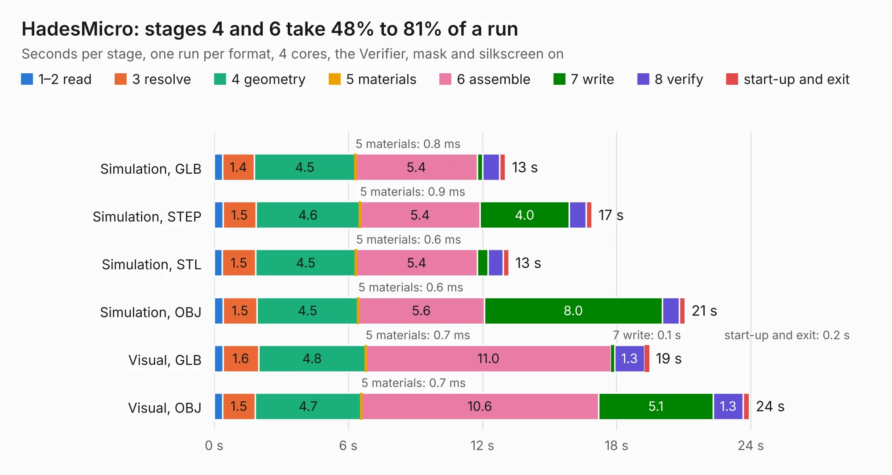

# 2263. HadesMicro

Board 2,263 of the 3,104 of [Corpus Testing](../Corpus-Testing.md), on [Corpus Page 21](../CorpusTestingPages/Corpus-Testing-21.md#2263-hadesmicro).

| Mode and format | 1–2 read | 3 resolve | 4 geometry | 5 materials | 6 assemble | 7 write | 8 verify | start-up and exit | Total |
|---|---:|---:|---:|---:|---:|---:|---:|---:|---:|
| Simulation, GLB | 0.4 | 1.4 | 4.5 | 0.8&nbsp;ms | 5.4 | 0.2 | 0.8 | 0.3 | 13.0 |
| Simulation, STEP | 0.4 | 1.5 | 4.6 | 0.9&nbsp;ms | 5.4 | 4.0 | 0.8 | 0.3 | 16.9 |
| Simulation, STL | 0.4 | 1.5 | 4.5 | 0.6&nbsp;ms | 5.4 | 0.5 | 0.7 | 0.3 | 13.2 |
| Simulation, OBJ | 0.4 | 1.5 | 4.5 | 0.6&nbsp;ms | 5.6 | 8.0 | 0.8 | 0.3 | 21.1 |
| Visual, GLB | 0.4 | 1.6 | 4.8 | 0.7&nbsp;ms | 11.0 | 0.1 | 1.3 | 0.2 | 19.5 |
| Visual, OBJ | 0.4 | 1.5 | 4.7 | 0.7&nbsp;ms | 10.6 | 5.1 | 1.3 | 0.3 | 23.9 |

<table align="center"><tr><td valign="top">

| Board | Repo: [pms67/HadesFCS](https://github.com/pms67/HadesFCS) Board: `HadesMicro.kicad_pcb` |
|---|---|
| Folder | Hardware / HadesMicro |
| Complexity | 303&nbsp;/&nbsp;1000 (size&nbsp;248, features&nbsp;55) |
| KESE&nbsp;features | through vias, rounded, trapezoid or chamfered pads, filled zones, curved board outline |
| Tested | 9th November 2026 |
| Copper&nbsp;layers | 4 |
| File&nbsp;format | KiCad 5 (20171130) |
| Parts,&nbsp;tracks,&nbsp;vias | 91, 893, 172 |
| Triangles,&nbsp;simulation | 1,393,582 in 125 parts |
| Verifier | PASS in all six runs |

</td><td valign="top">

<table>
<tr><th>File type</th><th>File size</th><th>Peak memory used</th></tr>
<tr><th colspan="3" align="left">Simulation</th></tr>
<tr><td>GLB</td><td align="right">48&nbsp;MB</td><td align="right">537&nbsp;MB</td></tr>
<tr><td>STEP</td><td align="right">174&nbsp;MB</td><td align="right">674&nbsp;MB</td></tr>
<tr><td>STL</td><td align="right">70&nbsp;MB</td><td align="right">527&nbsp;MB</td></tr>
<tr><td>OBJ</td><td align="right">143&nbsp;MB</td><td align="right">926&nbsp;MB</td></tr>
<tr><th colspan="3" align="left">Visual</th></tr>
<tr><td>GLB</td><td align="right">29&nbsp;MB</td><td align="right">760&nbsp;MB</td></tr>
<tr><td>OBJ</td><td align="right">88&nbsp;MB</td><td align="right">682&nbsp;MB</td></tr>
</table>

</td></tr></table>

| Previous | Next |
|:---|---:|
| [2262. HadesGPSDongle](b2262b_HadesFCS_HadesGPSDongle.md) | [2264. HadesMicroJLCPCB](b2264b_HadesFCS_HadesMicroJLCPCB.md) |
