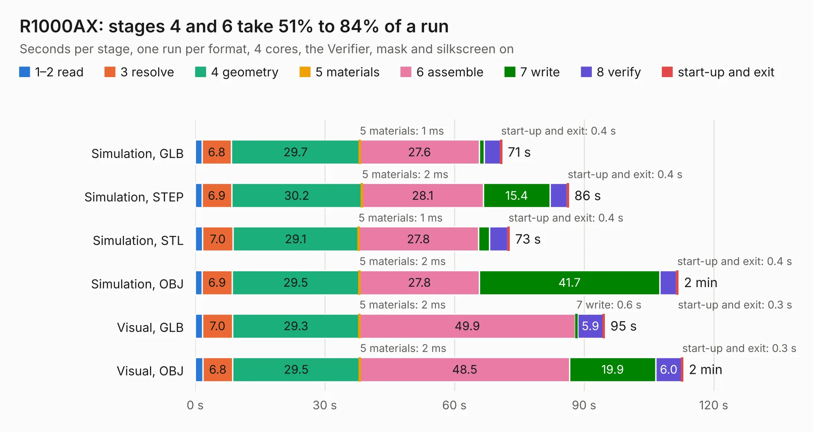

# 2263. R1000AX

Board 2,263 of the 3,107 of [Corpus Testing](../Corpus-Testing.md), on [Corpus Page 21](../CorpusTestingPages/Corpus-Testing-21.md#2263-r1000ax).

| Mode and format | 1–2 read | 3 resolve | 4 geometry | 5 materials | 6 assemble | 7 write | 8 verify | start-up and exit | Total |
|---|---:|---:|---:|---:|---:|---:|---:|---:|---:|
| Simulation, GLB | 1.6 | 6.8 | 29.7 | 1&nbsp;ms | 27.6 | 1.2 | 3.7 | 0.4 | 71.0 |
| Simulation, STEP | 1.6 | 6.9 | 30.2 | 2&nbsp;ms | 28.1 | 15.4 | 3.9 | 0.4 | 86.4 |
| Simulation, STL | 1.7 | 7.0 | 29.1 | 1&nbsp;ms | 27.8 | 2.5 | 4.3 | 0.4 | 72.7 |
| Simulation, OBJ | 1.6 | 6.9 | 29.5 | 2&nbsp;ms | 27.8 | 41.7 | 3.9 | 0.4 | 111.8 |
| Visual, GLB | 1.7 | 7.0 | 29.3 | 2&nbsp;ms | 49.9 | 0.6 | 5.9 | 0.3 | 94.7 |
| Visual, OBJ | 1.8 | 6.8 | 29.5 | 2&nbsp;ms | 48.5 | 19.9 | 6.0 | 0.3 | 112.9 |

<table align="center"><tr><td valign="top">

| Board | Repo: [pluggee/R1000AX](https://github.com/pluggee/R1000AX) Board: `R1000AX.kicad_pcb` |
|---|---|
| Folder | pcb |
| Complexity | 308&nbsp;/&nbsp;1000 (size&nbsp;263, features&nbsp;45) |
| KESE&nbsp;features | through vias, filled zones, curved board outline |
| Tested | 9th November 2026 |
| Copper&nbsp;layers | 4 |
| File&nbsp;format | KiCad 4 (4) |
| Parts,&nbsp;tracks,&nbsp;vias | 127, 3,163, 399 |
| Triangles,&nbsp;simulation | 6,324,084 in 148 parts |
| Verifier | PASS in all six runs |

</td><td valign="top">

<table>
<tr><th>File type</th><th>File size</th><th>Peak memory used</th></tr>
<tr><th colspan="3" align="left">Simulation</th></tr>
<tr><td>GLB</td><td align="right">218&nbsp;MB</td><td align="right">1.6&nbsp;GB</td></tr>
<tr><td>STEP</td><td align="right">817&nbsp;MB</td><td align="right">2.1&nbsp;GB</td></tr>
<tr><td>STL</td><td align="right">316&nbsp;MB</td><td align="right">1.6&nbsp;GB</td></tr>
<tr><td>OBJ</td><td align="right">682&nbsp;MB</td><td align="right">4.1&nbsp;GB</td></tr>
<tr><th colspan="3" align="left">Visual</th></tr>
<tr><td>GLB</td><td align="right">108&nbsp;MB</td><td align="right">1.9&nbsp;GB</td></tr>
<tr><td>OBJ</td><td align="right">345&nbsp;MB</td><td align="right">2.3&nbsp;GB</td></tr>
</table>

</td></tr></table>

| Previous | Next |
|:---|---:|
| [2262. yeti](b2262b_reference-hardware_yeti.md) | [2264. Hades](b2264b_HadesFCS_Hades.md) |
