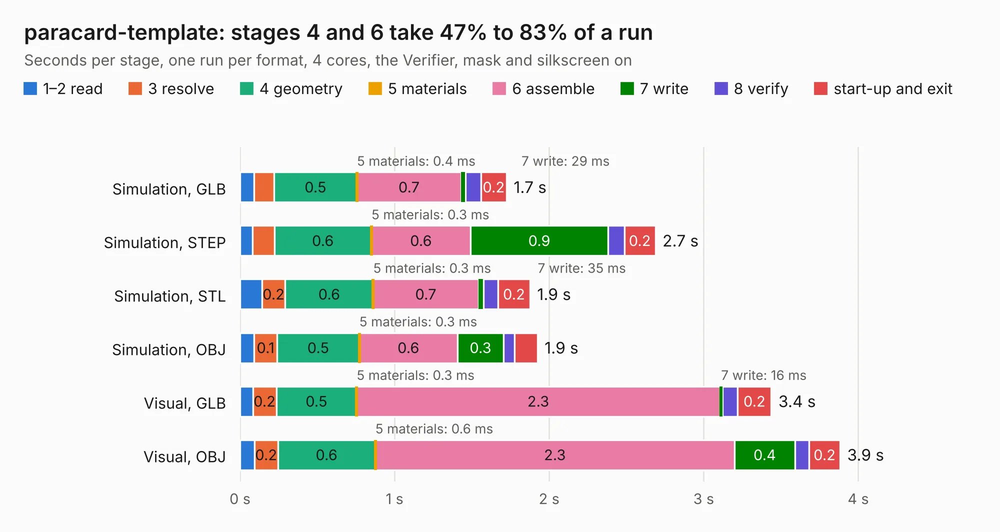

# 2264. paracard-template

Board 2,264 of the 3,122 of [Corpus Testing](../Corpus-Testing.md), on [Corpus Page 21](../CorpusTestingPages/Corpus-Testing-21.md#2264-paracard-template).

| Mode and format | 1–2 read | 3 resolve | 4 geometry | 5 materials | 6 assemble | 7 write | 8 verify | start-up and exit | Total |
|---|---:|---:|---:|---:|---:|---:|---:|---:|---:|
| Simulation, GLB | 89&nbsp;ms | 0.1 | 0.5 | 0.4&nbsp;ms | 0.7 | 29&nbsp;ms | 99&nbsp;ms | 0.2 | 1.7 |
| Simulation, STEP | 81&nbsp;ms | 0.1 | 0.6 | 0.3&nbsp;ms | 0.6 | 0.9 | 0.1 | 0.2 | 2.7 |
| Simulation, STL | 0.1 | 0.2 | 0.6 | 0.3&nbsp;ms | 0.7 | 35&nbsp;ms | 92&nbsp;ms | 0.2 | 1.9 |
| Simulation, OBJ | 91&nbsp;ms | 0.1 | 0.5 | 0.3&nbsp;ms | 0.6 | 0.3 | 71&nbsp;ms | 0.1 | 1.9 |
| Visual, GLB | 83&nbsp;ms | 0.2 | 0.5 | 0.3&nbsp;ms | 2.3 | 16&nbsp;ms | 99&nbsp;ms | 0.2 | 3.4 |
| Visual, OBJ | 93&nbsp;ms | 0.2 | 0.6 | 0.6&nbsp;ms | 2.3 | 0.4 | 91&nbsp;ms | 0.2 | 3.9 |

<table align="center"><tr><td valign="top">

| Board | Repo: [parallella/parallella-hw](https://github.com/parallella/parallella-hw) Board: `paracard-template.kicad_pcb` |
|---|---|
| Folder | paratemplate |
| Complexity | 34&nbsp;/&nbsp;1000 (size&nbsp;34, features&nbsp;0) |
| Tested | 9th November 2026 |
| Copper&nbsp;layers | 2 |
| File&nbsp;format | KiCad 3 (3) |
| Parts,&nbsp;tracks,&nbsp;vias | 4, 0, 0 |
| Triangles,&nbsp;simulation | 72,068 in 202 parts |
| Verifier | PASS in all six runs |

</td><td valign="top">

<table>
<tr><th>File type</th><th>File size</th><th>Peak memory used</th></tr>
<tr><th colspan="3" align="left">Simulation</th></tr>
<tr><td>GLB</td><td align="right">2.9&nbsp;MB</td><td align="right">181&nbsp;MB</td></tr>
<tr><td>STEP</td><td align="right">14&nbsp;MB</td><td align="right">186&nbsp;MB</td></tr>
<tr><td>STL</td><td align="right">3.6&nbsp;MB</td><td align="right">181&nbsp;MB</td></tr>
<tr><td>OBJ</td><td align="right">8.0&nbsp;MB</td><td align="right">180&nbsp;MB</td></tr>
<tr><th colspan="3" align="left">Visual</th></tr>
<tr><td>GLB</td><td align="right">3.0&nbsp;MB</td><td align="right">156&nbsp;MB</td></tr>
<tr><td>OBJ</td><td align="right">8.5&nbsp;MB</td><td align="right">156&nbsp;MB</td></tr>
</table>

</td></tr></table>

| Previous | Next |
|:---|---:|
| [2263. meta_breakout](b2263b_parallella-hw_meta-breakout.md) | [2265. porcupine](b2265b_parallella-hw_porcupine.md) |
