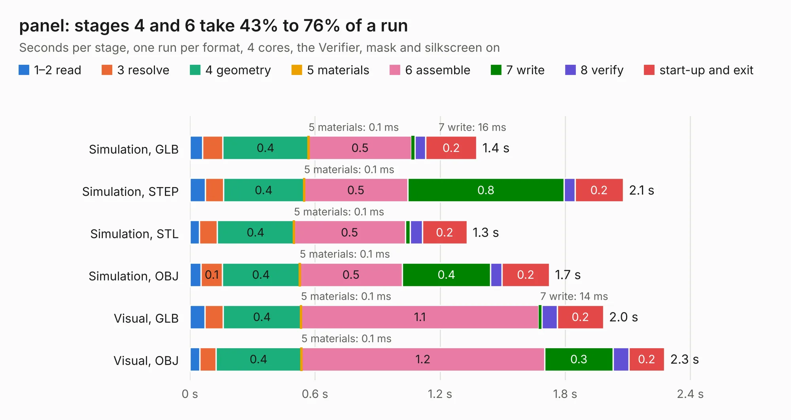

# 2265. panel

Board 2,265 of the 3,130 of [Corpus Testing](../Corpus-Testing.md), on [Corpus Page 21](../CorpusTestingPages/Corpus-Testing-21.md#2265-panel).

| Mode and format | 1–2 read | 3 resolve | 4 geometry | 5 materials | 6 assemble | 7 write | 8 verify | start-up and exit | Total |
|---|---:|---:|---:|---:|---:|---:|---:|---:|---:|
| Simulation, GLB | 61&nbsp;ms | 95&nbsp;ms | 0.4 | 0.1&nbsp;ms | 0.5 | 16&nbsp;ms | 52&nbsp;ms | 0.2 | 1.4 |
| Simulation, STEP | 73&nbsp;ms | 87&nbsp;ms | 0.4 | 0.1&nbsp;ms | 0.5 | 0.8 | 51&nbsp;ms | 0.2 | 2.1 |
| Simulation, STL | 45&nbsp;ms | 86&nbsp;ms | 0.4 | 0.1&nbsp;ms | 0.5 | 23&nbsp;ms | 58&nbsp;ms | 0.2 | 1.3 |
| Simulation, OBJ | 54&nbsp;ms | 0.1 | 0.4 | 0.1&nbsp;ms | 0.5 | 0.4 | 55&nbsp;ms | 0.2 | 1.7 |
| Visual, GLB | 71&nbsp;ms | 88&nbsp;ms | 0.4 | 0.1&nbsp;ms | 1.1 | 14&nbsp;ms | 75&nbsp;ms | 0.2 | 2.0 |
| Visual, OBJ | 47&nbsp;ms | 77&nbsp;ms | 0.4 | 0.1&nbsp;ms | 1.2 | 0.3 | 75&nbsp;ms | 0.2 | 2.3 |

<table align="center"><tr><td valign="top">

| Board | Repo: [Pakequis/Bad-Thing-of-the-Edge-keyboard](https://github.com/Pakequis/Bad-Thing-of-the-Edge-keyboard) Board: `panel.kicad_pcb` |
|---|---|
| Folder | Hardware / Panel-board |
| Complexity | 113&nbsp;/&nbsp;1000 (size&nbsp;63, features&nbsp;50) |
| KESE&nbsp;features | filled zones, TrueType text, tracks bare of mask |
| Tested | 9th November 2026 |
| Copper&nbsp;layers | 2 |
| File&nbsp;format | KiCad 9 (20241229) |
| Parts,&nbsp;tracks,&nbsp;vias | 0, 16, 0 |
| Triangles,&nbsp;simulation | 87,788 in 11 parts |
| Note | panel, no components |
| Verifier | PASS in all six runs |

</td><td valign="top">

<table>
<tr><th>File type</th><th>File size</th><th>Peak memory used</th></tr>
<tr><th colspan="3" align="left">Simulation</th></tr>
<tr><td>GLB</td><td align="right">3.2&nbsp;MB</td><td align="right">164&nbsp;MB</td></tr>
<tr><td>STEP</td><td align="right">16&nbsp;MB</td><td align="right">166&nbsp;MB</td></tr>
<tr><td>STL</td><td align="right">4.4&nbsp;MB</td><td align="right">162&nbsp;MB</td></tr>
<tr><td>OBJ</td><td align="right">8.7&nbsp;MB</td><td align="right">162&nbsp;MB</td></tr>
<tr><th colspan="3" align="left">Visual</th></tr>
<tr><td>GLB</td><td align="right">2.6&nbsp;MB</td><td align="right">135&nbsp;MB</td></tr>
<tr><td>OBJ</td><td align="right">7.1&nbsp;MB</td><td align="right">135&nbsp;MB</td></tr>
</table>

</td></tr></table>

| Previous | Next |
|:---|---:|
| [2264. Bad Thing of the Edge Keyboard](b2264b_Bad-Thing-of-the-Edge-keyboard_Bad-Thing-of-the-Edge-Keyboard.md) | [2266. Power_Integrations_interface](b2266b_vesc-controller_Power-Integrations-interface.md) |
