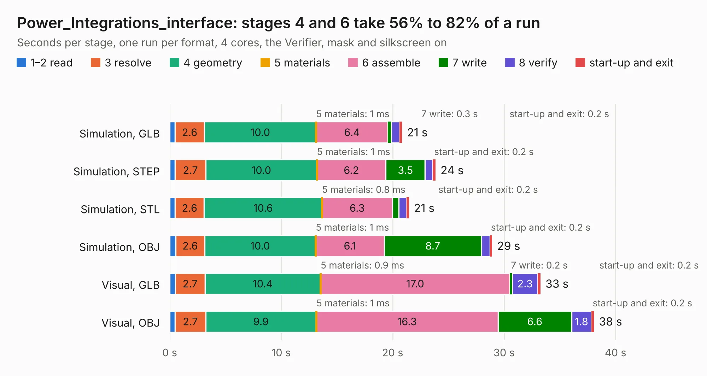

# 2265. Power_Integrations_interface

Board 2,265 of the 3,129 of [Corpus Testing](../Corpus-Testing.md), on [Corpus Page 21](../CorpusTestingPages/Corpus-Testing-21.md#2265-power_integrations_interface).

| Mode and format | 1–2 read | 3 resolve | 4 geometry | 5 materials | 6 assemble | 7 write | 8 verify | start-up and exit | Total |
|---|---:|---:|---:|---:|---:|---:|---:|---:|---:|
| Simulation, GLB | 0.5 | 2.6 | 10.0 | 1&nbsp;ms | 6.4 | 0.3 | 0.7 | 0.2 | 20.8 |
| Simulation, STEP | 0.5 | 2.7 | 10.0 | 1&nbsp;ms | 6.2 | 3.5 | 0.7 | 0.2 | 23.8 |
| Simulation, STL | 0.5 | 2.6 | 10.6 | 0.8&nbsp;ms | 6.3 | 0.6 | 0.7 | 0.2 | 21.5 |
| Simulation, OBJ | 0.5 | 2.6 | 10.0 | 1&nbsp;ms | 6.1 | 8.7 | 0.8 | 0.2 | 28.9 |
| Visual, GLB | 0.5 | 2.7 | 10.4 | 0.9&nbsp;ms | 17.0 | 0.2 | 2.3 | 0.2 | 33.3 |
| Visual, OBJ | 0.5 | 2.7 | 9.9 | 1&nbsp;ms | 16.3 | 6.6 | 1.8 | 0.2 | 38.1 |

<table align="center"><tr><td valign="top">

| Board | Repo: [paltatech/vesc-controller](https://github.com/paltatech/vesc-controller) Board: `Power_Integrations_interface.kicad_pcb` |
|---|---|
| Folder | adaptor boards / power_integrations_2SP0115T2A / pcb_design |
| Complexity | 230&nbsp;/&nbsp;1000 (size&nbsp;175, features&nbsp;55) |
| KESE&nbsp;features | through vias, drill offsets, filled zones, curved board outline |
| Tested | 9th November 2026 |
| Copper&nbsp;layers | 2 |
| File&nbsp;format | KiCad 5 (20170922) |
| Parts,&nbsp;tracks,&nbsp;vias | 80, 669, 66 |
| Triangles,&nbsp;simulation | 2,044,258 in 100 parts |
| Verifier | PASS in all six runs |

</td><td valign="top">

<table>
<tr><th>File type</th><th>File size</th><th>Peak memory used</th></tr>
<tr><th colspan="3" align="left">Simulation</th></tr>
<tr><td>GLB</td><td align="right">70&nbsp;MB</td><td align="right">949&nbsp;MB</td></tr>
<tr><td>STEP</td><td align="right">230&nbsp;MB</td><td align="right">996&nbsp;MB</td></tr>
<tr><td>STL</td><td align="right">102&nbsp;MB</td><td align="right">917&nbsp;MB</td></tr>
<tr><td>OBJ</td><td align="right">215&nbsp;MB</td><td align="right">1.4&nbsp;GB</td></tr>
<tr><th colspan="3" align="left">Visual</th></tr>
<tr><td>GLB</td><td align="right">54&nbsp;MB</td><td align="right">1.1&nbsp;GB</td></tr>
<tr><td>OBJ</td><td align="right">168&nbsp;MB</td><td align="right">1.3&nbsp;GB</td></tr>
</table>

</td></tr></table>

| Previous | Next |
|:---|---:|
| [2264. panel](b2264b_Bad-Thing-of-the-Edge-keyboard_panel.md) | [2266. VESC-controller](b2266b_vesc-controller_VESC-controller.md) |
