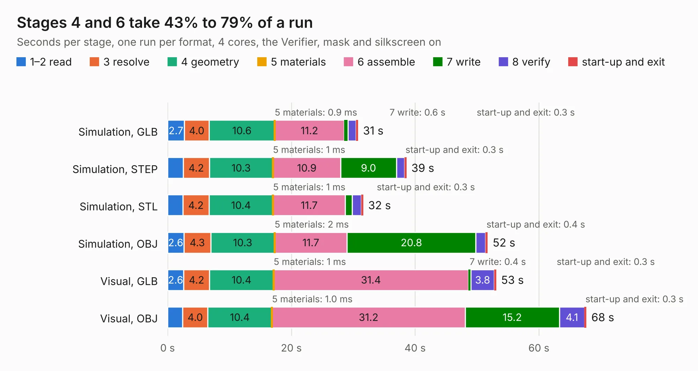

# 2268. PicoGUS chipdown with edge rails

Board 2,268 of the 3,106 of [Corpus Testing](../Corpus-Testing.md), on [Corpus Page 21](../CorpusTestingPages/Corpus-Testing-21.md#2268-picogus-chipdown-with-edge-rails).

| Mode and format | 1–2 read | 3 resolve | 4 geometry | 5 materials | 6 assemble | 7 write | 8 verify | start-up and exit | Total |
|---|---:|---:|---:|---:|---:|---:|---:|---:|---:|
| Simulation, GLB | 2.7 | 4.0 | 10.6 | 0.9&nbsp;ms | 11.2 | 0.6 | 1.3 | 0.3 | 30.8 |
| Simulation, STEP | 2.5 | 4.2 | 10.3 | 1&nbsp;ms | 10.9 | 9.0 | 1.3 | 0.3 | 38.6 |
| Simulation, STL | 2.5 | 4.2 | 10.4 | 1&nbsp;ms | 11.7 | 1.1 | 1.5 | 0.3 | 31.6 |
| Simulation, OBJ | 2.6 | 4.3 | 10.3 | 2&nbsp;ms | 11.7 | 20.8 | 1.5 | 0.4 | 51.7 |
| Visual, GLB | 2.6 | 4.2 | 10.4 | 1&nbsp;ms | 31.4 | 0.4 | 3.8 | 0.3 | 53.1 |
| Visual, OBJ | 2.5 | 4.0 | 10.4 | 1.0&nbsp;ms | 31.2 | 15.2 | 4.1 | 0.3 | 67.7 |

<table align="center"><tr><td valign="top">

| Board | Repo: [polpo/picogus](https://github.com/polpo/picogus) Board: `PicoGUS chipdown with edge rails.kicad_pcb` |
|---|---|
| Folder | hw-chipdown |
| Complexity | 396&nbsp;/&nbsp;1000 (size&nbsp;251, features&nbsp;145) |
| KESE&nbsp;features | through vias, slotted holes, custom pads, rounded, trapezoid or chamfered pads, filled zones, copper drawings, TrueType text, stack-up, dielectric εr and tanδ, copper finish, mask and silkscreen colours |
| Tested | 9th November 2026 |
| Copper&nbsp;layers | 4 |
| File&nbsp;format | KiCad 7 (20221018) |
| Parts,&nbsp;tracks,&nbsp;vias | 96, 1,334, 374 |
| Triangles,&nbsp;simulation | 3,297,988 in 176 parts |
| Verifier | PASS in all six runs |

</td><td valign="top">

<table>
<tr><th>File type</th><th>File size</th><th>Peak memory used</th></tr>
<tr><th colspan="3" align="left">Simulation</th></tr>
<tr><td>GLB</td><td align="right">115&nbsp;MB</td><td align="right">1.3&nbsp;GB</td></tr>
<tr><td>STEP</td><td align="right">371&nbsp;MB</td><td align="right">1.5&nbsp;GB</td></tr>
<tr><td>STL</td><td align="right">165&nbsp;MB</td><td align="right">1.3&nbsp;GB</td></tr>
<tr><td>OBJ</td><td align="right">359&nbsp;MB</td><td align="right">2.3&nbsp;GB</td></tr>
<tr><th colspan="3" align="left">Visual</th></tr>
<tr><td>GLB</td><td align="right">87&nbsp;MB</td><td align="right">1.5&nbsp;GB</td></tr>
<tr><td>OBJ</td><td align="right">274&nbsp;MB</td><td align="right">1.9&nbsp;GB</td></tr>
</table>

</td></tr></table>

| Previous | Next |
|:---|---:|
| [2267. HadesNT](b2267b_HadesFCS_HadesNT.md) | [2269. PicoGUS chipdown](b2269b_picogus_PicoGUS-chipdown.md) |
