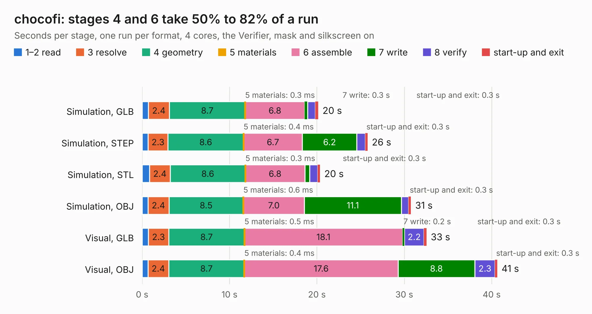

# 2270. chocofi

Board 2,270 of the 3,128 of [Corpus Testing](../Corpus-Testing.md), on [Corpus Page 22](../CorpusTestingPages/Corpus-Testing-22.md#2270-chocofi).

| Mode and format | 1–2 read | 3 resolve | 4 geometry | 5 materials | 6 assemble | 7 write | 8 verify | start-up and exit | Total |
|---|---:|---:|---:|---:|---:|---:|---:|---:|---:|
| Simulation, GLB | 0.7 | 2.4 | 8.7 | 0.3&nbsp;ms | 6.8 | 0.3 | 0.9 | 0.3 | 20.2 |
| Simulation, STEP | 0.7 | 2.3 | 8.6 | 0.4&nbsp;ms | 6.7 | 6.2 | 1.0 | 0.3 | 25.8 |
| Simulation, STL | 0.9 | 2.4 | 8.6 | 0.3&nbsp;ms | 6.8 | 0.6 | 0.9 | 0.3 | 20.4 |
| Simulation, OBJ | 0.7 | 2.4 | 8.5 | 0.6&nbsp;ms | 7.0 | 11.1 | 0.8 | 0.3 | 30.8 |
| Visual, GLB | 0.7 | 2.3 | 8.7 | 0.5&nbsp;ms | 18.1 | 0.2 | 2.2 | 0.3 | 32.5 |
| Visual, OBJ | 0.7 | 2.4 | 8.7 | 0.4&nbsp;ms | 17.6 | 8.8 | 2.3 | 0.3 | 40.6 |

<table align="center"><tr><td valign="top">

| Board | Repo: [pashutk/chocofi](https://github.com/pashutk/chocofi) Board: `chocofi.kicad_pcb` |
|---|---|
| Folder | pcb |
| Complexity | 285&nbsp;/&nbsp;1000 (size&nbsp;175, features&nbsp;110) |
| KESE&nbsp;features | through vias, slotted holes, rounded, trapezoid or chamfered pads, filled zones, copper text, curved board outline, stack-up, dielectric εr and tanδ, mask and silkscreen colours |
| Tested | 9th November 2026 |
| Copper&nbsp;layers | 2 |
| File&nbsp;format | KiCad 6 (20211014) |
| Parts,&nbsp;tracks,&nbsp;vias | 53, 797, 97 |
| Triangles,&nbsp;simulation | 1,835,776 in 56 parts |
| Verifier | PASS in all six runs |

</td><td valign="top">

<table>
<tr><th>File type</th><th>File size</th><th>Peak memory used</th></tr>
<tr><th colspan="3" align="left">Simulation</th></tr>
<tr><td>GLB</td><td align="right">64&nbsp;MB</td><td align="right">856&nbsp;MB</td></tr>
<tr><td>STEP</td><td align="right">370&nbsp;MB</td><td align="right">862&nbsp;MB</td></tr>
<tr><td>STL</td><td align="right">92&nbsp;MB</td><td align="right">855&nbsp;MB</td></tr>
<tr><td>OBJ</td><td align="right">194&nbsp;MB</td><td align="right">1.3&nbsp;GB</td></tr>
<tr><th colspan="3" align="left">Visual</th></tr>
<tr><td>GLB</td><td align="right">50&nbsp;MB</td><td align="right">985&nbsp;MB</td></tr>
<tr><td>OBJ</td><td align="right">153&nbsp;MB</td><td align="right">1.1&nbsp;GB</td></tr>
</table>

</td></tr></table>

| Previous | Next |
|:---|---:|
| [2269. chocofi-topplate](b2269b_chocofi_chocofi-topplate.md) | [2271. pda6502v2](b2271b_pda6502v2_pda6502v2.md) |
