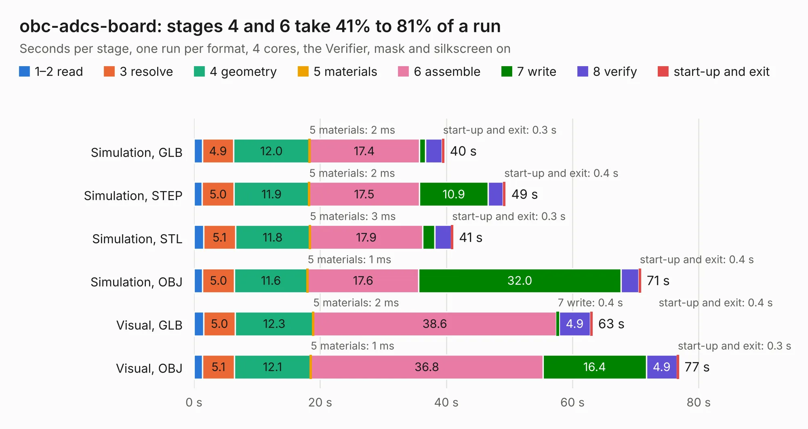

# 2272. obc-adcs-board

Board 2,272 of the 3,127 of [Corpus Testing](../Corpus-Testing.md), on [Corpus Page 22](../CorpusTestingPages/Corpus-Testing-22.md#2272-obc-adcs-board).

| Mode and format | 1–2 read | 3 resolve | 4 geometry | 5 materials | 6 assemble | 7 write | 8 verify | start-up and exit | Total |
|---|---:|---:|---:|---:|---:|---:|---:|---:|---:|
| Simulation, GLB | 1.3 | 4.9 | 12.0 | 2&nbsp;ms | 17.4 | 1.0 | 2.6 | 0.3 | 39.6 |
| Simulation, STEP | 1.3 | 5.0 | 11.9 | 2&nbsp;ms | 17.5 | 10.9 | 2.4 | 0.4 | 49.4 |
| Simulation, STL | 1.5 | 5.1 | 11.8 | 3&nbsp;ms | 17.9 | 1.9 | 2.6 | 0.3 | 41.1 |
| Simulation, OBJ | 1.4 | 5.0 | 11.6 | 1&nbsp;ms | 17.6 | 32.0 | 2.8 | 0.4 | 70.8 |
| Visual, GLB | 1.5 | 5.0 | 12.3 | 2&nbsp;ms | 38.6 | 0.4 | 4.9 | 0.4 | 63.2 |
| Visual, OBJ | 1.3 | 5.1 | 12.1 | 1&nbsp;ms | 36.8 | 16.4 | 4.9 | 0.3 | 76.8 |

<table align="center"><tr><td valign="top">

| Board | Repo: [peaksat/obcboard_pcb](https://github.com/peaksat/obcboard_pcb) Board: `obc-adcs-board.kicad_pcb` |
|---|---|
| Complexity | 356&nbsp;/&nbsp;1000 (size&nbsp;251, features&nbsp;105) |
| KESE&nbsp;features | through vias, rounded, trapezoid or chamfered pads, arc tracks, filled zones, curved board outline, stack-up, dielectric εr and tanδ, mask and silkscreen colours |
| Tested | 9th November 2026 |
| Copper&nbsp;layers | 8 |
| File&nbsp;format | KiCad 8 (20240108) |
| Parts,&nbsp;tracks,&nbsp;vias | 257, 3,863, 515 |
| Triangles,&nbsp;simulation | 5,758,330 in 492 parts |
| Verifier | PASS in all six runs |

</td><td valign="top">

<table>
<tr><th>File type</th><th>File size</th><th>Peak memory used</th></tr>
<tr><th colspan="3" align="left">Simulation</th></tr>
<tr><td>GLB</td><td align="right">191&nbsp;MB</td><td align="right">1.4&nbsp;GB</td></tr>
<tr><td>STEP</td><td align="right">583&nbsp;MB</td><td align="right">1.8&nbsp;GB</td></tr>
<tr><td>STL</td><td align="right">288&nbsp;MB</td><td align="right">1.4&nbsp;GB</td></tr>
<tr><td>OBJ</td><td align="right">613&nbsp;MB</td><td align="right">3.6&nbsp;GB</td></tr>
<tr><th colspan="3" align="left">Visual</th></tr>
<tr><td>GLB</td><td align="right">101&nbsp;MB</td><td align="right">1.9&nbsp;GB</td></tr>
<tr><td>OBJ</td><td align="right">326&nbsp;MB</td><td align="right">2.2&nbsp;GB</td></tr>
</table>

</td></tr></table>

| Previous | Next |
|:---|---:|
| [2271. pda6502v2](b2271b_pda6502v2_pda6502v2.md) | [2273. mc0020x](b2273b_cpc-schematics_mc0020x.md) |
