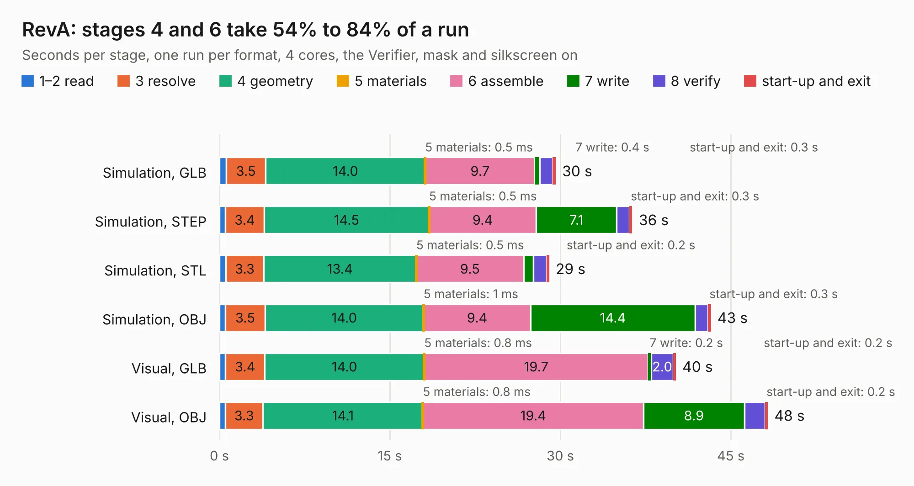

# 2273. RevA

Board 2,273 of the 3,124 of [Corpus Testing](../Corpus-Testing.md), on [Corpus Page 22](../CorpusTestingPages/Corpus-Testing-22.md#2273-reva).

| Mode and format | 1–2 read | 3 resolve | 4 geometry | 5 materials | 6 assemble | 7 write | 8 verify | start-up and exit | Total |
|---|---:|---:|---:|---:|---:|---:|---:|---:|---:|
| Simulation, GLB | 0.6 | 3.5 | 14.0 | 0.5&nbsp;ms | 9.7 | 0.4 | 1.1 | 0.3 | 29.6 |
| Simulation, STEP | 0.5 | 3.4 | 14.5 | 0.5&nbsp;ms | 9.4 | 7.1 | 1.1 | 0.3 | 36.3 |
| Simulation, STL | 0.6 | 3.3 | 13.4 | 0.5&nbsp;ms | 9.5 | 0.9 | 1.2 | 0.2 | 29.0 |
| Simulation, OBJ | 0.5 | 3.5 | 14.0 | 1&nbsp;ms | 9.4 | 14.4 | 1.1 | 0.3 | 43.2 |
| Visual, GLB | 0.5 | 3.4 | 14.0 | 0.8&nbsp;ms | 19.7 | 0.2 | 2.0 | 0.2 | 40.2 |
| Visual, OBJ | 0.5 | 3.3 | 14.1 | 0.8&nbsp;ms | 19.4 | 8.9 | 1.8 | 0.2 | 48.3 |

<table align="center"><tr><td valign="top">

| Board | Repo: [pergola-fpga/pergola](https://github.com/pergola-fpga/pergola) Board: `RevA.kicad_pcb` |
|---|---|
| Folder | hardware / RevA |
| Complexity | 334&nbsp;/&nbsp;1000 (size&nbsp;269, features&nbsp;65) |
| KESE&nbsp;features | through vias, slotted holes, rounded, trapezoid or chamfered pads, filled zones, curved board outline |
| Tested | 9th November 2026 |
| Copper&nbsp;layers | 4 |
| File&nbsp;format | KiCad 5 (20171130) |
| Parts,&nbsp;tracks,&nbsp;vias | 136, 1,513, 318 |
| Triangles,&nbsp;simulation | 2,761,988 in 189 parts |
| Verifier | PASS in all six runs |

</td><td valign="top">

<table>
<tr><th>File type</th><th>File size</th><th>Peak memory used</th></tr>
<tr><th colspan="3" align="left">Simulation</th></tr>
<tr><td>GLB</td><td align="right">96&nbsp;MB</td><td align="right">857&nbsp;MB</td></tr>
<tr><td>STEP</td><td align="right">435&nbsp;MB</td><td align="right">1.1&nbsp;GB</td></tr>
<tr><td>STL</td><td align="right">138&nbsp;MB</td><td align="right">858&nbsp;MB</td></tr>
<tr><td>OBJ</td><td align="right">298&nbsp;MB</td><td align="right">1.9&nbsp;GB</td></tr>
<tr><th colspan="3" align="left">Visual</th></tr>
<tr><td>GLB</td><td align="right">57&nbsp;MB</td><td align="right">1.1&nbsp;GB</td></tr>
<tr><td>OBJ</td><td align="right">179&nbsp;MB</td><td align="right">1.3&nbsp;GB</td></tr>
</table>

</td></tr></table>

| Previous | Next |
|:---|---:|
| [2272. mc0020x](b2272b_cpc-schematics_mc0020x.md) | [2274. CM5_MINIMA](b2274b_CM5-MINIMA-REV1_CM5-MINIMA.md) |
