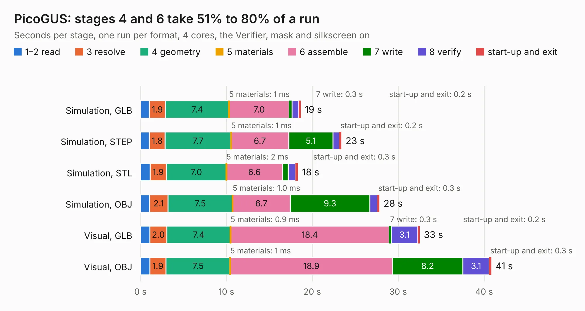

# 2275. PicoGUS

Board 2,275 of the 3,110 of [Corpus Testing](../Corpus-Testing.md), on [Corpus Page 22](../CorpusTestingPages/Corpus-Testing-22.md#2275-picogus).

| Mode and format | 1–2 read | 3 resolve | 4 geometry | 5 materials | 6 assemble | 7 write | 8 verify | start-up and exit | Total |
|---|---:|---:|---:|---:|---:|---:|---:|---:|---:|
| Simulation, GLB | 1.0 | 1.9 | 7.4 | 1&nbsp;ms | 7.0 | 0.3 | 0.8 | 0.2 | 18.6 |
| Simulation, STEP | 1.0 | 1.8 | 7.7 | 1&nbsp;ms | 6.7 | 5.1 | 0.8 | 0.2 | 23.4 |
| Simulation, STL | 1.1 | 1.9 | 7.0 | 2&nbsp;ms | 6.6 | 0.6 | 0.8 | 0.3 | 18.3 |
| Simulation, OBJ | 1.1 | 2.1 | 7.5 | 1.0&nbsp;ms | 6.7 | 9.3 | 0.9 | 0.3 | 27.8 |
| Visual, GLB | 1.1 | 2.0 | 7.4 | 0.9&nbsp;ms | 18.4 | 0.3 | 3.1 | 0.2 | 32.5 |
| Visual, OBJ | 1.1 | 1.9 | 7.5 | 1&nbsp;ms | 18.9 | 8.2 | 3.1 | 0.3 | 40.9 |

<table align="center"><tr><td valign="top">

| Board | Repo: [polpo/picogus](https://github.com/polpo/picogus) Board: `PicoGUS.kicad_pcb` |
|---|---|
| Folder | hw |
| Complexity | 313&nbsp;/&nbsp;1000 (size&nbsp;183, features&nbsp;130) |
| KESE&nbsp;features | through vias, slotted holes, rounded, trapezoid or chamfered pads, drill offsets, arc tracks, filled zones, TrueType text, stack-up, dielectric εr and tanδ, mask and silkscreen colours |
| Tested | 9th November 2026 |
| Copper&nbsp;layers | 2 |
| File&nbsp;format | KiCad 7 (20221018) |
| Parts,&nbsp;tracks,&nbsp;vias | 51, 999, 296 |
| Triangles,&nbsp;simulation | 2,194,242 in 135 parts |
| Verifier | PASS in all six runs |

</td><td valign="top">

<table>
<tr><th>File type</th><th>File size</th><th>Peak memory used</th></tr>
<tr><th colspan="3" align="left">Simulation</th></tr>
<tr><td>GLB</td><td align="right">76&nbsp;MB</td><td align="right">847&nbsp;MB</td></tr>
<tr><td>STEP</td><td align="right">325&nbsp;MB</td><td align="right">1.1&nbsp;GB</td></tr>
<tr><td>STL</td><td align="right">110&nbsp;MB</td><td align="right">838&nbsp;MB</td></tr>
<tr><td>OBJ</td><td align="right">234&nbsp;MB</td><td align="right">1.5&nbsp;GB</td></tr>
<tr><th colspan="3" align="left">Visual</th></tr>
<tr><td>GLB</td><td align="right">63&nbsp;MB</td><td align="right">1.1&nbsp;GB</td></tr>
<tr><td>OBJ</td><td align="right">194&nbsp;MB</td><td align="right">1.3&nbsp;GB</td></tr>
</table>

</td></tr></table>

| Previous | Next |
|:---|---:|
| [2274. PicoGUS Hand386](b2274b_picogus_PicoGUS-Hand386.md) | [2276. ISA adapter](b2276b_picogus_ISA-adapter.md) |
