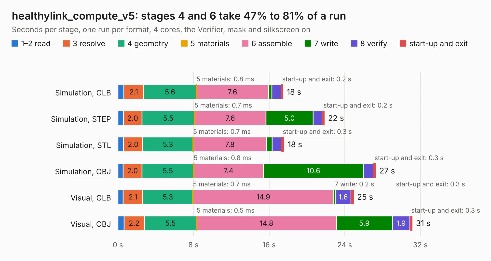

# 2275. healthylink_compute_v5

Board 2,275 of the 3,105 of [Corpus Testing](../Corpus-Testing.md), on [Corpus Page 22](../CorpusTestingPages/Corpus-Testing-22.md#2275-healthylink_compute_v5).

| Mode and format | 1–2 read | 3 resolve | 4 geometry | 5 materials | 6 assemble | 7 write | 8 verify | start-up and exit | Total |
|---|---:|---:|---:|---:|---:|---:|---:|---:|---:|
| Simulation, GLB | 0.6 | 2.1 | 5.6 | 0.8&nbsp;ms | 7.6 | 0.3 | 1.0 | 0.2 | 17.5 |
| Simulation, STEP | 0.6 | 2.0 | 5.5 | 0.7&nbsp;ms | 7.6 | 5.0 | 1.0 | 0.2 | 21.9 |
| Simulation, STL | 0.6 | 2.0 | 5.3 | 0.7&nbsp;ms | 7.8 | 0.6 | 1.0 | 0.3 | 17.6 |
| Simulation, OBJ | 0.5 | 2.0 | 5.5 | 0.8&nbsp;ms | 7.4 | 10.6 | 1.0 | 0.3 | 27.3 |
| Visual, GLB | 0.6 | 2.1 | 5.3 | 0.7&nbsp;ms | 14.9 | 0.2 | 1.6 | 0.3 | 24.9 |
| Visual, OBJ | 0.6 | 2.2 | 5.5 | 0.5&nbsp;ms | 14.8 | 5.9 | 1.9 | 0.3 | 31.2 |

<table align="center"><tr><td valign="top">

| Board | Repo: [protocentral/protocentral_healthypi6_hardware](https://github.com/protocentral/protocentral_healthypi6_hardware) Board: `healthylink_compute_v5.kicad_pcb` |
|---|---|
| Folder | hardware / healthylink_compute_v5 |
| Complexity | 418&nbsp;/&nbsp;1000 (size&nbsp;268, features&nbsp;150) |
| KESE&nbsp;features | through vias, slotted holes, custom pads, rounded, trapezoid or chamfered pads, filled zones, copper drawings, curved board outline, knockout text, TrueType text, stack-up, dielectric εr and tanδ |
| Tested | 9th November 2026 |
| Copper&nbsp;layers | 6 |
| File&nbsp;format | KiCad 10 (20260206) |
| Parts,&nbsp;tracks,&nbsp;vias | 114, 930, 237 |
| Triangles,&nbsp;simulation | 2,134,666 in 222 parts |
| Verifier | PASS in all six runs |

</td><td valign="top">

<table>
<tr><th>File type</th><th>File size</th><th>Peak memory used</th></tr>
<tr><th colspan="3" align="left">Simulation</th></tr>
<tr><td>GLB</td><td align="right">72&nbsp;MB</td><td align="right">720&nbsp;MB</td></tr>
<tr><td>STEP</td><td align="right">259&nbsp;MB</td><td align="right">845&nbsp;MB</td></tr>
<tr><td>STL</td><td align="right">107&nbsp;MB</td><td align="right">695&nbsp;MB</td></tr>
<tr><td>OBJ</td><td align="right">222&nbsp;MB</td><td align="right">1.4&nbsp;GB</td></tr>
<tr><th colspan="3" align="left">Visual</th></tr>
<tr><td>GLB</td><td align="right">40&nbsp;MB</td><td align="right">850&nbsp;MB</td></tr>
<tr><td>OBJ</td><td align="right">122&nbsp;MB</td><td align="right">939&nbsp;MB</td></tr>
</table>

</td></tr></table>

| Previous | Next |
|:---|---:|
| [2274. pc_healthypi_move_sensor_v9](b2274b_healthypi-move-hw_pc-healthypi-move-sensor-v9.md) | [2276. healthylink_gpio_v2](b2276b_protocentral-healthypi6-hardware_healthylink-gpio-v2.md) |
