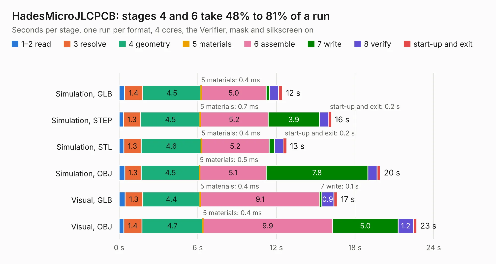

# 2276. HadesMicroJLCPCB

Board 2,276 of the 3,116 of [Corpus Testing](../Corpus-Testing.md), on [Corpus Page 22](../CorpusTestingPages/Corpus-Testing-22.md#2276-hadesmicrojlcpcb).

| Mode and format | 1–2 read | 3 resolve | 4 geometry | 5 materials | 6 assemble | 7 write | 8 verify | start-up and exit | Total |
|---|---:|---:|---:|---:|---:|---:|---:|---:|---:|
| Simulation, GLB | 0.4 | 1.4 | 4.5 | 0.4&nbsp;ms | 5.0 | 0.2 | 0.7 | 0.3 | 12.5 |
| Simulation, STEP | 0.3 | 1.3 | 4.5 | 0.7&nbsp;ms | 5.2 | 3.9 | 0.7 | 0.2 | 16.2 |
| Simulation, STL | 0.4 | 1.3 | 4.6 | 0.4&nbsp;ms | 5.2 | 0.4 | 0.7 | 0.2 | 12.8 |
| Simulation, OBJ | 0.4 | 1.3 | 4.5 | 0.5&nbsp;ms | 5.1 | 7.8 | 0.7 | 0.2 | 19.9 |
| Visual, GLB | 0.5 | 1.3 | 4.4 | 0.4&nbsp;ms | 9.1 | 0.1 | 0.9 | 0.3 | 16.6 |
| Visual, OBJ | 0.4 | 1.4 | 4.7 | 0.4&nbsp;ms | 9.9 | 5.0 | 1.2 | 0.2 | 22.7 |

<table align="center"><tr><td valign="top">

| Board | Repo: [pms67/HadesFCS](https://github.com/pms67/HadesFCS) Board: `HadesMicroJLCPCB.kicad_pcb` |
|---|---|
| Folder | Hardware / HadesMicroJLCPCB |
| Complexity | 296&nbsp;/&nbsp;1000 (size&nbsp;241, features&nbsp;55) |
| KESE&nbsp;features | through vias, rounded, trapezoid or chamfered pads, filled zones, curved board outline |
| Tested | 9th November 2026 |
| Copper&nbsp;layers | 4 |
| File&nbsp;format | KiCad 5 (20171130) |
| Parts,&nbsp;tracks,&nbsp;vias | 88, 912, 165 |
| Triangles,&nbsp;simulation | 1,440,242 in 130 parts |
| Verifier | PASS in all six runs |

</td><td valign="top">

<table>
<tr><th>File type</th><th>File size</th><th>Peak memory used</th></tr>
<tr><th colspan="3" align="left">Simulation</th></tr>
<tr><td>GLB</td><td align="right">49&nbsp;MB</td><td align="right">529&nbsp;MB</td></tr>
<tr><td>STEP</td><td align="right">181&nbsp;MB</td><td align="right">670&nbsp;MB</td></tr>
<tr><td>STL</td><td align="right">72&nbsp;MB</td><td align="right">522&nbsp;MB</td></tr>
<tr><td>OBJ</td><td align="right">147&nbsp;MB</td><td align="right">956&nbsp;MB</td></tr>
<tr><th colspan="3" align="left">Visual</th></tr>
<tr><td>GLB</td><td align="right">30&nbsp;MB</td><td align="right">663&nbsp;MB</td></tr>
<tr><td>OBJ</td><td align="right">91&nbsp;MB</td><td align="right">701&nbsp;MB</td></tr>
</table>

</td></tr></table>

| Previous | Next |
|:---|---:|
| [2275. HadesMicro](b2275b_HadesFCS_HadesMicro.md) | [2277. HadesNT](b2277b_HadesFCS_HadesNT.md) |
