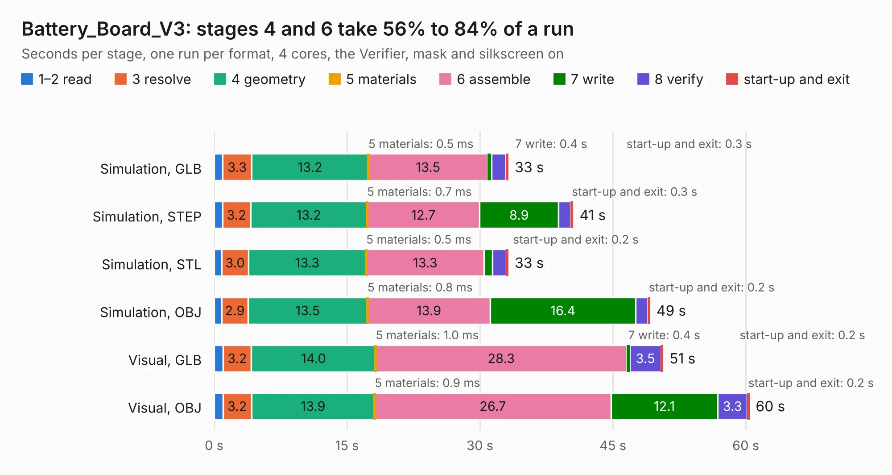

# 2277. Battery_Board_V3

Board 2,277 of the 3,102 of [Corpus Testing](../Corpus-Testing.md), on [Corpus Page 22](../CorpusTestingPages/Corpus-Testing-22.md#2277-battery_board_v3).

| Mode and format | 1–2 read | 3 resolve | 4 geometry | 5 materials | 6 assemble | 7 write | 8 verify | start-up and exit | Total |
|---|---:|---:|---:|---:|---:|---:|---:|---:|---:|
| Simulation, GLB | 1.0 | 3.3 | 13.2 | 0.5&nbsp;ms | 13.5 | 0.4 | 1.6 | 0.3 | 33.2 |
| Simulation, STEP | 0.9 | 3.2 | 13.2 | 0.7&nbsp;ms | 12.7 | 8.9 | 1.4 | 0.3 | 40.5 |
| Simulation, STL | 0.9 | 3.0 | 13.3 | 0.5&nbsp;ms | 13.3 | 0.9 | 1.6 | 0.2 | 33.2 |
| Simulation, OBJ | 0.9 | 2.9 | 13.5 | 0.8&nbsp;ms | 13.9 | 16.4 | 1.4 | 0.2 | 49.2 |
| Visual, GLB | 1.0 | 3.2 | 14.0 | 1.0&nbsp;ms | 28.3 | 0.4 | 3.5 | 0.2 | 50.7 |
| Visual, OBJ | 1.0 | 3.2 | 13.9 | 0.9&nbsp;ms | 26.7 | 12.1 | 3.3 | 0.2 | 60.4 |

<table align="center"><tr><td valign="top">

| Board | Repo: [proveskit/battery_board](https://github.com/proveskit/battery_board) Board: `Battery_Board_V3.kicad_pcb` |
|---|---|
| Folder | battery_board_v3 |
| Complexity | 387&nbsp;/&nbsp;1000 (size&nbsp;267, features&nbsp;120) |
| KESE&nbsp;features | through vias, slotted holes, custom pads, rounded, trapezoid or chamfered pads, filled zones, copper drawings, curved board outline, stack-up, dielectric εr and tanδ |
| Tested | 9th November 2026 |
| Copper&nbsp;layers | 4 |
| File&nbsp;format | KiCad 7 (20221018) |
| Parts,&nbsp;tracks,&nbsp;vias | 177, 1,595, 240 |
| Triangles,&nbsp;simulation | 2,908,442 in 199 parts |
| Verifier | PASS in all six runs |

</td><td valign="top">

<table>
<tr><th>File type</th><th>File size</th><th>Peak memory used</th></tr>
<tr><th colspan="3" align="left">Simulation</th></tr>
<tr><td>GLB</td><td align="right">101&nbsp;MB</td><td align="right">997&nbsp;MB</td></tr>
<tr><td>STEP</td><td align="right">506&nbsp;MB</td><td align="right">1.3&nbsp;GB</td></tr>
<tr><td>STL</td><td align="right">145&nbsp;MB</td><td align="right">998&nbsp;MB</td></tr>
<tr><td>OBJ</td><td align="right">314&nbsp;MB</td><td align="right">1.9&nbsp;GB</td></tr>
<tr><th colspan="3" align="left">Visual</th></tr>
<tr><td>GLB</td><td align="right">75&nbsp;MB</td><td align="right">1.3&nbsp;GB</td></tr>
<tr><td>OBJ</td><td align="right">233&nbsp;MB</td><td align="right">1.5&nbsp;GB</td></tr>
</table>

</td></tr></table>

| Previous | Next |
|:---|---:|
| [2276. battery_board_v1](b2276b_battery-board_battery-board-v1.md) | [2278. Battery_Board_V3a](b2278b_battery-board_Battery-Board-V3a.md) |
