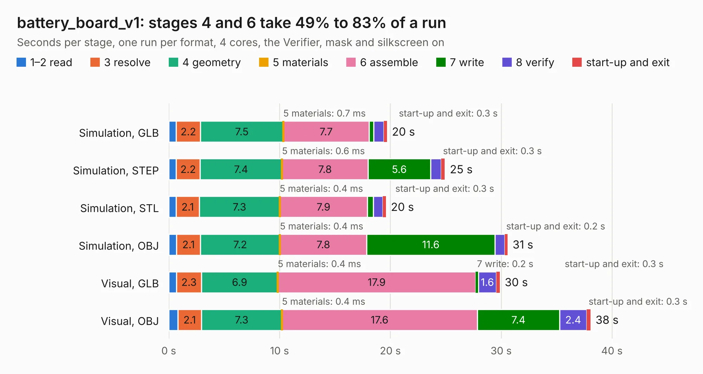

# 2277. battery_board_v1

Board 2,277 of the 3,103 of [Corpus Testing](../Corpus-Testing.md), on [Corpus Page 22](../CorpusTestingPages/Corpus-Testing-22.md#2277-battery_board_v1).

| Mode and format | 1–2 read | 3 resolve | 4 geometry | 5 materials | 6 assemble | 7 write | 8 verify | start-up and exit | Total |
|---|---:|---:|---:|---:|---:|---:|---:|---:|---:|
| Simulation, GLB | 0.7 | 2.2 | 7.5 | 0.7&nbsp;ms | 7.7 | 0.4 | 0.9 | 0.3 | 19.7 |
| Simulation, STEP | 0.7 | 2.2 | 7.4 | 0.6&nbsp;ms | 7.8 | 5.6 | 1.0 | 0.3 | 24.9 |
| Simulation, STL | 0.7 | 2.1 | 7.3 | 0.4&nbsp;ms | 7.9 | 0.5 | 0.8 | 0.3 | 19.6 |
| Simulation, OBJ | 0.7 | 2.1 | 7.2 | 0.4&nbsp;ms | 7.8 | 11.6 | 0.9 | 0.2 | 30.6 |
| Visual, GLB | 0.7 | 2.3 | 6.9 | 0.4&nbsp;ms | 17.9 | 0.2 | 1.6 | 0.3 | 29.9 |
| Visual, OBJ | 0.8 | 2.1 | 7.3 | 0.4&nbsp;ms | 17.6 | 7.4 | 2.4 | 0.3 | 38.1 |

<table align="center"><tr><td valign="top">

| Board | Repo: [proveskit/battery_board](https://github.com/proveskit/battery_board) Board: `battery_board_v1.kicad_pcb` |
|---|---|
| Folder | battery_board_v2 |
| Complexity | 318&nbsp;/&nbsp;1000 (size&nbsp;208, features&nbsp;110) |
| KESE&nbsp;features | through vias, custom pads, rounded, trapezoid or chamfered pads, filled zones, copper drawings, curved board outline, stack-up, dielectric εr and tanδ |
| Tested | 9th November 2026 |
| Copper&nbsp;layers | 4 |
| File&nbsp;format | KiCad 6 (20211014) |
| Parts,&nbsp;tracks,&nbsp;vias | 109, 1,234, 215 |
| Triangles,&nbsp;simulation | 1,805,022 in 117 parts |
| Verifier | PASS in all six runs |

</td><td valign="top">

<table>
<tr><th>File type</th><th>File size</th><th>Peak memory used</th></tr>
<tr><th colspan="3" align="left">Simulation</th></tr>
<tr><td>GLB</td><td align="right">62&nbsp;MB</td><td align="right">666&nbsp;MB</td></tr>
<tr><td>STEP</td><td align="right">281&nbsp;MB</td><td align="right">850&nbsp;MB</td></tr>
<tr><td>STL</td><td align="right">90&nbsp;MB</td><td align="right">651&nbsp;MB</td></tr>
<tr><td>OBJ</td><td align="right">191&nbsp;MB</td><td align="right">1.2&nbsp;GB</td></tr>
<tr><th colspan="3" align="left">Visual</th></tr>
<tr><td>GLB</td><td align="right">43&nbsp;MB</td><td align="right">1.0&nbsp;GB</td></tr>
<tr><td>OBJ</td><td align="right">132&nbsp;MB</td><td align="right">986&nbsp;MB</td></tr>
</table>

</td></tr></table>

| Previous | Next |
|:---|---:|
| [2276. healthypi_6_v5](b2276b_protocentral-healthypi6-hardware_healthypi-6-v5.md) | [2278. Battery_Board_V3](b2278b_battery-board_Battery-Board-V3.md) |
