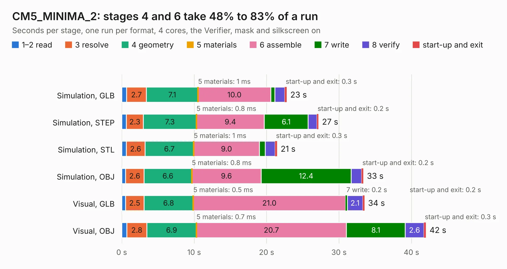

# 2280. CM5_MINIMA_2

Board 2,280 of the 3,132 of [Corpus Testing](../Corpus-Testing.md), on [Corpus Page 22](../CorpusTestingPages/Corpus-Testing-22.md#2280-cm5_minima_2).

| Mode and format | 1–2 read | 3 resolve | 4 geometry | 5 materials | 6 assemble | 7 write | 8 verify | start-up and exit | Total |
|---|---:|---:|---:|---:|---:|---:|---:|---:|---:|
| Simulation, GLB | 0.7 | 2.7 | 7.1 | 1&nbsp;ms | 10.0 | 0.6 | 1.4 | 0.3 | 22.8 |
| Simulation, STEP | 0.6 | 2.3 | 7.3 | 0.8&nbsp;ms | 9.4 | 6.1 | 1.2 | 0.2 | 27.2 |
| Simulation, STL | 0.6 | 2.6 | 6.7 | 1&nbsp;ms | 9.0 | 0.8 | 1.3 | 0.3 | 21.4 |
| Simulation, OBJ | 0.5 | 2.6 | 6.6 | 0.8&nbsp;ms | 9.6 | 12.4 | 1.4 | 0.2 | 33.4 |
| Visual, GLB | 0.5 | 2.5 | 6.8 | 0.5&nbsp;ms | 21.0 | 0.2 | 2.1 | 0.2 | 33.5 |
| Visual, OBJ | 0.7 | 2.8 | 6.9 | 0.7&nbsp;ms | 20.7 | 8.1 | 2.6 | 0.3 | 42.0 |

<table align="center"><tr><td valign="top">

| Board | Repo: [piecol/CM5_MINIMA_REV2](https://github.com/piecol/CM5_MINIMA_REV2) Board: `CM5_MINIMA_2.kicad_pcb` |
|---|---|
| Complexity | 346&nbsp;/&nbsp;1000 (size&nbsp;221, features&nbsp;125) |
| KESE&nbsp;features | through vias, slotted holes, rounded, trapezoid or chamfered pads, arc tracks, filled zones, curved board outline, stack-up, dielectric εr and tanδ, copper finish |
| Tested | 9th November 2026 |
| Copper&nbsp;layers | 6 |
| File&nbsp;format | KiCad 9 (20241229) |
| Parts,&nbsp;tracks,&nbsp;vias | 72, 1,848, 365 |
| Triangles,&nbsp;simulation | 2,701,666 in 226 parts |
| Verifier | PASS in all six runs |

</td><td valign="top">

<table>
<tr><th>File type</th><th>File size</th><th>Peak memory used</th></tr>
<tr><th colspan="3" align="left">Simulation</th></tr>
<tr><td>GLB</td><td align="right">92&nbsp;MB</td><td align="right">1.0&nbsp;GB</td></tr>
<tr><td>STEP</td><td align="right">367&nbsp;MB</td><td align="right">1.1&nbsp;GB</td></tr>
<tr><td>STL</td><td align="right">135&nbsp;MB</td><td align="right">1.0&nbsp;GB</td></tr>
<tr><td>OBJ</td><td align="right">287&nbsp;MB</td><td align="right">1.8&nbsp;GB</td></tr>
<tr><th colspan="3" align="left">Visual</th></tr>
<tr><td>GLB</td><td align="right">56&nbsp;MB</td><td align="right">1.1&nbsp;GB</td></tr>
<tr><td>OBJ</td><td align="right">177&nbsp;MB</td><td align="right">1.3&nbsp;GB</td></tr>
</table>

</td></tr></table>

| Previous | Next |
|:---|---:|
| [2279. CM5_MINIMA](b2279b_CM5-MINIMA-REV1_CM5-MINIMA.md) | [2281. carrier_template](b2281b_zynq-som_carrier-template.md) |
