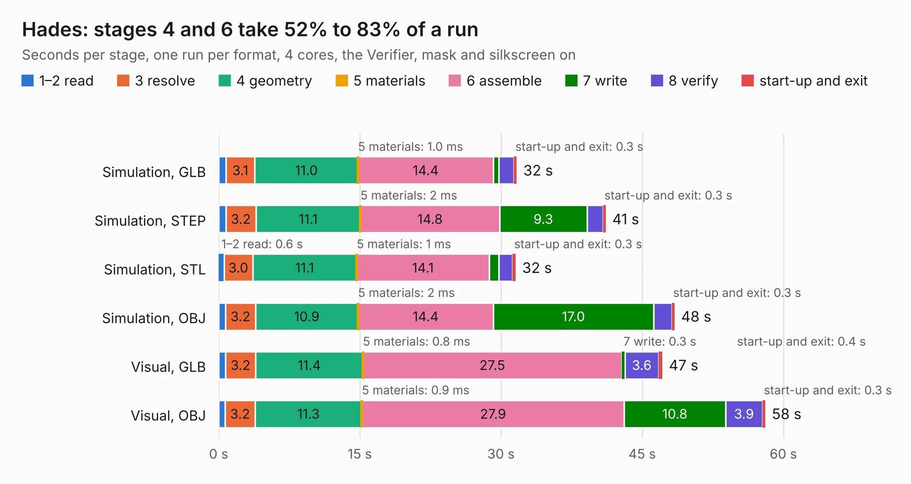

# 2282. Hades

Board 2,282 of the 3,126 of [Corpus Testing](../Corpus-Testing.md), on [Corpus Page 22](../CorpusTestingPages/Corpus-Testing-22.md#2282-hades).

| Mode and format | 1–2 read | 3 resolve | 4 geometry | 5 materials | 6 assemble | 7 write | 8 verify | start-up and exit | Total |
|---|---:|---:|---:|---:|---:|---:|---:|---:|---:|
| Simulation, GLB | 0.8 | 3.1 | 11.0 | 1.0&nbsp;ms | 14.4 | 0.6 | 1.6 | 0.3 | 31.7 |
| Simulation, STEP | 0.8 | 3.2 | 11.1 | 2&nbsp;ms | 14.8 | 9.3 | 1.7 | 0.3 | 41.1 |
| Simulation, STL | 0.6 | 3.0 | 11.1 | 1&nbsp;ms | 14.1 | 1.0 | 1.5 | 0.3 | 31.6 |
| Simulation, OBJ | 0.7 | 3.2 | 10.9 | 2&nbsp;ms | 14.4 | 17.0 | 1.9 | 0.3 | 48.4 |
| Visual, GLB | 0.7 | 3.2 | 11.4 | 0.8&nbsp;ms | 27.5 | 0.3 | 3.6 | 0.4 | 47.1 |
| Visual, OBJ | 0.7 | 3.2 | 11.3 | 0.9&nbsp;ms | 27.9 | 10.8 | 3.9 | 0.3 | 58.1 |

<table align="center"><tr><td valign="top">

| Board | Repo: [pms67/HadesFCS](https://github.com/pms67/HadesFCS) Board: `Hades.kicad_pcb` |
|---|---|
| Folder | Hardware / Hades |
| Complexity | 350&nbsp;/&nbsp;1000 (size&nbsp;270, features&nbsp;80) |
| KESE&nbsp;features | through vias, custom pads, rounded, trapezoid or chamfered pads, filled zones, copper drawings, curved board outline |
| Tested | 9th November 2026 |
| Copper&nbsp;layers | 4 |
| File&nbsp;format | KiCad 5 (20171130) |
| Parts,&nbsp;tracks,&nbsp;vias | 208, 1,978, 382 |
| Triangles,&nbsp;simulation | 3,210,182 in 265 parts |
| Verifier | PASS in all six runs |

</td><td valign="top">

<table>
<tr><th>File type</th><th>File size</th><th>Peak memory used</th></tr>
<tr><th colspan="3" align="left">Simulation</th></tr>
<tr><td>GLB</td><td align="right">110&nbsp;MB</td><td align="right">1.0&nbsp;GB</td></tr>
<tr><td>STEP</td><td align="right">449&nbsp;MB</td><td align="right">1.4&nbsp;GB</td></tr>
<tr><td>STL</td><td align="right">161&nbsp;MB</td><td align="right">1.0&nbsp;GB</td></tr>
<tr><td>OBJ</td><td align="right">340&nbsp;MB</td><td align="right">2.1&nbsp;GB</td></tr>
<tr><th colspan="3" align="left">Visual</th></tr>
<tr><td>GLB</td><td align="right">69&nbsp;MB</td><td align="right">1.3&nbsp;GB</td></tr>
<tr><td>OBJ</td><td align="right">218&nbsp;MB</td><td align="right">1.5&nbsp;GB</td></tr>
</table>

</td></tr></table>

| Previous | Next |
|:---|---:|
| [2281. R1000AX](b2281b_R1000AX_R1000AX.md) | [2283. HadesGPSDongle](b2283b_HadesFCS_HadesGPSDongle.md) |
