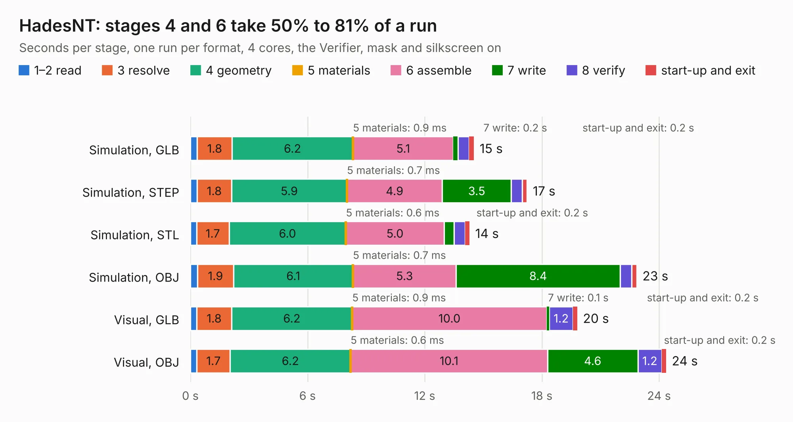

# 2282. HadesNT

Board 2,282 of the 3,121 of [Corpus Testing](../Corpus-Testing.md), on [Corpus Page 22](../CorpusTestingPages/Corpus-Testing-22.md#2282-hadesnt).

| Mode and format | 1–2 read | 3 resolve | 4 geometry | 5 materials | 6 assemble | 7 write | 8 verify | start-up and exit | Total |
|---|---:|---:|---:|---:|---:|---:|---:|---:|---:|
| Simulation, GLB | 0.4 | 1.8 | 6.2 | 0.9&nbsp;ms | 5.1 | 0.2 | 0.6 | 0.2 | 14.5 |
| Simulation, STEP | 0.3 | 1.8 | 5.9 | 0.7&nbsp;ms | 4.9 | 3.5 | 0.6 | 0.3 | 17.2 |
| Simulation, STL | 0.3 | 1.7 | 6.0 | 0.6&nbsp;ms | 5.0 | 0.5 | 0.6 | 0.2 | 14.3 |
| Simulation, OBJ | 0.4 | 1.9 | 6.1 | 0.7&nbsp;ms | 5.3 | 8.4 | 0.6 | 0.3 | 22.9 |
| Visual, GLB | 0.3 | 1.8 | 6.2 | 0.9&nbsp;ms | 10.0 | 0.1 | 1.2 | 0.2 | 19.8 |
| Visual, OBJ | 0.3 | 1.7 | 6.2 | 0.6&nbsp;ms | 10.1 | 4.6 | 1.2 | 0.2 | 24.4 |

<table align="center"><tr><td valign="top">

| Board | Repo: [pms67/HadesFCS](https://github.com/pms67/HadesFCS) Board: `HadesNT.kicad_pcb` |
|---|---|
| Folder | Hardware / HadesNT |
| Complexity | 311&nbsp;/&nbsp;1000 (size&nbsp;246, features&nbsp;65) |
| KESE&nbsp;features | through vias, slotted holes, rounded, trapezoid or chamfered pads, filled zones, curved board outline |
| Tested | 9th November 2026 |
| Copper&nbsp;layers | 4 |
| File&nbsp;format | KiCad 5 (20171130) |
| Parts,&nbsp;tracks,&nbsp;vias | 100, 1,175, 201 |
| Triangles,&nbsp;simulation | 1,543,476 in 149 parts |
| Verifier | PASS in all six runs |

</td><td valign="top">

<table>
<tr><th>File type</th><th>File size</th><th>Peak memory used</th></tr>
<tr><th colspan="3" align="left">Simulation</th></tr>
<tr><td>GLB</td><td align="right">53&nbsp;MB</td><td align="right">555&nbsp;MB</td></tr>
<tr><td>STEP</td><td align="right">210&nbsp;MB</td><td align="right">687&nbsp;MB</td></tr>
<tr><td>STL</td><td align="right">77&nbsp;MB</td><td align="right">561&nbsp;MB</td></tr>
<tr><td>OBJ</td><td align="right">161&nbsp;MB</td><td align="right">1.1&nbsp;GB</td></tr>
<tr><th colspan="3" align="left">Visual</th></tr>
<tr><td>GLB</td><td align="right">30&nbsp;MB</td><td align="right">645&nbsp;MB</td></tr>
<tr><td>OBJ</td><td align="right">91&nbsp;MB</td><td align="right">714&nbsp;MB</td></tr>
</table>

</td></tr></table>

| Previous | Next |
|:---|---:|
| [2281. HadesMicroJLCPCB](b2281b_HadesFCS_HadesMicroJLCPCB.md) | [2283. PicoGUS chipdown with edge rails](b2283b_picogus_PicoGUS-chipdown-with-edge-rails.md) |
