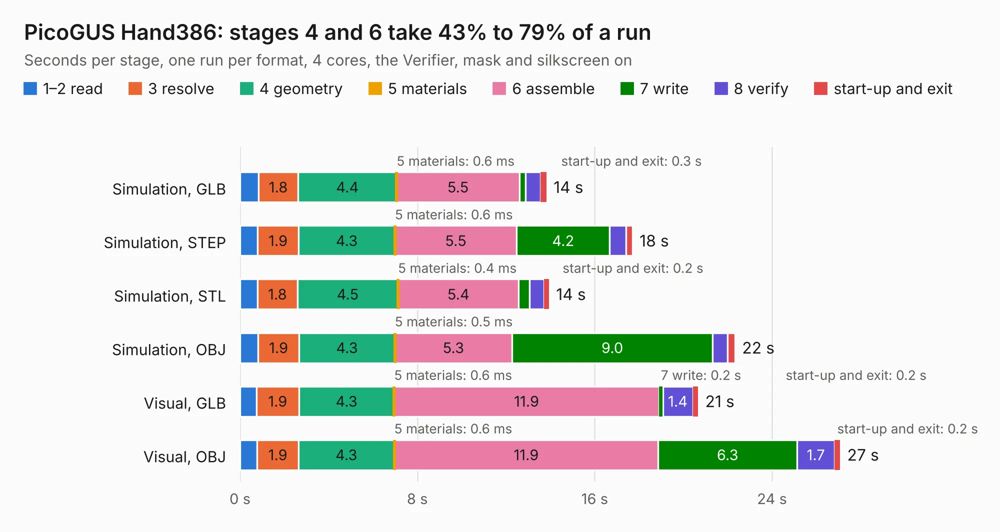

# 2282. PicoGUS Hand386

Board 2,282 of the 3,118 of [Corpus Testing](../Corpus-Testing.md), on [Corpus Page 22](../CorpusTestingPages/Corpus-Testing-22.md#2282-picogus-hand386).

| Mode and format | 1–2 read | 3 resolve | 4 geometry | 5 materials | 6 assemble | 7 write | 8 verify | start-up and exit | Total |
|---|---:|---:|---:|---:|---:|---:|---:|---:|---:|
| Simulation, GLB | 0.8 | 1.8 | 4.4 | 0.6&nbsp;ms | 5.5 | 0.3 | 0.7 | 0.3 | 13.8 |
| Simulation, STEP | 0.8 | 1.9 | 4.3 | 0.6&nbsp;ms | 5.5 | 4.2 | 0.7 | 0.3 | 17.7 |
| Simulation, STL | 0.8 | 1.8 | 4.5 | 0.4&nbsp;ms | 5.4 | 0.5 | 0.6 | 0.2 | 13.9 |
| Simulation, OBJ | 0.8 | 1.9 | 4.3 | 0.5&nbsp;ms | 5.3 | 9.0 | 0.7 | 0.3 | 22.3 |
| Visual, GLB | 0.7 | 1.9 | 4.3 | 0.6&nbsp;ms | 11.9 | 0.2 | 1.4 | 0.2 | 20.7 |
| Visual, OBJ | 0.8 | 1.9 | 4.3 | 0.6&nbsp;ms | 11.9 | 6.3 | 1.7 | 0.2 | 27.1 |

<table align="center"><tr><td valign="top">

| Board | Repo: [polpo/picogus](https://github.com/polpo/picogus) Board: `PicoGUS Hand386.kicad_pcb` |
|---|---|
| Folder | hw-hand386 |
| Complexity | 333&nbsp;/&nbsp;1000 (size&nbsp;198, features&nbsp;135) |
| KESE&nbsp;features | through vias, custom pads, rounded, trapezoid or chamfered pads, arc tracks, filled zones, copper drawings, TrueType text, stack-up, dielectric εr and tanδ, mask and silkscreen colours |
| Tested | 9th November 2026 |
| Copper&nbsp;layers | 4 |
| File&nbsp;format | KiCad 8 (20240108) |
| Parts,&nbsp;tracks,&nbsp;vias | 50, 903, 278 |
| Triangles,&nbsp;simulation | 1,662,280 in 127 parts |
| Verifier | PASS in all six runs |

</td><td valign="top">

<table>
<tr><th>File type</th><th>File size</th><th>Peak memory used</th></tr>
<tr><th colspan="3" align="left">Simulation</th></tr>
<tr><td>GLB</td><td align="right">57&nbsp;MB</td><td align="right">651&nbsp;MB</td></tr>
<tr><td>STEP</td><td align="right">217&nbsp;MB</td><td align="right">755&nbsp;MB</td></tr>
<tr><td>STL</td><td align="right">83&nbsp;MB</td><td align="right">631&nbsp;MB</td></tr>
<tr><td>OBJ</td><td align="right">174&nbsp;MB</td><td align="right">1.2&nbsp;GB</td></tr>
<tr><th colspan="3" align="left">Visual</th></tr>
<tr><td>GLB</td><td align="right">39&nbsp;MB</td><td align="right">737&nbsp;MB</td></tr>
<tr><td>OBJ</td><td align="right">119&nbsp;MB</td><td align="right">901&nbsp;MB</td></tr>
</table>

</td></tr></table>

| Previous | Next |
|:---|---:|
| [2281. PicoGUS chipdown](b2281b_picogus_PicoGUS-chipdown.md) | [2283. PicoGUS](b2283b_picogus_PicoGUS.md) |
