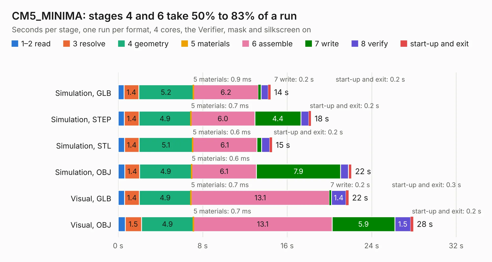

# 2283. CM5_MINIMA

Board 2,283 of the 3,139 of [Corpus Testing](../Corpus-Testing.md), on [Corpus Page 22](../CorpusTestingPages/Corpus-Testing-22.md#2283-cm5_minima).

| Mode and format | 1–2 read | 3 resolve | 4 geometry | 5 materials | 6 assemble | 7 write | 8 verify | start-up and exit | Total |
|---|---:|---:|---:|---:|---:|---:|---:|---:|---:|
| Simulation, GLB | 0.6 | 1.4 | 5.2 | 0.9&nbsp;ms | 6.2 | 0.2 | 0.7 | 0.2 | 14.4 |
| Simulation, STEP | 0.6 | 1.4 | 4.9 | 0.7&nbsp;ms | 6.0 | 4.4 | 0.7 | 0.2 | 18.3 |
| Simulation, STL | 0.6 | 1.4 | 5.1 | 0.6&nbsp;ms | 6.1 | 0.5 | 0.8 | 0.2 | 14.6 |
| Simulation, OBJ | 0.6 | 1.4 | 4.9 | 0.6&nbsp;ms | 6.1 | 7.9 | 0.7 | 0.3 | 22.1 |
| Visual, GLB | 0.6 | 1.4 | 4.9 | 0.7&nbsp;ms | 13.1 | 0.2 | 1.4 | 0.3 | 21.8 |
| Visual, OBJ | 0.7 | 1.5 | 4.9 | 0.7&nbsp;ms | 13.1 | 5.9 | 1.5 | 0.2 | 27.9 |

<table align="center"><tr><td valign="top">

| Board | Repo: [piecol/CM5_MINIMA_REV1](https://github.com/piecol/CM5_MINIMA_REV1) Board: `CM5_MINIMA.kicad_pcb` |
|---|---|
| Complexity | 351&nbsp;/&nbsp;1000 (size&nbsp;201, features&nbsp;150) |
| KESE&nbsp;features | through vias, slotted holes, custom pads, rounded, trapezoid or chamfered pads, arc tracks, filled zones, copper drawings, curved board outline, stack-up, dielectric εr and tanδ, copper finish |
| Tested | 9th November 2026 |
| Copper&nbsp;layers | 4 |
| File&nbsp;format | KiCad 8 (20240108) |
| Parts,&nbsp;tracks,&nbsp;vias | 68, 969, 234 |
| Triangles,&nbsp;simulation | 1,470,828 in 210 parts |
| Verifier | PASS in all six runs |

</td><td valign="top">

<table>
<tr><th>File type</th><th>File size</th><th>Peak memory used</th></tr>
<tr><th colspan="3" align="left">Simulation</th></tr>
<tr><td>GLB</td><td align="right">51&nbsp;MB</td><td align="right">597&nbsp;MB</td></tr>
<tr><td>STEP</td><td align="right">242&nbsp;MB</td><td align="right">769&nbsp;MB</td></tr>
<tr><td>STL</td><td align="right">74&nbsp;MB</td><td align="right">604&nbsp;MB</td></tr>
<tr><td>OBJ</td><td align="right">154&nbsp;MB</td><td align="right">1.0&nbsp;GB</td></tr>
<tr><th colspan="3" align="left">Visual</th></tr>
<tr><td>GLB</td><td align="right">37&nbsp;MB</td><td align="right">713&nbsp;MB</td></tr>
<tr><td>OBJ</td><td align="right">113&nbsp;MB</td><td align="right">817&nbsp;MB</td></tr>
</table>

</td></tr></table>

| Previous | Next |
|:---|---:|
| [2282. RevA](b2282b_pergola_RevA.md) | [2284. CM5_MINIMA_2](b2284b_CM5-MINIMA-REV2_CM5-MINIMA-2.md) |
