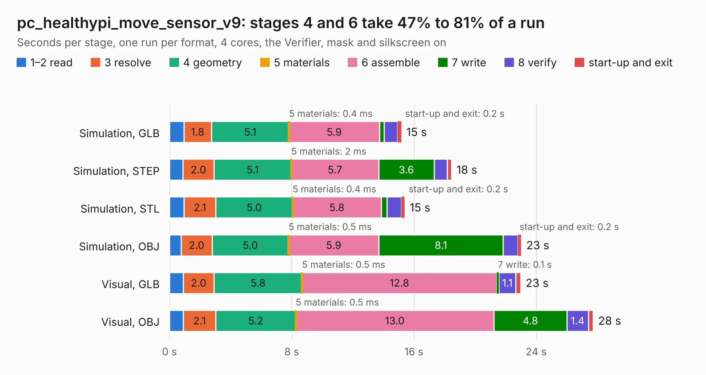

# 2286. pc_healthypi_move_sensor_v9

Board 2,286 of the 3,117 of [Corpus Testing](../Corpus-Testing.md), on [Corpus Page 22](../CorpusTestingPages/Corpus-Testing-22.md#2286-pc_healthypi_move_sensor_v9).

| Mode and format | 1–2 read | 3 resolve | 4 geometry | 5 materials | 6 assemble | 7 write | 8 verify | start-up and exit | Total |
|---|---:|---:|---:|---:|---:|---:|---:|---:|---:|
| Simulation, GLB | 0.9 | 1.8 | 5.1 | 0.4&nbsp;ms | 5.9 | 0.3 | 0.9 | 0.2 | 15.2 |
| Simulation, STEP | 0.9 | 2.0 | 5.1 | 2&nbsp;ms | 5.7 | 3.6 | 0.9 | 0.3 | 18.5 |
| Simulation, STL | 1.0 | 2.1 | 5.0 | 0.4&nbsp;ms | 5.8 | 0.4 | 0.9 | 0.2 | 15.4 |
| Simulation, OBJ | 0.8 | 2.0 | 5.0 | 0.5&nbsp;ms | 5.9 | 8.1 | 1.0 | 0.2 | 23.0 |
| Visual, GLB | 0.9 | 2.0 | 5.8 | 0.5&nbsp;ms | 12.8 | 0.1 | 1.1 | 0.3 | 23.0 |
| Visual, OBJ | 0.9 | 2.1 | 5.2 | 0.5&nbsp;ms | 13.0 | 4.8 | 1.4 | 0.3 | 27.7 |

<table align="center"><tr><td valign="top">

| Board | Repo: [Protocentral/healthypi-move-hw](https://github.com/Protocentral/healthypi-move-hw) Board: `pc_healthypi_move_sensor_v9.kicad_pcb` |
|---|---|
| Folder | pcbs / sensor board / kicad_pc_healthypi_move_sensor_v9 |
| Complexity | 371&nbsp;/&nbsp;1000 (size&nbsp;261, features&nbsp;110) |
| KESE&nbsp;features | through vias, custom pads, rounded, trapezoid or chamfered pads, filled zones, copper drawings, curved board outline, stack-up, dielectric εr and tanδ |
| Tested | 9th November 2026 |
| Copper&nbsp;layers | 6 |
| File&nbsp;format | KiCad 9 (20241229) |
| Parts,&nbsp;tracks,&nbsp;vias | 80, 1,142, 158 |
| Triangles,&nbsp;simulation | 1,702,322 in 119 parts |
| Verifier | PASS in all six runs |

</td><td valign="top">

<table>
<tr><th>File type</th><th>File size</th><th>Peak memory used</th></tr>
<tr><th colspan="3" align="left">Simulation</th></tr>
<tr><td>GLB</td><td align="right">59&nbsp;MB</td><td align="right">598&nbsp;MB</td></tr>
<tr><td>STEP</td><td align="right">241&nbsp;MB</td><td align="right">710&nbsp;MB</td></tr>
<tr><td>STL</td><td align="right">85&nbsp;MB</td><td align="right">592&nbsp;MB</td></tr>
<tr><td>OBJ</td><td align="right">183&nbsp;MB</td><td align="right">1.2&nbsp;GB</td></tr>
<tr><th colspan="3" align="left">Visual</th></tr>
<tr><td>GLB</td><td align="right">33&nbsp;MB</td><td align="right">738&nbsp;MB</td></tr>
<tr><td>OBJ</td><td align="right">105&nbsp;MB</td><td align="right">840&nbsp;MB</td></tr>
</table>

</td></tr></table>

| Previous | Next |
|:---|---:|
| [2285. pc_healthypi_move_nRF5340_v12](b2285b_healthypi-move-hw_pc-healthypi-move-nRF5340-v12.md) | [2287. healthylink_compute_v5](b2287b_protocentral-healthypi6-hardware_healthylink-compute-v5.md) |
