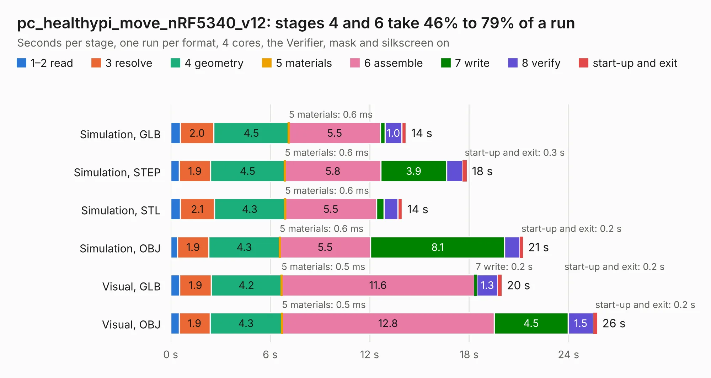

# 2287. pc_healthypi_move_nRF5340_v12

Board 2,287 of the 3,119 of [Corpus Testing](../Corpus-Testing.md), on [Corpus Page 22](../CorpusTestingPages/Corpus-Testing-22.md#2287-pc_healthypi_move_nrf5340_v12).

| Mode and format | 1–2 read | 3 resolve | 4 geometry | 5 materials | 6 assemble | 7 write | 8 verify | start-up and exit | Total |
|---|---:|---:|---:|---:|---:|---:|---:|---:|---:|
| Simulation, GLB | 0.6 | 2.0 | 4.5 | 0.6&nbsp;ms | 5.5 | 0.3 | 1.0 | 0.3 | 14.2 |
| Simulation, STEP | 0.5 | 1.9 | 4.5 | 0.6&nbsp;ms | 5.8 | 3.9 | 1.0 | 0.3 | 17.9 |
| Simulation, STL | 0.6 | 2.1 | 4.3 | 0.6&nbsp;ms | 5.5 | 0.4 | 0.8 | 0.3 | 14.0 |
| Simulation, OBJ | 0.4 | 1.9 | 4.3 | 0.6&nbsp;ms | 5.5 | 8.1 | 0.9 | 0.2 | 21.3 |
| Visual, GLB | 0.5 | 1.9 | 4.2 | 0.5&nbsp;ms | 11.6 | 0.2 | 1.3 | 0.2 | 20.0 |
| Visual, OBJ | 0.5 | 1.9 | 4.3 | 0.5&nbsp;ms | 12.8 | 4.5 | 1.5 | 0.2 | 25.7 |

<table align="center"><tr><td valign="top">

| Board | Repo: [Protocentral/healthypi-move-hw](https://github.com/Protocentral/healthypi-move-hw) Board: `pc_healthypi_move_nRF5340_v12.kicad_pcb` |
|---|---|
| Folder | pcbs / main board / kicad_pc_healthypi_move_nRF5340_v12 |
| Complexity | 407&nbsp;/&nbsp;1000 (size&nbsp;257, features&nbsp;150) |
| KESE&nbsp;features | through vias, microvias, slotted holes, rounded, trapezoid or chamfered pads, filled zones, curved board outline, TrueType text, stack-up, dielectric εr and tanδ |
| Tested | 9th November 2026 |
| Copper&nbsp;layers | 6 |
| File&nbsp;format | KiCad 9 (20241229) |
| Parts,&nbsp;tracks,&nbsp;vias | 78, 1,711, 186 |
| Triangles,&nbsp;simulation | 1,636,860 in 129 parts |
| Verifier | PASS in all six runs |

</td><td valign="top">

<table>
<tr><th>File type</th><th>File size</th><th>Peak memory used</th></tr>
<tr><th colspan="3" align="left">Simulation</th></tr>
<tr><td>GLB</td><td align="right">56&nbsp;MB</td><td align="right">572&nbsp;MB</td></tr>
<tr><td>STEP</td><td align="right">230&nbsp;MB</td><td align="right">733&nbsp;MB</td></tr>
<tr><td>STL</td><td align="right">82&nbsp;MB</td><td align="right">568&nbsp;MB</td></tr>
<tr><td>OBJ</td><td align="right">176&nbsp;MB</td><td align="right">1.1&nbsp;GB</td></tr>
<tr><th colspan="3" align="left">Visual</th></tr>
<tr><td>GLB</td><td align="right">33&nbsp;MB</td><td align="right">793&nbsp;MB</td></tr>
<tr><td>OBJ</td><td align="right">105&nbsp;MB</td><td align="right">801&nbsp;MB</td></tr>
</table>

</td></tr></table>

| Previous | Next |
|:---|---:|
| [2286. pc_healthypi_move_program_adapter_v7](b2286b_healthypi-move-hw_pc-healthypi-move-program-adapter-v7.md) | [2288. pc_healthypi_move_sensor_v9](b2288b_healthypi-move-hw_pc-healthypi-move-sensor-v9.md) |
