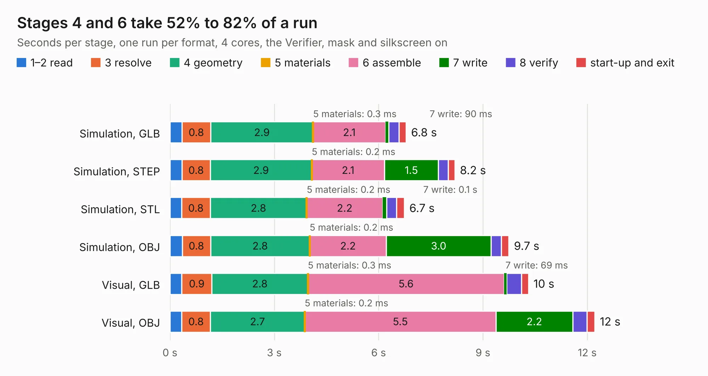

# 2288. pc_healthypi_move_program_adapter_v7

Board 2,288 of the 3,121 of [Corpus Testing](../Corpus-Testing.md), on [Corpus Page 22](../CorpusTestingPages/Corpus-Testing-22.md#2288-pc_healthypi_move_program_adapter_v7).

| Mode and format | 1–2 read | 3 resolve | 4 geometry | 5 materials | 6 assemble | 7 write | 8 verify | start-up and exit | Total |
|---|---:|---:|---:|---:|---:|---:|---:|---:|---:|
| Simulation, GLB | 0.3 | 0.8 | 2.9 | 0.3&nbsp;ms | 2.1 | 90&nbsp;ms | 0.3 | 0.2 | 6.8 |
| Simulation, STEP | 0.3 | 0.8 | 2.9 | 0.2&nbsp;ms | 2.1 | 1.5 | 0.3 | 0.2 | 8.2 |
| Simulation, STL | 0.3 | 0.8 | 2.8 | 0.2&nbsp;ms | 2.2 | 0.1 | 0.3 | 0.2 | 6.7 |
| Simulation, OBJ | 0.4 | 0.8 | 2.8 | 0.2&nbsp;ms | 2.2 | 3.0 | 0.3 | 0.2 | 9.7 |
| Visual, GLB | 0.3 | 0.9 | 2.8 | 0.3&nbsp;ms | 5.6 | 69&nbsp;ms | 0.4 | 0.2 | 10.3 |
| Visual, OBJ | 0.3 | 0.8 | 2.7 | 0.2&nbsp;ms | 5.5 | 2.2 | 0.4 | 0.2 | 12.2 |

<table align="center"><tr><td valign="top">

| Board | Repo: [Protocentral/healthypi-move-hw](https://github.com/Protocentral/healthypi-move-hw) Board: `pc_healthypi_move_program_adapter_v7.kicad_pcb` |
|---|---|
| Folder | pcbs / kicad_healthypi_move_program_adapter |
| Complexity | 239&nbsp;/&nbsp;1000 (size&nbsp;154, features&nbsp;85) |
| KESE&nbsp;features | through vias, rounded, trapezoid or chamfered pads, filled zones, curved board outline, stack-up, dielectric εr and tanδ |
| Tested | 9th November 2026 |
| Copper&nbsp;layers | 4 |
| File&nbsp;format | KiCad 8 (20240108) |
| Parts,&nbsp;tracks,&nbsp;vias | 9, 276, 25 |
| Triangles,&nbsp;simulation | 564,298 in 53 parts |
| Verifier | PASS in all six runs |

</td><td valign="top">

<table>
<tr><th>File type</th><th>File size</th><th>Peak memory used</th></tr>
<tr><th colspan="3" align="left">Simulation</th></tr>
<tr><td>GLB</td><td align="right">20&nbsp;MB</td><td align="right">295&nbsp;MB</td></tr>
<tr><td>STEP</td><td align="right">101&nbsp;MB</td><td align="right">356&nbsp;MB</td></tr>
<tr><td>STL</td><td align="right">28&nbsp;MB</td><td align="right">296&nbsp;MB</td></tr>
<tr><td>OBJ</td><td align="right">60&nbsp;MB</td><td align="right">451&nbsp;MB</td></tr>
<tr><th colspan="3" align="left">Visual</th></tr>
<tr><td>GLB</td><td align="right">15&nbsp;MB</td><td align="right">375&nbsp;MB</td></tr>
<tr><td>OBJ</td><td align="right">45&nbsp;MB</td><td align="right">377&nbsp;MB</td></tr>
</table>

</td></tr></table>

| Previous | Next |
|:---|---:|
| [2287. ISA adapter](b2287b_picogus_ISA-adapter.md) | [2289. pc_healthypi_move_nRF5340_v12](b2289b_healthypi-move-hw_pc-healthypi-move-nRF5340-v12.md) |
