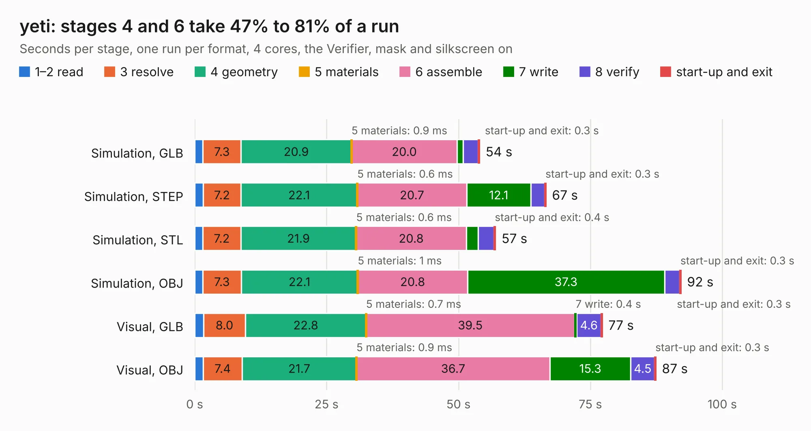

# 2288. yeti

Board 2,288 of the 3,138 of [Corpus Testing](../Corpus-Testing.md), on [Corpus Page 22](../CorpusTestingPages/Corpus-Testing-22.md#2288-yeti).

| Mode and format | 1–2 read | 3 resolve | 4 geometry | 5 materials | 6 assemble | 7 write | 8 verify | start-up and exit | Total |
|---|---:|---:|---:|---:|---:|---:|---:|---:|---:|
| Simulation, GLB | 1.5 | 7.3 | 20.9 | 0.9&nbsp;ms | 20.0 | 1.1 | 2.8 | 0.3 | 54.0 |
| Simulation, STEP | 1.6 | 7.2 | 22.1 | 0.6&nbsp;ms | 20.7 | 12.1 | 2.7 | 0.3 | 66.6 |
| Simulation, STL | 1.5 | 7.2 | 21.9 | 0.6&nbsp;ms | 20.8 | 2.2 | 3.0 | 0.4 | 57.1 |
| Simulation, OBJ | 1.5 | 7.3 | 22.1 | 1&nbsp;ms | 20.8 | 37.3 | 2.9 | 0.3 | 92.2 |
| Visual, GLB | 1.7 | 8.0 | 22.8 | 0.7&nbsp;ms | 39.5 | 0.4 | 4.6 | 0.3 | 77.3 |
| Visual, OBJ | 1.6 | 7.4 | 21.7 | 0.9&nbsp;ms | 36.7 | 15.3 | 4.5 | 0.3 | 87.5 |

<table align="center"><tr><td valign="top">

| Board | Repo: [pionixpublic/reference-hardware](https://github.com/pionixpublic/reference-hardware) Board: `yeti.kicad_pcb` |
|---|---|
| Folder | Yeti |
| Complexity | 370&nbsp;/&nbsp;1000 (size&nbsp;250, features&nbsp;120) |
| KESE&nbsp;features | through vias, slotted holes, custom pads, rounded, trapezoid or chamfered pads, filled zones, copper drawings, curved board outline, stack-up, dielectric εr and tanδ |
| Tested | 9th November 2026 |
| Copper&nbsp;layers | 8 |
| File&nbsp;format | KiCad 6 (20211014) |
| Parts,&nbsp;tracks,&nbsp;vias | 262, 2,762, 718 |
| Triangles,&nbsp;simulation | 6,306,866 in 228 parts |
| Verifier | PASS in all six runs |

</td><td valign="top">

<table>
<tr><th>File type</th><th>File size</th><th>Peak memory used</th></tr>
<tr><th colspan="3" align="left">Simulation</th></tr>
<tr><td>GLB</td><td align="right">209&nbsp;MB</td><td align="right">1.7&nbsp;GB</td></tr>
<tr><td>STEP</td><td align="right">746&nbsp;MB</td><td align="right">2.0&nbsp;GB</td></tr>
<tr><td>STL</td><td align="right">315&nbsp;MB</td><td align="right">1.6&nbsp;GB</td></tr>
<tr><td>OBJ</td><td align="right">693&nbsp;MB</td><td align="right">4.1&nbsp;GB</td></tr>
<tr><th colspan="3" align="left">Visual</th></tr>
<tr><td>GLB</td><td align="right">98&nbsp;MB</td><td align="right">1.8&nbsp;GB</td></tr>
<tr><td>OBJ</td><td align="right">324&nbsp;MB</td><td align="right">2.2&nbsp;GB</td></tr>
</table>

</td></tr></table>

| Previous | Next |
|:---|---:|
| [2287. everestCM4](b2287b_reference-hardware_everestCM4.md) | [2289. R1000AX](b2289b_R1000AX_R1000AX.md) |
