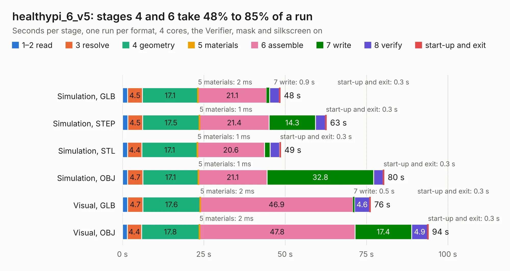

# 2292. healthypi_6_v5

Board 2,292 of the 3,119 of [Corpus Testing](../Corpus-Testing.md), on [Corpus Page 22](../CorpusTestingPages/Corpus-Testing-22.md#2292-healthypi_6_v5).

| Mode and format | 1–2 read | 3 resolve | 4 geometry | 5 materials | 6 assemble | 7 write | 8 verify | start-up and exit | Total |
|---|---:|---:|---:|---:|---:|---:|---:|---:|---:|
| Simulation, GLB | 1.6 | 4.5 | 17.1 | 2&nbsp;ms | 21.1 | 0.9 | 3.0 | 0.3 | 48.5 |
| Simulation, STEP | 1.6 | 4.5 | 17.5 | 1&nbsp;ms | 21.4 | 14.3 | 3.1 | 0.3 | 62.7 |
| Simulation, STL | 1.6 | 4.4 | 17.1 | 1&nbsp;ms | 20.6 | 1.7 | 3.0 | 0.3 | 48.6 |
| Simulation, OBJ | 1.6 | 4.7 | 17.1 | 1&nbsp;ms | 21.1 | 32.8 | 2.9 | 0.3 | 80.4 |
| Visual, GLB | 1.6 | 4.7 | 17.6 | 2&nbsp;ms | 46.9 | 0.5 | 4.6 | 0.3 | 76.3 |
| Visual, OBJ | 1.5 | 4.4 | 17.8 | 2&nbsp;ms | 47.8 | 17.4 | 4.9 | 0.3 | 94.0 |

<table align="center"><tr><td valign="top">

| Board | Repo: [protocentral/protocentral_healthypi6_hardware](https://github.com/protocentral/protocentral_healthypi6_hardware) Board: `healthypi_6_v5.kicad_pcb` |
|---|---|
| Folder | hardware / healthypi_6_main_v5 |
| Complexity | 433&nbsp;/&nbsp;1000 (size&nbsp;298, features&nbsp;135) |
| KESE&nbsp;features | through vias, slotted holes, custom pads, rounded, trapezoid or chamfered pads, filled zones, copper drawings, curved board outline, TrueType text, stack-up, dielectric εr and tanδ |
| Tested | 9th November 2026 |
| Copper&nbsp;layers | 6 |
| File&nbsp;format | KiCad 10 (20260206) |
| Parts,&nbsp;tracks,&nbsp;vias | 229, 3,001, 665 |
| Triangles,&nbsp;simulation | 6,044,362 in 327 parts |
| Verifier | PASS in all six runs |

</td><td valign="top">

<table>
<tr><th>File type</th><th>File size</th><th>Peak memory used</th></tr>
<tr><th colspan="3" align="left">Simulation</th></tr>
<tr><td>GLB</td><td align="right">205&nbsp;MB</td><td align="right">1.6&nbsp;GB</td></tr>
<tr><td>STEP</td><td align="right">889&nbsp;MB</td><td align="right">2.2&nbsp;GB</td></tr>
<tr><td>STL</td><td align="right">302&nbsp;MB</td><td align="right">1.7&nbsp;GB</td></tr>
<tr><td>OBJ</td><td align="right">645&nbsp;MB</td><td align="right">3.9&nbsp;GB</td></tr>
<tr><th colspan="3" align="left">Visual</th></tr>
<tr><td>GLB</td><td align="right">115&nbsp;MB</td><td align="right">2.1&nbsp;GB</td></tr>
<tr><td>OBJ</td><td align="right">373&nbsp;MB</td><td align="right">2.5&nbsp;GB</td></tr>
</table>

</td></tr></table>

| Previous | Next |
|:---|---:|
| [2291. healthypi_6_display_v7](b2291b_protocentral-healthypi6-hardware_healthypi-6-display-v7.md) | [2293. battery_board_v1](b2293b_battery-board_battery-board-v1.md) |
