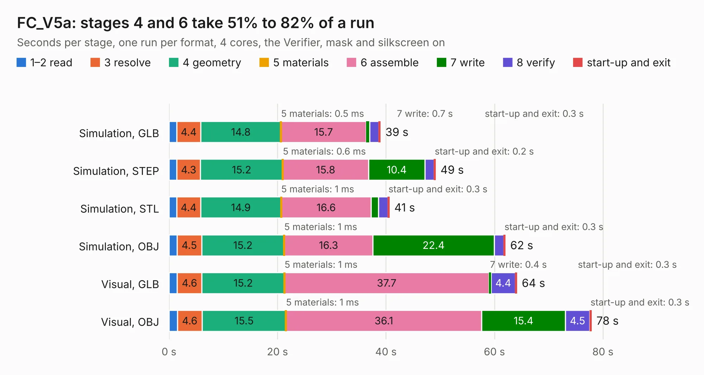

# 2296. FC_V5a

Board 2,296 of the 3,108 of [Corpus Testing](../Corpus-Testing.md), on [Corpus Page 22](../CorpusTestingPages/Corpus-Testing-22.md#2296-fc_v5a).

| Mode and format | 1–2 read | 3 resolve | 4 geometry | 5 materials | 6 assemble | 7 write | 8 verify | start-up and exit | Total |
|---|---:|---:|---:|---:|---:|---:|---:|---:|---:|
| Simulation, GLB | 1.4 | 4.4 | 14.8 | 0.5&nbsp;ms | 15.7 | 0.7 | 1.7 | 0.3 | 39.0 |
| Simulation, STEP | 1.5 | 4.3 | 15.2 | 0.6&nbsp;ms | 15.8 | 10.4 | 1.7 | 0.2 | 49.1 |
| Simulation, STL | 1.4 | 4.4 | 14.9 | 1&nbsp;ms | 16.6 | 1.3 | 1.7 | 0.3 | 40.6 |
| Simulation, OBJ | 1.5 | 4.5 | 15.2 | 1&nbsp;ms | 16.3 | 22.4 | 1.7 | 0.3 | 62.0 |
| Visual, GLB | 1.5 | 4.6 | 15.2 | 1&nbsp;ms | 37.7 | 0.4 | 4.4 | 0.3 | 64.1 |
| Visual, OBJ | 1.5 | 4.6 | 15.5 | 1&nbsp;ms | 36.1 | 15.4 | 4.5 | 0.3 | 77.9 |

<table align="center"><tr><td valign="top">

| Board | Repo: [proveskit/flight_controller_board](https://github.com/proveskit/flight_controller_board) Board: `FC_V5a.kicad_pcb` |
|---|---|
| Folder | Deprecated Versions / FC_V5a |
| Complexity | 406&nbsp;/&nbsp;1000 (size&nbsp;276, features&nbsp;130) |
| KESE&nbsp;features | through vias, slotted holes, custom pads, rounded, trapezoid or chamfered pads, filled zones, copper drawings, copper text, curved board outline, stack-up, dielectric εr and tanδ |
| Tested | 9th November 2026 |
| Copper&nbsp;layers | 4 |
| File&nbsp;format | KiCad 9 (20241229) |
| Parts,&nbsp;tracks,&nbsp;vias | 254, 2,647, 442 |
| Triangles,&nbsp;simulation | 4,208,656 in 231 parts |
| Verifier | PASS in all six runs |

</td><td valign="top">

<table>
<tr><th>File type</th><th>File size</th><th>Peak memory used</th></tr>
<tr><th colspan="3" align="left">Simulation</th></tr>
<tr><td>GLB</td><td align="right">146&nbsp;MB</td><td align="right">1.3&nbsp;GB</td></tr>
<tr><td>STEP</td><td align="right">744&nbsp;MB</td><td align="right">1.6&nbsp;GB</td></tr>
<tr><td>STL</td><td align="right">210&nbsp;MB</td><td align="right">1.3&nbsp;GB</td></tr>
<tr><td>OBJ</td><td align="right">458&nbsp;MB</td><td align="right">2.8&nbsp;GB</td></tr>
<tr><th colspan="3" align="left">Visual</th></tr>
<tr><td>GLB</td><td align="right">100&nbsp;MB</td><td align="right">1.6&nbsp;GB</td></tr>
<tr><td>OBJ</td><td align="right">315&nbsp;MB</td><td align="right">2.1&nbsp;GB</td></tr>
</table>

</td></tr></table>

| Previous | Next |
|:---|---:|
| [2295. FC_V5](b2295b_flight-controller-board_FC-V5.md) | [2297. FC_v5d](b2297b_flight-controller-board_FC-v5d.md) |
