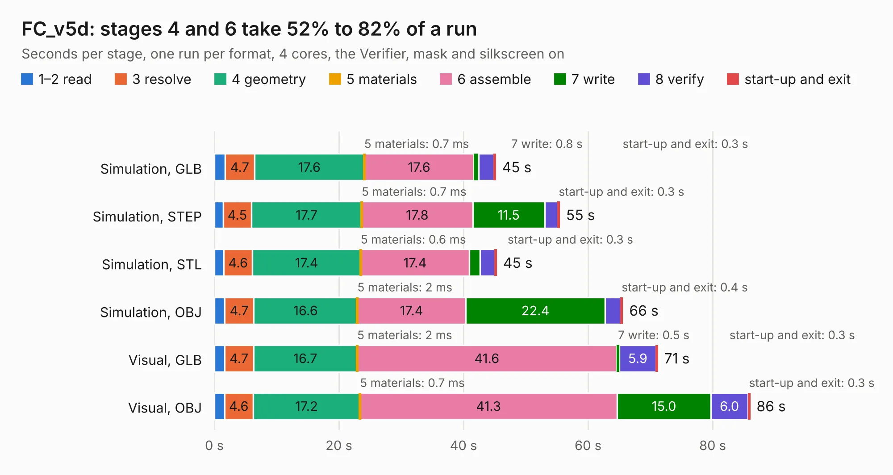

# 2296. FC_v5d

Board 2,296 of the 3,107 of [Corpus Testing](../Corpus-Testing.md), on [Corpus Page 22](../CorpusTestingPages/Corpus-Testing-22.md#2296-fc_v5d).

| Mode and format | 1–2 read | 3 resolve | 4 geometry | 5 materials | 6 assemble | 7 write | 8 verify | start-up and exit | Total |
|---|---:|---:|---:|---:|---:|---:|---:|---:|---:|
| Simulation, GLB | 1.7 | 4.7 | 17.6 | 0.7&nbsp;ms | 17.6 | 0.8 | 2.4 | 0.3 | 45.2 |
| Simulation, STEP | 1.4 | 4.5 | 17.7 | 0.7&nbsp;ms | 17.8 | 11.5 | 2.1 | 0.3 | 55.4 |
| Simulation, STL | 1.5 | 4.6 | 17.4 | 0.6&nbsp;ms | 17.4 | 1.7 | 2.4 | 0.3 | 45.3 |
| Simulation, OBJ | 1.6 | 4.7 | 16.6 | 2&nbsp;ms | 17.4 | 22.4 | 2.5 | 0.4 | 65.6 |
| Visual, GLB | 1.6 | 4.7 | 16.7 | 2&nbsp;ms | 41.6 | 0.5 | 5.9 | 0.3 | 71.2 |
| Visual, OBJ | 1.6 | 4.6 | 17.2 | 0.7&nbsp;ms | 41.3 | 15.0 | 6.0 | 0.3 | 86.0 |

<table align="center"><tr><td valign="top">

| Board | Repo: [proveskit/flight_controller_board](https://github.com/proveskit/flight_controller_board) Board: `FC_v5d.kicad_pcb` |
|---|---|
| Folder | Deprecated Versions / FC_V5d_Express |
| Complexity | 414&nbsp;/&nbsp;1000 (size&nbsp;284, features&nbsp;130) |
| KESE&nbsp;features | through vias, slotted holes, custom pads, rounded, trapezoid or chamfered pads, filled zones, copper drawings, copper text, curved board outline, stack-up, dielectric εr and tanδ |
| Tested | 9th November 2026 |
| Copper&nbsp;layers | 4 |
| File&nbsp;format | KiCad 9 (20241229) |
| Parts,&nbsp;tracks,&nbsp;vias | 252, 2,764, 512 |
| Triangles,&nbsp;simulation | 4,655,724 in 240 parts |
| Verifier | PASS in all six runs |

</td><td valign="top">

<table>
<tr><th>File type</th><th>File size</th><th>Peak memory used</th></tr>
<tr><th colspan="3" align="left">Simulation</th></tr>
<tr><td>GLB</td><td align="right">160&nbsp;MB</td><td align="right">1.5&nbsp;GB</td></tr>
<tr><td>STEP</td><td align="right">800&nbsp;MB</td><td align="right">1.8&nbsp;GB</td></tr>
<tr><td>STL</td><td align="right">233&nbsp;MB</td><td align="right">1.4&nbsp;GB</td></tr>
<tr><td>OBJ</td><td align="right">507&nbsp;MB</td><td align="right">3.1&nbsp;GB</td></tr>
<tr><th colspan="3" align="left">Visual</th></tr>
<tr><td>GLB</td><td align="right">106&nbsp;MB</td><td align="right">2.0&nbsp;GB</td></tr>
<tr><td>OBJ</td><td align="right">337&nbsp;MB</td><td align="right">2.2&nbsp;GB</td></tr>
</table>

</td></tr></table>

| Previous | Next |
|:---|---:|
| [2295. FC_V5a](b2295b_flight-controller-board_FC-V5a.md) | [2297. FC_V5d_Pro_Rev1](b2297b_flight-controller-board_FC-V5d-Pro-Rev1.md) |
