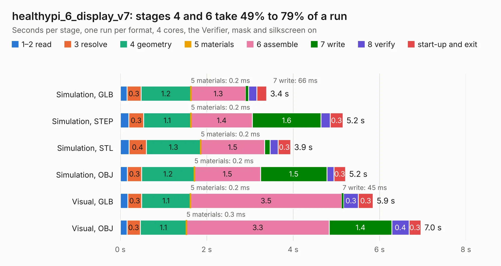

# 2296. healthypi_6_display_v7

Board 2,296 of the 3,124 of [Corpus Testing](../Corpus-Testing.md), on [Corpus Page 22](../CorpusTestingPages/Corpus-Testing-22.md#2296-healthypi_6_display_v7).

| Mode and format | 1–2 read | 3 resolve | 4 geometry | 5 materials | 6 assemble | 7 write | 8 verify | start-up and exit | Total |
|---|---:|---:|---:|---:|---:|---:|---:|---:|---:|
| Simulation, GLB | 0.2 | 0.3 | 1.2 | 0.2&nbsp;ms | 1.3 | 66&nbsp;ms | 0.2 | 0.2 | 3.4 |
| Simulation, STEP | 0.2 | 0.3 | 1.1 | 0.2&nbsp;ms | 1.4 | 1.6 | 0.2 | 0.3 | 5.2 |
| Simulation, STL | 0.2 | 0.4 | 1.3 | 0.2&nbsp;ms | 1.5 | 0.1 | 0.2 | 0.3 | 3.9 |
| Simulation, OBJ | 0.2 | 0.3 | 1.2 | 0.2&nbsp;ms | 1.5 | 1.5 | 0.2 | 0.3 | 5.2 |
| Visual, GLB | 0.2 | 0.3 | 1.1 | 0.2&nbsp;ms | 3.5 | 45&nbsp;ms | 0.3 | 0.3 | 5.9 |
| Visual, OBJ | 0.2 | 0.3 | 1.1 | 0.3&nbsp;ms | 3.3 | 1.4 | 0.4 | 0.3 | 7.0 |

<table align="center"><tr><td valign="top">

| Board | Repo: [protocentral/protocentral_healthypi6_hardware](https://github.com/protocentral/protocentral_healthypi6_hardware) Board: `healthypi_6_display_v7.kicad_pcb` |
|---|---|
| Folder | hardware / healthypi_6_display_v7 |
| Complexity | 232&nbsp;/&nbsp;1000 (size&nbsp;142, features&nbsp;90) |
| KESE&nbsp;features | through vias, rounded, trapezoid or chamfered pads, filled zones, TrueType text, stack-up, dielectric εr and tanδ |
| Tested | 9th November 2026 |
| Copper&nbsp;layers | 2 |
| File&nbsp;format | KiCad 10 (20260206) |
| Parts,&nbsp;tracks,&nbsp;vias | 14, 189, 50 |
| Triangles,&nbsp;simulation | 240,022 in 41 parts |
| Verifier | PASS in all six runs |

</td><td valign="top">

<table>
<tr><th>File type</th><th>File size</th><th>Peak memory used</th></tr>
<tr><th colspan="3" align="left">Simulation</th></tr>
<tr><td>GLB</td><td align="right">8.5&nbsp;MB</td><td align="right">212&nbsp;MB</td></tr>
<tr><td>STEP</td><td align="right">42&nbsp;MB</td><td align="right">227&nbsp;MB</td></tr>
<tr><td>STL</td><td align="right">12&nbsp;MB</td><td align="right">212&nbsp;MB</td></tr>
<tr><td>OBJ</td><td align="right">24&nbsp;MB</td><td align="right">212&nbsp;MB</td></tr>
<tr><th colspan="3" align="left">Visual</th></tr>
<tr><td>GLB</td><td align="right">7.4&nbsp;MB</td><td align="right">210&nbsp;MB</td></tr>
<tr><td>OBJ</td><td align="right">22&nbsp;MB</td><td align="right">215&nbsp;MB</td></tr>
</table>

</td></tr></table>

| Previous | Next |
|:---|---:|
| [2295. healthylink_gpio_v2](b2295b_protocentral-healthypi6-hardware_healthylink-gpio-v2.md) | [2297. healthypi_6_v5](b2297b_protocentral-healthypi6-hardware_healthypi-6-v5.md) |
