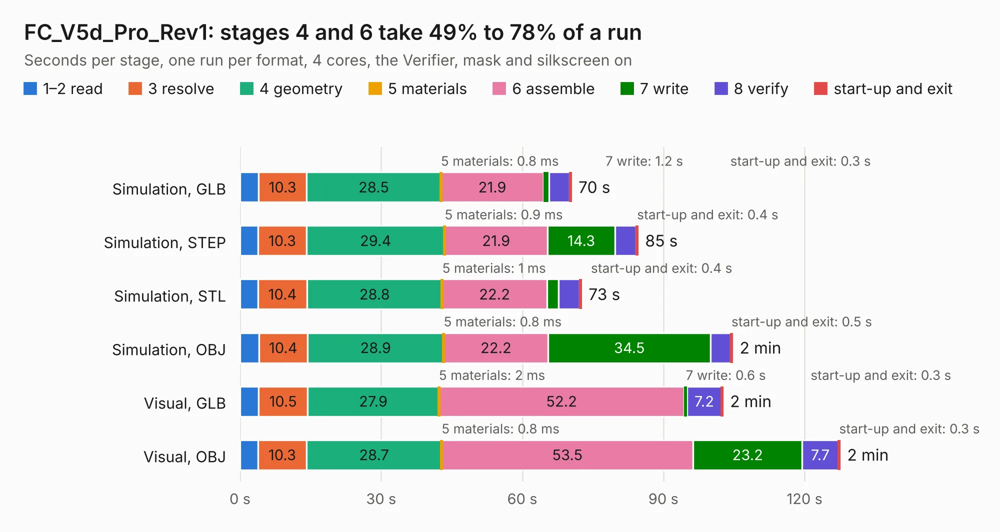

# 2297. FC_V5d_Pro_Rev1

Board 2,297 of the 3,107 of [Corpus Testing](../Corpus-Testing.md), on [Corpus Page 22](../CorpusTestingPages/Corpus-Testing-22.md#2297-fc_v5d_pro_rev1).

| Mode and format | 1–2 read | 3 resolve | 4 geometry | 5 materials | 6 assemble | 7 write | 8 verify | start-up and exit | Total |
|---|---:|---:|---:|---:|---:|---:|---:|---:|---:|
| Simulation, GLB | 3.9 | 10.3 | 28.5 | 0.8&nbsp;ms | 21.9 | 1.2 | 4.4 | 0.3 | 70.4 |
| Simulation, STEP | 3.8 | 10.3 | 29.4 | 0.9&nbsp;ms | 21.9 | 14.3 | 4.5 | 0.4 | 84.6 |
| Simulation, STL | 3.8 | 10.4 | 28.8 | 1&nbsp;ms | 22.2 | 2.4 | 4.5 | 0.4 | 72.6 |
| Simulation, OBJ | 4.0 | 10.4 | 28.9 | 0.8&nbsp;ms | 22.2 | 34.5 | 4.2 | 0.5 | 104.7 |
| Visual, GLB | 3.9 | 10.5 | 27.9 | 2&nbsp;ms | 52.2 | 0.6 | 7.2 | 0.3 | 102.6 |
| Visual, OBJ | 3.8 | 10.3 | 28.7 | 0.8&nbsp;ms | 53.5 | 23.2 | 7.7 | 0.3 | 127.5 |

<table align="center"><tr><td valign="top">

| Board | Repo: [proveskit/flight_controller_board](https://github.com/proveskit/flight_controller_board) Board: `FC_V5d_Pro_Rev1.kicad_pcb` |
|---|---|
| Folder | Deprecated Versions / FC_V5d_Pro_Rev1 |
| Complexity | 428&nbsp;/&nbsp;1000 (size&nbsp;283, features&nbsp;145) |
| KESE&nbsp;features | through vias, slotted holes, custom pads, rounded, trapezoid or chamfered pads, filled zones, copper drawings, copper text, curved board outline, knockout text, stack-up, dielectric εr and tanδ |
| Tested | 9th November 2026 |
| Copper&nbsp;layers | 4 |
| File&nbsp;format | KiCad 9 (20241229) |
| Parts,&nbsp;tracks,&nbsp;vias | 248, 2,703, 496 |
| Triangles,&nbsp;simulation | 5,218,602 in 233 parts |
| Verifier | PASS in all six runs |

</td><td valign="top">

<table>
<tr><th>File type</th><th>File size</th><th>Peak memory used</th></tr>
<tr><th colspan="3" align="left">Simulation</th></tr>
<tr><td>GLB</td><td align="right">185&nbsp;MB</td><td align="right">1.7&nbsp;GB</td></tr>
<tr><td>STEP</td><td align="right">955&nbsp;MB</td><td align="right">2.1&nbsp;GB</td></tr>
<tr><td>STL</td><td align="right">261&nbsp;MB</td><td align="right">1.7&nbsp;GB</td></tr>
<tr><td>OBJ</td><td align="right">583&nbsp;MB</td><td align="right">3.6&nbsp;GB</td></tr>
<tr><th colspan="3" align="left">Visual</th></tr>
<tr><td>GLB</td><td align="right">130&nbsp;MB</td><td align="right">2.1&nbsp;GB</td></tr>
<tr><td>OBJ</td><td align="right">411&nbsp;MB</td><td align="right">2.7&nbsp;GB</td></tr>
</table>

</td></tr></table>

| Previous | Next |
|:---|---:|
| [2296. FC_v5d](b2296b_flight-controller-board_FC-v5d.md) | [2298. FC_V4c_InspireFly_Special](b2298b_flight-controller-board_FC-V4c-InspireFly-Special.md) |
