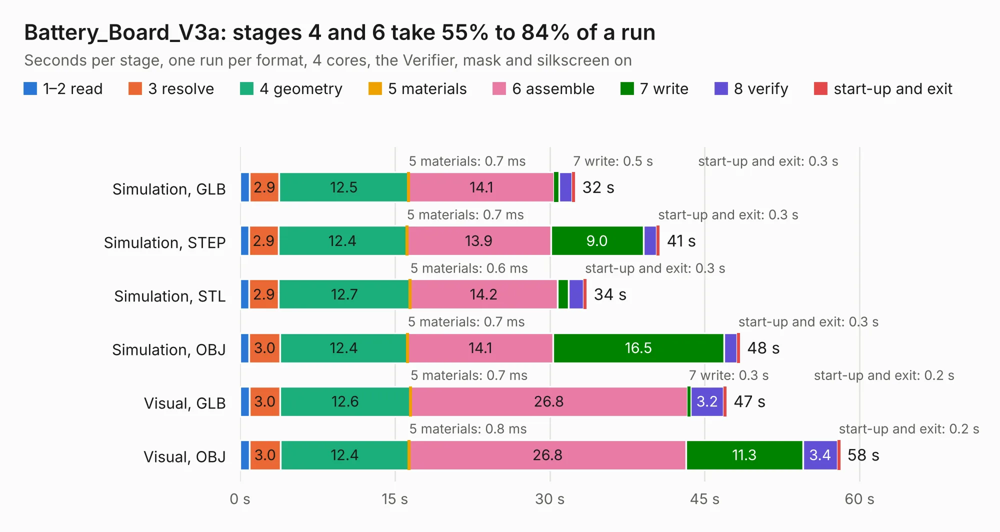

# 2298. Battery_Board_V3a

Board 2,298 of the 3,122 of [Corpus Testing](../Corpus-Testing.md), on [Corpus Page 22](../CorpusTestingPages/Corpus-Testing-22.md#2298-battery_board_v3a).

| Mode and format | 1–2 read | 3 resolve | 4 geometry | 5 materials | 6 assemble | 7 write | 8 verify | start-up and exit | Total |
|---|---:|---:|---:|---:|---:|---:|---:|---:|---:|
| Simulation, GLB | 0.9 | 2.9 | 12.5 | 0.7&nbsp;ms | 14.1 | 0.5 | 1.3 | 0.3 | 32.4 |
| Simulation, STEP | 0.9 | 2.9 | 12.4 | 0.7&nbsp;ms | 13.9 | 9.0 | 1.3 | 0.3 | 40.6 |
| Simulation, STL | 0.9 | 2.9 | 12.7 | 0.6&nbsp;ms | 14.2 | 1.1 | 1.5 | 0.3 | 33.6 |
| Simulation, OBJ | 0.9 | 3.0 | 12.4 | 0.7&nbsp;ms | 14.1 | 16.5 | 1.3 | 0.3 | 48.4 |
| Visual, GLB | 0.9 | 3.0 | 12.6 | 0.7&nbsp;ms | 26.8 | 0.3 | 3.2 | 0.2 | 47.1 |
| Visual, OBJ | 0.9 | 3.0 | 12.4 | 0.8&nbsp;ms | 26.8 | 11.3 | 3.4 | 0.2 | 58.1 |

<table align="center"><tr><td valign="top">

| Board | Repo: [proveskit/battery_board](https://github.com/proveskit/battery_board) Board: `Battery_Board_V3a.kicad_pcb` |
|---|---|
| Folder | Battery_Board_V3a |
| Complexity | 405&nbsp;/&nbsp;1000 (size&nbsp;270, features&nbsp;135) |
| KESE&nbsp;features | through vias, slotted holes, custom pads, rounded, trapezoid or chamfered pads, arc tracks, filled zones, copper drawings, curved board outline, stack-up, dielectric εr and tanδ |
| Tested | 9th November 2026 |
| Copper&nbsp;layers | 4 |
| File&nbsp;format | KiCad 8 (20240108) |
| Parts,&nbsp;tracks,&nbsp;vias | 192, 1,568, 235 |
| Triangles,&nbsp;simulation | 2,965,452 in 178 parts |
| Verifier | PASS in all six runs |

</td><td valign="top">

<table>
<tr><th>File type</th><th>File size</th><th>Peak memory used</th></tr>
<tr><th colspan="3" align="left">Simulation</th></tr>
<tr><td>GLB</td><td align="right">102&nbsp;MB</td><td align="right">1.0&nbsp;GB</td></tr>
<tr><td>STEP</td><td align="right">513&nbsp;MB</td><td align="right">1.3&nbsp;GB</td></tr>
<tr><td>STL</td><td align="right">148&nbsp;MB</td><td align="right">1.0&nbsp;GB</td></tr>
<tr><td>OBJ</td><td align="right">320&nbsp;MB</td><td align="right">2.0&nbsp;GB</td></tr>
<tr><th colspan="3" align="left">Visual</th></tr>
<tr><td>GLB</td><td align="right">74&nbsp;MB</td><td align="right">1.5&nbsp;GB</td></tr>
<tr><td>OBJ</td><td align="right">232&nbsp;MB</td><td align="right">1.6&nbsp;GB</td></tr>
</table>

</td></tr></table>

| Previous | Next |
|:---|---:|
| [2297. Battery_Board_V3](b2297b_battery-board_Battery-Board-V3.md) | [2299. battery_board_v3b](b2299b_battery-board_battery-board-v3b.md) |
