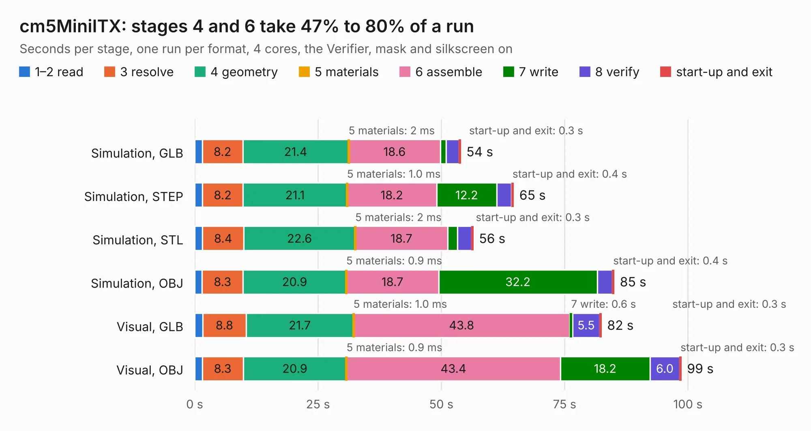

# 2299. cm5MiniITX

Board 2,299 of the 3,101 of [Corpus Testing](../Corpus-Testing.md), on [Corpus Page 22](../CorpusTestingPages/Corpus-Testing-22.md#2299-cm5miniitx).

| Mode and format | 1–2 read | 3 resolve | 4 geometry | 5 materials | 6 assemble | 7 write | 8 verify | start-up and exit | Total |
|---|---:|---:|---:|---:|---:|---:|---:|---:|---:|
| Simulation, GLB | 1.5 | 8.2 | 21.4 | 2&nbsp;ms | 18.6 | 1.1 | 2.6 | 0.3 | 53.9 |
| Simulation, STEP | 1.6 | 8.2 | 21.1 | 1.0&nbsp;ms | 18.2 | 12.2 | 3.0 | 0.4 | 64.6 |
| Simulation, STL | 1.6 | 8.4 | 22.6 | 2&nbsp;ms | 18.7 | 2.0 | 2.9 | 0.3 | 56.5 |
| Simulation, OBJ | 1.5 | 8.3 | 20.9 | 0.9&nbsp;ms | 18.7 | 32.2 | 3.1 | 0.4 | 85.0 |
| Visual, GLB | 1.6 | 8.8 | 21.7 | 1.0&nbsp;ms | 43.8 | 0.6 | 5.5 | 0.3 | 82.5 |
| Visual, OBJ | 1.5 | 8.3 | 20.9 | 0.9&nbsp;ms | 43.4 | 18.2 | 6.0 | 0.3 | 98.6 |

<table align="center"><tr><td valign="top">

| Board | Repo: [pullobi/cm5MiniITX](https://github.com/pullobi/cm5MiniITX) Board: `cm5MiniITX.kicad_pcb` |
|---|---|
| Complexity | 346&nbsp;/&nbsp;1000 (size&nbsp;216, features&nbsp;130) |
| KESE&nbsp;features | through vias, slotted holes, rounded, trapezoid or chamfered pads, arc tracks, filled zones, curved board outline, TrueType text, stack-up, dielectric εr and tanδ, mask and silkscreen colours |
| Tested | 9th November 2026 |
| Copper&nbsp;layers | 4 |
| File&nbsp;format | KiCad 9 (20241229) |
| Parts,&nbsp;tracks,&nbsp;vias | 51, 3,024, 728 |
| Triangles,&nbsp;simulation | 5,274,120 in 270 parts |
| Verifier | PASS in all six runs |

</td><td valign="top">

<table>
<tr><th>File type</th><th>File size</th><th>Peak memory used</th></tr>
<tr><th colspan="3" align="left">Simulation</th></tr>
<tr><td>GLB</td><td align="right">177&nbsp;MB</td><td align="right">1.5&nbsp;GB</td></tr>
<tr><td>STEP</td><td align="right">613&nbsp;MB</td><td align="right">2.0&nbsp;GB</td></tr>
<tr><td>STL</td><td align="right">264&nbsp;MB</td><td align="right">1.5&nbsp;GB</td></tr>
<tr><td>OBJ</td><td align="right">558&nbsp;MB</td><td align="right">3.4&nbsp;GB</td></tr>
<tr><th colspan="3" align="left">Visual</th></tr>
<tr><td>GLB</td><td align="right">107&nbsp;MB</td><td align="right">1.8&nbsp;GB</td></tr>
<tr><td>OBJ</td><td align="right">342&nbsp;MB</td><td align="right">2.3&nbsp;GB</td></tr>
</table>

</td></tr></table>

| Previous | Next |
|:---|---:|
| [2298. FC_V5e_Production_Rev1](b2298b_flight-controller-board_FC-V5e-Production-Rev1.md) | [2300. SwitchBlox](b2300b_SwitchBlox_SwitchBlox.md) |
