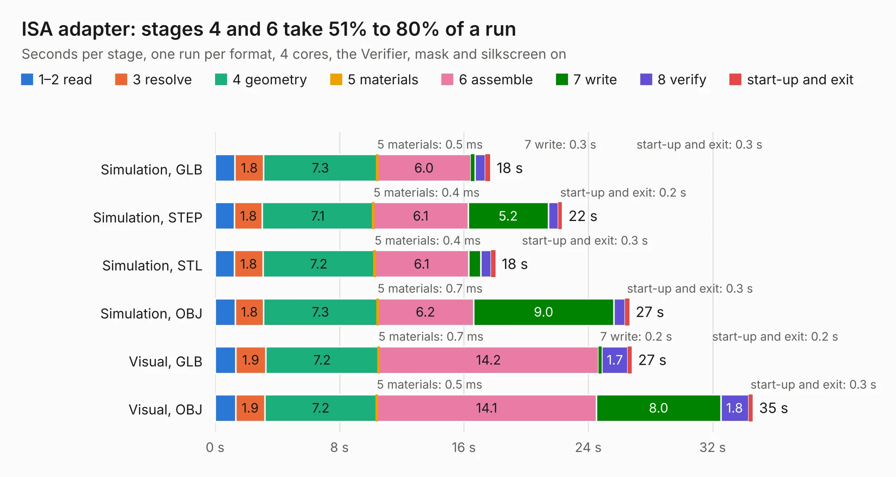

# 2299 ISA adapter

Board 2,299 of the 3,138 of [Corpus Testing](../Corpus-Testing.md), on [Corpus Page 22](../CorpusTestingPages/Corpus-Testing-22.md#2299-isa-adapter).

| Mode and format | 1–2 read | 3 resolve | 4 geometry | 5 materials | 6 assemble | 7 write | 8 verify | start-up and exit | Total |
|---|---:|---:|---:|---:|---:|---:|---:|---:|---:|
| Simulation, GLB | 1.3 | 1.8 | 7.3 | 0.5&nbsp;ms | 6.0 | 0.3 | 0.7 | 0.3 | 17.7 |
| Simulation, STEP | 1.3 | 1.8 | 7.1 | 0.4&nbsp;ms | 6.1 | 5.2 | 0.7 | 0.2 | 22.3 |
| Simulation, STL | 1.2 | 1.8 | 7.2 | 0.4&nbsp;ms | 6.1 | 0.8 | 0.7 | 0.3 | 18.0 |
| Simulation, OBJ | 1.3 | 1.8 | 7.3 | 0.7&nbsp;ms | 6.2 | 9.0 | 0.7 | 0.3 | 26.6 |
| Visual, GLB | 1.3 | 1.9 | 7.2 | 0.7&nbsp;ms | 14.2 | 0.2 | 1.7 | 0.2 | 26.8 |
| Visual, OBJ | 1.3 | 1.9 | 7.2 | 0.5&nbsp;ms | 14.1 | 8.0 | 1.8 | 0.3 | 34.6 |

<table align="center"><tr><td valign="top">

| Board | Repo: [polpo/picogus](https://github.com/polpo/picogus) Board: `ISA adapter.kicad_pcb` |
|---|---|
| Folder | isa-hand386 adapter |
| Complexity | 257&nbsp;/&nbsp;1000 (size&nbsp;152, features&nbsp;105) |
| KESE&nbsp;features | through vias, slotted holes, rounded, trapezoid or chamfered pads, filled zones, TrueType text, stack-up, dielectric εr and tanδ, mask and silkscreen colours |
| Tested | 9th November 2026 |
| Copper&nbsp;layers | 2 |
| File&nbsp;format | KiCad 8 (20240108) |
| Parts,&nbsp;tracks,&nbsp;vias | 14, 279, 124 |
| Triangles,&nbsp;simulation | 1,493,942 in 122 parts |
| Verifier | PASS in all six runs |

</td><td valign="top">

<table>
<tr><th>File type</th><th>File size</th><th>Peak memory used</th></tr>
<tr><th colspan="3" align="left">Simulation</th></tr>
<tr><td>GLB</td><td align="right">52&nbsp;MB</td><td align="right">696&nbsp;MB</td></tr>
<tr><td>STEP</td><td align="right">211&nbsp;MB</td><td align="right">767&nbsp;MB</td></tr>
<tr><td>STL</td><td align="right">75&nbsp;MB</td><td align="right">730&nbsp;MB</td></tr>
<tr><td>OBJ</td><td align="right">157&nbsp;MB</td><td align="right">1.1&nbsp;GB</td></tr>
<tr><th colspan="3" align="left">Visual</th></tr>
<tr><td>GLB</td><td align="right">42&nbsp;MB</td><td align="right">894&nbsp;MB</td></tr>
<tr><td>OBJ</td><td align="right">127&nbsp;MB</td><td align="right">945&nbsp;MB</td></tr>
</table>

</td></tr></table>

| Previous | Next |
|:---|---:|
| [2298 PicoGUS](b2298b_picogus_PicoGUS.md) | [2300 pc_healthypi_move_program_adapter_v7](b2300b_healthypi-move-hw_pc-healthypi-move-program-adapter-v7.md) |
