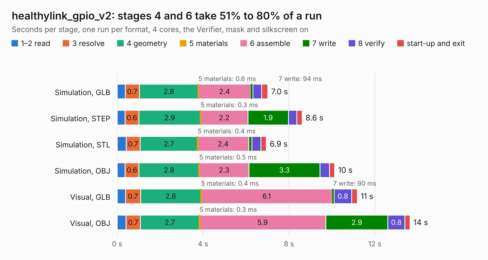

# 2299. healthylink_gpio_v2

Board 2,299 of the 3,131 of [Corpus Testing](../Corpus-Testing.md), on [Corpus Page 22](../CorpusTestingPages/Corpus-Testing-22.md#2299-healthylink_gpio_v2).

| Mode and format | 1–2 read | 3 resolve | 4 geometry | 5 materials | 6 assemble | 7 write | 8 verify | start-up and exit | Total |
|---|---:|---:|---:|---:|---:|---:|---:|---:|---:|
| Simulation, GLB | 0.4 | 0.7 | 2.8 | 0.6&nbsp;ms | 2.4 | 94&nbsp;ms | 0.4 | 0.3 | 7.0 |
| Simulation, STEP | 0.4 | 0.6 | 2.9 | 0.3&nbsp;ms | 2.2 | 1.9 | 0.4 | 0.2 | 8.6 |
| Simulation, STL | 0.4 | 0.7 | 2.7 | 0.4&nbsp;ms | 2.4 | 0.2 | 0.4 | 0.3 | 6.9 |
| Simulation, OBJ | 0.4 | 0.6 | 2.8 | 0.5&nbsp;ms | 2.3 | 3.3 | 0.4 | 0.2 | 10.1 |
| Visual, GLB | 0.4 | 0.7 | 2.8 | 0.4&nbsp;ms | 6.1 | 90&nbsp;ms | 0.8 | 0.3 | 11.2 |
| Visual, OBJ | 0.4 | 0.7 | 2.7 | 0.3&nbsp;ms | 5.9 | 2.9 | 0.8 | 0.2 | 13.6 |

<table align="center"><tr><td valign="top">

| Board | Repo: [protocentral/protocentral_healthypi6_hardware](https://github.com/protocentral/protocentral_healthypi6_hardware) Board: `healthylink_gpio_v2.kicad_pcb` |
|---|---|
| Folder | hardware / healthylink_gpio_v2 |
| Complexity | 287&nbsp;/&nbsp;1000 (size&nbsp;147, features&nbsp;140) |
| KESE&nbsp;features | through vias, custom pads, rounded, trapezoid or chamfered pads, filled zones, copper drawings, curved board outline, knockout text, TrueType text, stack-up, dielectric εr and tanδ |
| Tested | 9th November 2026 |
| Copper&nbsp;layers | 2 |
| File&nbsp;format | KiCad 10 (20260206) |
| Parts,&nbsp;tracks,&nbsp;vias | 16, 288, 47 |
| Triangles,&nbsp;simulation | 591,150 in 65 parts |
| Verifier | PASS in all six runs |

</td><td valign="top">

<table>
<tr><th>File type</th><th>File size</th><th>Peak memory used</th></tr>
<tr><th colspan="3" align="left">Simulation</th></tr>
<tr><td>GLB</td><td align="right">21&nbsp;MB</td><td align="right">328&nbsp;MB</td></tr>
<tr><td>STEP</td><td align="right">102&nbsp;MB</td><td align="right">399&nbsp;MB</td></tr>
<tr><td>STL</td><td align="right">30&nbsp;MB</td><td align="right">341&nbsp;MB</td></tr>
<tr><td>OBJ</td><td align="right">60&nbsp;MB</td><td align="right">427&nbsp;MB</td></tr>
<tr><th colspan="3" align="left">Visual</th></tr>
<tr><td>GLB</td><td align="right">17&nbsp;MB</td><td align="right">449&nbsp;MB</td></tr>
<tr><td>OBJ</td><td align="right">52&nbsp;MB</td><td align="right">469&nbsp;MB</td></tr>
</table>

</td></tr></table>

| Previous | Next |
|:---|---:|
| [2298. healthylink_compute_v5](b2298b_protocentral-healthypi6-hardware_healthylink-compute-v5.md) | [2300. healthypi_6_display_v7](b2300b_protocentral-healthypi6-hardware_healthypi-6-display-v7.md) |
