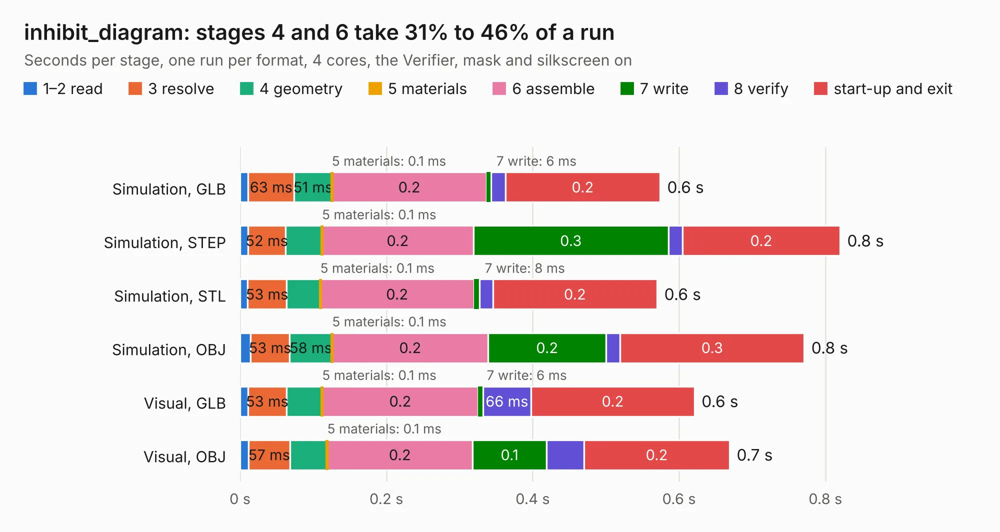

# 2302. inhibit_diagram

Board 2,302 of the 3,120 of [Corpus Testing](../Corpus-Testing.md), on [Corpus Page 22](../CorpusTestingPages/Corpus-Testing-22.md#2302-inhibit_diagram).

| Mode and format | 1–2 read | 3 resolve | 4 geometry | 5 materials | 6 assemble | 7 write | 8 verify | start-up and exit | Total |
|---|---:|---:|---:|---:|---:|---:|---:|---:|---:|
| Simulation, GLB | 11&nbsp;ms | 63&nbsp;ms | 51&nbsp;ms | 0.1&nbsp;ms | 0.2 | 6&nbsp;ms | 20&nbsp;ms | 0.2 | 0.6 |
| Simulation, STEP | 11&nbsp;ms | 52&nbsp;ms | 50&nbsp;ms | 0.1&nbsp;ms | 0.2 | 0.3 | 19&nbsp;ms | 0.2 | 0.8 |
| Simulation, STL | 11&nbsp;ms | 53&nbsp;ms | 46&nbsp;ms | 0.1&nbsp;ms | 0.2 | 8&nbsp;ms | 18&nbsp;ms | 0.2 | 0.6 |
| Simulation, OBJ | 15&nbsp;ms | 53&nbsp;ms | 58&nbsp;ms | 0.1&nbsp;ms | 0.2 | 0.2 | 19&nbsp;ms | 0.3 | 0.8 |
| Visual, GLB | 11&nbsp;ms | 53&nbsp;ms | 49&nbsp;ms | 0.1&nbsp;ms | 0.2 | 6&nbsp;ms | 66&nbsp;ms | 0.2 | 0.6 |
| Visual, OBJ | 11&nbsp;ms | 57&nbsp;ms | 51&nbsp;ms | 0.1&nbsp;ms | 0.2 | 0.1 | 51&nbsp;ms | 0.2 | 0.7 |

<table align="center"><tr><td valign="top">

| Board | Repo: [proveskit/battery_board](https://github.com/proveskit/battery_board) Board: `inhibit_diagram.kicad_pcb` |
|---|---|
| Folder | inhibit_diagram |
| Complexity | 106&nbsp;/&nbsp;1000 (size&nbsp;106, features&nbsp;0) |
| Tested | 9th November 2026 |
| Copper&nbsp;layers | 2 |
| File&nbsp;format | KiCad 8 (20240108) |
| Parts,&nbsp;tracks,&nbsp;vias | 0, 231, 0 |
| Triangles,&nbsp;simulation | 29,954 in 4 parts |
| Note | no components |
| Verifier | PASS in all six runs |

</td><td valign="top">

<table>
<tr><th>File type</th><th>File size</th><th>Peak memory used</th></tr>
<tr><th colspan="3" align="left">Simulation</th></tr>
<tr><td>GLB</td><td align="right">1.0&nbsp;MB</td><td align="right">52&nbsp;MB</td></tr>
<tr><td>STEP</td><td align="right">6.8&nbsp;MB</td><td align="right">57&nbsp;MB</td></tr>
<tr><td>STL</td><td align="right">1.5&nbsp;MB</td><td align="right">52&nbsp;MB</td></tr>
<tr><td>OBJ</td><td align="right">2.8&nbsp;MB</td><td align="right">57&nbsp;MB</td></tr>
<tr><th colspan="3" align="left">Visual</th></tr>
<tr><td>GLB</td><td align="right">646&nbsp;kB</td><td align="right">69&nbsp;MB</td></tr>
<tr><td>OBJ</td><td align="right">1.7&nbsp;MB</td><td align="right">55&nbsp;MB</td></tr>
</table>

</td></tr></table>

| Previous | Next |
|:---|---:|
| [2301. battery_pack_v2](b2301b_battery-board_battery-pack-v2.md) | [2303. FC_Board_v3](b2303b_flight-controller-board_FC-Board-v3.md) |
