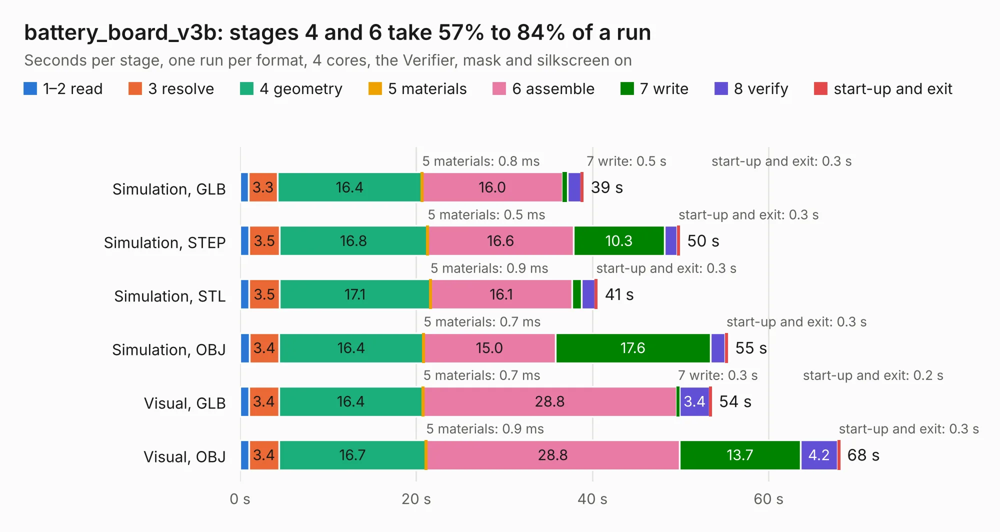

# 2304. battery_board_v3b

Board 2,304 of the 3,130 of [Corpus Testing](../Corpus-Testing.md), on [Corpus Page 22](../CorpusTestingPages/Corpus-Testing-22.md#2304-battery_board_v3b).

| Mode and format | 1–2 read | 3 resolve | 4 geometry | 5 materials | 6 assemble | 7 write | 8 verify | start-up and exit | Total |
|---|---:|---:|---:|---:|---:|---:|---:|---:|---:|
| Simulation, GLB | 0.9 | 3.3 | 16.4 | 0.8&nbsp;ms | 16.0 | 0.5 | 1.5 | 0.3 | 39.0 |
| Simulation, STEP | 1.0 | 3.5 | 16.8 | 0.5&nbsp;ms | 16.6 | 10.3 | 1.5 | 0.3 | 49.9 |
| Simulation, STL | 1.0 | 3.5 | 17.1 | 0.9&nbsp;ms | 16.1 | 1.0 | 1.6 | 0.3 | 40.6 |
| Simulation, OBJ | 1.1 | 3.4 | 16.4 | 0.7&nbsp;ms | 15.0 | 17.6 | 1.6 | 0.3 | 55.4 |
| Visual, GLB | 1.0 | 3.4 | 16.4 | 0.7&nbsp;ms | 28.8 | 0.3 | 3.4 | 0.2 | 53.5 |
| Visual, OBJ | 1.0 | 3.4 | 16.7 | 0.9&nbsp;ms | 28.8 | 13.7 | 4.2 | 0.3 | 68.1 |

<table align="center"><tr><td valign="top">

| Board | Repo: [proveskit/battery_board](https://github.com/proveskit/battery_board) Board: `battery_board_v3b.kicad_pcb` |
|---|---|
| Folder | battery_board_v3b |
| Complexity | 407&nbsp;/&nbsp;1000 (size&nbsp;272, features&nbsp;135) |
| KESE&nbsp;features | through vias, slotted holes, custom pads, rounded, trapezoid or chamfered pads, arc tracks, filled zones, copper drawings, curved board outline, stack-up, dielectric εr and tanδ |
| Tested | 9th November 2026 |
| Copper&nbsp;layers | 4 |
| File&nbsp;format | KiCad 8 (20240108) |
| Parts,&nbsp;tracks,&nbsp;vias | 194, 1,762, 256 |
| Triangles,&nbsp;simulation | 3,067,082 in 180 parts |
| Verifier | PASS in all six runs |

</td><td valign="top">

<table>
<tr><th>File type</th><th>File size</th><th>Peak memory used</th></tr>
<tr><th colspan="3" align="left">Simulation</th></tr>
<tr><td>GLB</td><td align="right">106&nbsp;MB</td><td align="right">1.1&nbsp;GB</td></tr>
<tr><td>STEP</td><td align="right">523&nbsp;MB</td><td align="right">1.4&nbsp;GB</td></tr>
<tr><td>STL</td><td align="right">153&nbsp;MB</td><td align="right">1.1&nbsp;GB</td></tr>
<tr><td>OBJ</td><td align="right">331&nbsp;MB</td><td align="right">2.1&nbsp;GB</td></tr>
<tr><th colspan="3" align="left">Visual</th></tr>
<tr><td>GLB</td><td align="right">78&nbsp;MB</td><td align="right">1.3&nbsp;GB</td></tr>
<tr><td>OBJ</td><td align="right">244&nbsp;MB</td><td align="right">1.7&nbsp;GB</td></tr>
</table>

</td></tr></table>

| Previous | Next |
|:---|---:|
| [2303. Battery_Board_V3a](b2303b_battery-board_Battery-Board-V3a.md) | [2305. battery_board_v3c](b2305b_battery-board_battery-board-v3c.md) |
