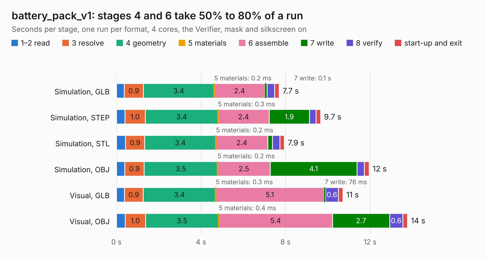

# 2306. battery_pack_v1

Board 2,306 of the 3,130 of [Corpus Testing](../Corpus-Testing.md), on [Corpus Page 22](../CorpusTestingPages/Corpus-Testing-22.md#2306-battery_pack_v1).

| Mode and format | 1–2 read | 3 resolve | 4 geometry | 5 materials | 6 assemble | 7 write | 8 verify | start-up and exit | Total |
|---|---:|---:|---:|---:|---:|---:|---:|---:|---:|
| Simulation, GLB | 0.4 | 0.9 | 3.4 | 0.2&nbsp;ms | 2.4 | 0.1 | 0.4 | 0.2 | 7.7 |
| Simulation, STEP | 0.4 | 1.0 | 3.4 | 0.3&nbsp;ms | 2.4 | 1.9 | 0.3 | 0.2 | 9.7 |
| Simulation, STL | 0.4 | 0.9 | 3.4 | 0.2&nbsp;ms | 2.4 | 0.2 | 0.4 | 0.2 | 7.9 |
| Simulation, OBJ | 0.4 | 0.9 | 3.5 | 0.2&nbsp;ms | 2.5 | 4.1 | 0.3 | 0.2 | 12.0 |
| Visual, GLB | 0.4 | 0.9 | 3.4 | 0.3&nbsp;ms | 5.1 | 76&nbsp;ms | 0.6 | 0.2 | 10.7 |
| Visual, OBJ | 0.4 | 1.0 | 3.5 | 0.4&nbsp;ms | 5.4 | 2.7 | 0.6 | 0.2 | 13.8 |

<table align="center"><tr><td valign="top">

| Board | Repo: [proveskit/battery_board](https://github.com/proveskit/battery_board) Board: `battery_pack_v1.kicad_pcb` |
|---|---|
| Folder | battery_pack_v1 |
| Complexity | 256&nbsp;/&nbsp;1000 (size&nbsp;161, features&nbsp;95) |
| KESE&nbsp;features | through vias, slotted holes, rounded, trapezoid or chamfered pads, filled zones, curved board outline, stack-up, dielectric εr and tanδ |
| Tested | 9th November 2026 |
| Copper&nbsp;layers | 4 |
| File&nbsp;format | KiCad 9 (20241229) |
| Parts,&nbsp;tracks,&nbsp;vias | 16, 135, 78 |
| Triangles,&nbsp;simulation | 785,718 in 28 parts |
| Verifier | PASS in all six runs |

</td><td valign="top">

<table>
<tr><th>File type</th><th>File size</th><th>Peak memory used</th></tr>
<tr><th colspan="3" align="left">Simulation</th></tr>
<tr><td>GLB</td><td align="right">27&nbsp;MB</td><td align="right">400&nbsp;MB</td></tr>
<tr><td>STEP</td><td align="right">125&nbsp;MB</td><td align="right">461&nbsp;MB</td></tr>
<tr><td>STL</td><td align="right">39&nbsp;MB</td><td align="right">386&nbsp;MB</td></tr>
<tr><td>OBJ</td><td align="right">81&nbsp;MB</td><td align="right">579&nbsp;MB</td></tr>
<tr><th colspan="3" align="left">Visual</th></tr>
<tr><td>GLB</td><td align="right">19&nbsp;MB</td><td align="right">451&nbsp;MB</td></tr>
<tr><td>OBJ</td><td align="right">56&nbsp;MB</td><td align="right">492&nbsp;MB</td></tr>
</table>

</td></tr></table>

| Previous | Next |
|:---|---:|
| [2305. battery_board_v3c](b2305b_battery-board_battery-board-v3c.md) | [2307. battery_pack_v1a](b2307b_battery-board_battery-pack-v1a.md) |
