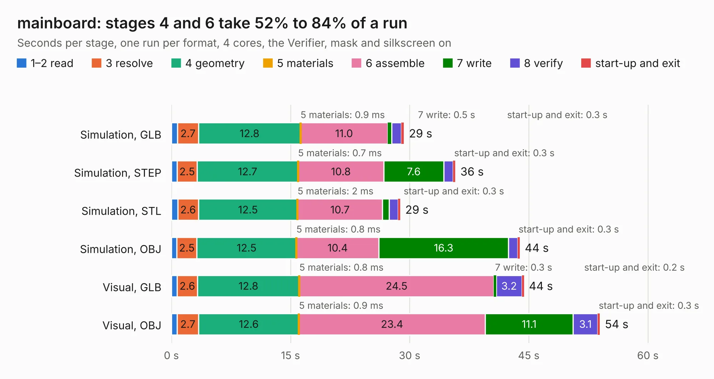

# 2306. mainboard

Board 2,306 of the 3,103 of [Corpus Testing](../Corpus-Testing.md), on [Corpus Page 22](../CorpusTestingPages/Corpus-Testing-22.md#2306-mainboard).

| Mode and format | 1–2 read | 3 resolve | 4 geometry | 5 materials | 6 assemble | 7 write | 8 verify | start-up and exit | Total |
|---|---:|---:|---:|---:|---:|---:|---:|---:|---:|
| Simulation, GLB | 0.8 | 2.7 | 12.8 | 0.9&nbsp;ms | 11.0 | 0.5 | 1.2 | 0.3 | 29.3 |
| Simulation, STEP | 0.7 | 2.5 | 12.7 | 0.7&nbsp;ms | 10.8 | 7.6 | 1.2 | 0.3 | 35.7 |
| Simulation, STL | 0.8 | 2.6 | 12.5 | 2&nbsp;ms | 10.7 | 0.8 | 1.1 | 0.3 | 28.8 |
| Simulation, OBJ | 0.7 | 2.5 | 12.5 | 0.8&nbsp;ms | 10.4 | 16.3 | 1.2 | 0.3 | 43.9 |
| Visual, GLB | 0.7 | 2.6 | 12.8 | 0.8&nbsp;ms | 24.5 | 0.3 | 3.2 | 0.2 | 44.4 |
| Visual, OBJ | 0.7 | 2.7 | 12.6 | 0.9&nbsp;ms | 23.4 | 11.1 | 3.1 | 0.3 | 53.9 |

<table align="center"><tr><td valign="top">

| Board | Repo: [pycubed/hardware](https://github.com/pycubed/hardware) Board: `mainboard.kicad_pcb` |
|---|---|
| Folder | mainboard-v02 |
| Complexity | 313&nbsp;/&nbsp;1000 (size&nbsp;258, features&nbsp;55) |
| KESE&nbsp;features | through vias, rounded, trapezoid or chamfered pads, filled zones, curved board outline |
| Tested | 9th November 2026 |
| Copper&nbsp;layers | 4 |
| File&nbsp;format | KiCad 5 (20171130) |
| Parts,&nbsp;tracks,&nbsp;vias | 142, 1,190, 252 |
| Triangles,&nbsp;simulation | 3,087,922 in 192 parts |
| Verifier | PASS in all six runs |

</td><td valign="top">

<table>
<tr><th>File type</th><th>File size</th><th>Peak memory used</th></tr>
<tr><th colspan="3" align="left">Simulation</th></tr>
<tr><td>GLB</td><td align="right">108&nbsp;MB</td><td align="right">1.1&nbsp;GB</td></tr>
<tr><td>STEP</td><td align="right">454&nbsp;MB</td><td align="right">1.2&nbsp;GB</td></tr>
<tr><td>STL</td><td align="right">154&nbsp;MB</td><td align="right">1.1&nbsp;GB</td></tr>
<tr><td>OBJ</td><td align="right">332&nbsp;MB</td><td align="right">2.0&nbsp;GB</td></tr>
<tr><th colspan="3" align="left">Visual</th></tr>
<tr><td>GLB</td><td align="right">71&nbsp;MB</td><td align="right">1.3&nbsp;GB</td></tr>
<tr><td>OBJ</td><td align="right">222&nbsp;MB</td><td align="right">1.5&nbsp;GB</td></tr>
</table>

</td></tr></table>

| Previous | Next |
|:---|---:|
| [2305. mainboard](b2305b_hardware_mainboard-v01_mainboard.md) | [2307. mainboard](b2307b_hardware_mainboard-v04_mainboard.md) |
