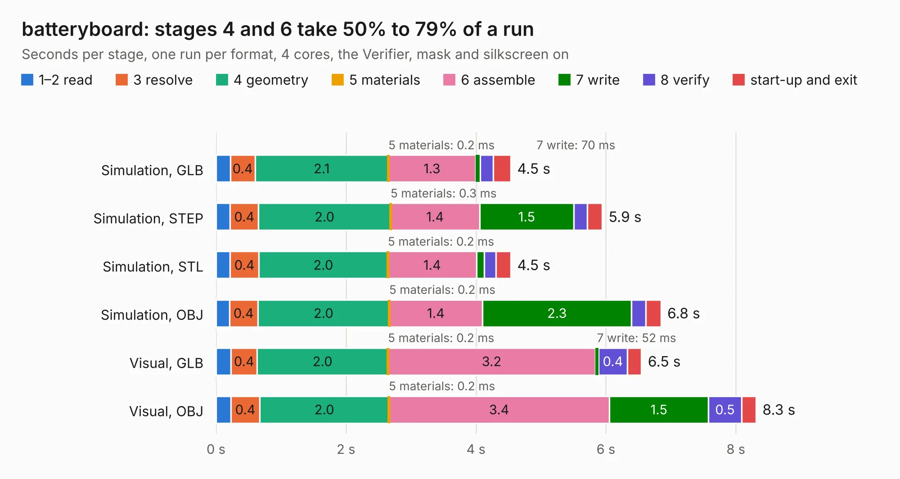

# 2308. batteryboard

Board 2,308 of the 3,107 of [Corpus Testing](../Corpus-Testing.md), on [Corpus Page 22](../CorpusTestingPages/Corpus-Testing-22.md#2308-batteryboard).

| Mode and format | 1–2 read | 3 resolve | 4 geometry | 5 materials | 6 assemble | 7 write | 8 verify | start-up and exit | Total |
|---|---:|---:|---:|---:|---:|---:|---:|---:|---:|
| Simulation, GLB | 0.2 | 0.4 | 2.1 | 0.2&nbsp;ms | 1.3 | 70&nbsp;ms | 0.2 | 0.3 | 4.5 |
| Simulation, STEP | 0.2 | 0.4 | 2.0 | 0.3&nbsp;ms | 1.4 | 1.5 | 0.2 | 0.2 | 5.9 |
| Simulation, STL | 0.2 | 0.4 | 2.0 | 0.2&nbsp;ms | 1.4 | 0.1 | 0.2 | 0.2 | 4.5 |
| Simulation, OBJ | 0.2 | 0.4 | 2.0 | 0.2&nbsp;ms | 1.4 | 2.3 | 0.2 | 0.2 | 6.8 |
| Visual, GLB | 0.2 | 0.4 | 2.0 | 0.2&nbsp;ms | 3.2 | 52&nbsp;ms | 0.4 | 0.2 | 6.5 |
| Visual, OBJ | 0.2 | 0.4 | 2.0 | 0.2&nbsp;ms | 3.4 | 1.5 | 0.5 | 0.2 | 8.3 |

<table align="center"><tr><td valign="top">

| Board | Repo: [pycubed/hardware](https://github.com/pycubed/hardware) Board: `batteryboard.kicad_pcb` |
|---|---|
| Folder | batteryboard-v01b |
| Complexity | 193&nbsp;/&nbsp;1000 (size&nbsp;138, features&nbsp;55) |
| KESE&nbsp;features | through vias, rounded, trapezoid or chamfered pads, filled zones, curved board outline |
| Tested | 9th November 2026 |
| Copper&nbsp;layers | 2 |
| File&nbsp;format | KiCad 5 (20171130) |
| Parts,&nbsp;tracks,&nbsp;vias | 24, 50, 48 |
| Triangles,&nbsp;simulation | 444,304 in 28 parts |
| Verifier | PASS in all six runs |

</td><td valign="top">

<table>
<tr><th>File type</th><th>File size</th><th>Peak memory used</th></tr>
<tr><th colspan="3" align="left">Simulation</th></tr>
<tr><td>GLB</td><td align="right">16&nbsp;MB</td><td align="right">291&nbsp;MB</td></tr>
<tr><td>STEP</td><td align="right">77&nbsp;MB</td><td align="right">315&nbsp;MB</td></tr>
<tr><td>STL</td><td align="right">22&nbsp;MB</td><td align="right">288&nbsp;MB</td></tr>
<tr><td>OBJ</td><td align="right">46&nbsp;MB</td><td align="right">354&nbsp;MB</td></tr>
<tr><th colspan="3" align="left">Visual</th></tr>
<tr><td>GLB</td><td align="right">11&nbsp;MB</td><td align="right">299&nbsp;MB</td></tr>
<tr><td>OBJ</td><td align="right">33&nbsp;MB</td><td align="right">309&nbsp;MB</td></tr>
</table>

</td></tr></table>

| Previous | Next |
|:---|---:|
| [2307. batteryboard](b2307b_hardware_batteryboard-v01_batteryboard.md) | [2309. mainboard](b2309b_hardware_mainboard-v01_mainboard.md) |
