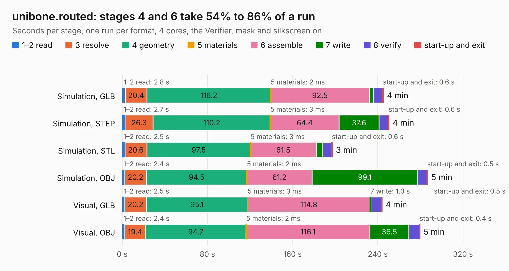

# 2309. unibone.routed

Board 2,309 of the 3,101 of [Corpus Testing](../Corpus-Testing.md), on [Corpus Page 22](../CorpusTestingPages/Corpus-Testing-22.md#2309-unibonerouted).

| Mode and format | 1–2 read | 3 resolve | 4 geometry | 5 materials | 6 assemble | 7 write | 8 verify | start-up and exit | Total |
|---|---:|---:|---:|---:|---:|---:|---:|---:|---:|
| Simulation, GLB | 2.8 | 20.4 | 116.2 | 2&nbsp;ms | 92.5 | 3.7 | 9.0 | 0.6 | 245.2 |
| Simulation, STEP | 2.7 | 26.3 | 110.2 | 3&nbsp;ms | 64.4 | 37.6 | 8.7 | 0.6 | 250.5 |
| Simulation, STL | 2.5 | 20.6 | 97.5 | 3&nbsp;ms | 61.5 | 6.2 | 8.4 | 0.6 | 197.2 |
| Simulation, OBJ | 2.4 | 20.2 | 94.5 | 2&nbsp;ms | 61.2 | 99.1 | 8.9 | 0.5 | 286.8 |
| Visual, GLB | 2.5 | 20.2 | 95.1 | 3&nbsp;ms | 114.8 | 1.0 | 9.9 | 0.5 | 243.9 |
| Visual, OBJ | 2.4 | 19.4 | 94.7 | 2&nbsp;ms | 116.1 | 36.5 | 10.0 | 0.4 | 279.5 |

<table align="center"><tr><td valign="top">

| Board | Repo: [QUniBone/QUniBoneClassic](https://github.com/QUniBone/QUniBoneClassic) Board: `unibone.routed.kicad_pcb` |
|---|---|
| Folder | 01.01_pcb / unibone |
| Complexity | 358&nbsp;/&nbsp;1000 (size&nbsp;278, features&nbsp;80) |
| KESE&nbsp;features | through vias, custom pads, rounded, trapezoid or chamfered pads, drill offsets, filled zones, copper drawings |
| Tested | 9th November 2026 |
| Copper&nbsp;layers | 4 |
| File&nbsp;format | KiCad 8 (20240108) |
| Parts,&nbsp;tracks,&nbsp;vias | 224, 6,542, 358 |
| Triangles,&nbsp;simulation | 13,611,408 in 449 parts |
| Verifier | PASS in all six runs |

</td><td valign="top">

<table>
<tr><th>File type</th><th>File size</th><th>Peak memory used</th></tr>
<tr><th colspan="3" align="left">Simulation</th></tr>
<tr><td>GLB</td><td align="right">467&nbsp;MB</td><td align="right">3.3&nbsp;GB</td></tr>
<tr><td>STEP</td><td align="right">1.9&nbsp;GB</td><td align="right">4.0&nbsp;GB</td></tr>
<tr><td>STL</td><td align="right">681&nbsp;MB</td><td align="right">3.2&nbsp;GB</td></tr>
<tr><td>OBJ</td><td align="right">1.5&nbsp;GB</td><td align="right">8.7&nbsp;GB</td></tr>
<tr><th colspan="3" align="left">Visual</th></tr>
<tr><td>GLB</td><td align="right">201&nbsp;MB</td><td align="right">3.6&nbsp;GB</td></tr>
<tr><td>OBJ</td><td align="right">652&nbsp;MB</td><td align="right">4.2&nbsp;GB</td></tr>
</table>

</td></tr></table>

| Previous | Next |
|:---|---:|
| [2308. qomu-board](b2308b_qomu-dev-board_qomu-board_1326.md) | [2310. unibone.unrouted](b2310b_QUniBoneClassic_unibone-unrouted.md) |
