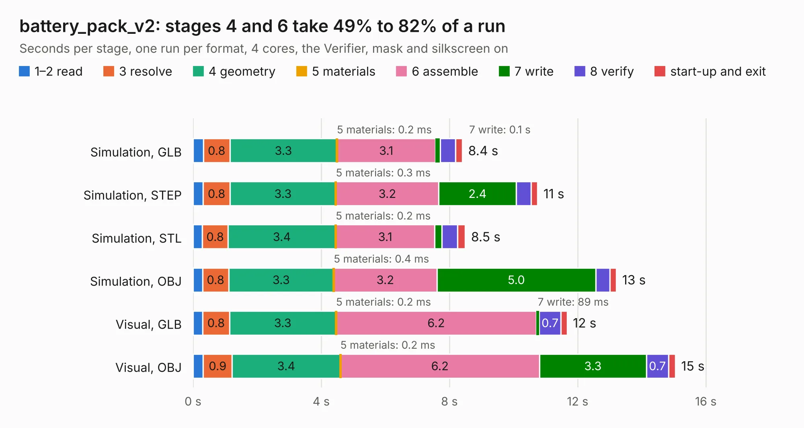

# 2309. battery_pack_v2

Board 2,309 of the 3,131 of [Corpus Testing](../Corpus-Testing.md), on [Corpus Page 22](../CorpusTestingPages/Corpus-Testing-22.md#2309-battery_pack_v2).

| Mode and format | 1–2 read | 3 resolve | 4 geometry | 5 materials | 6 assemble | 7 write | 8 verify | start-up and exit | Total |
|---|---:|---:|---:|---:|---:|---:|---:|---:|---:|
| Simulation, GLB | 0.3 | 0.8 | 3.3 | 0.2&nbsp;ms | 3.1 | 0.1 | 0.5 | 0.2 | 8.4 |
| Simulation, STEP | 0.3 | 0.8 | 3.3 | 0.3&nbsp;ms | 3.2 | 2.4 | 0.5 | 0.2 | 10.8 |
| Simulation, STL | 0.3 | 0.8 | 3.4 | 0.2&nbsp;ms | 3.1 | 0.2 | 0.5 | 0.2 | 8.5 |
| Simulation, OBJ | 0.3 | 0.8 | 3.3 | 0.4&nbsp;ms | 3.2 | 5.0 | 0.4 | 0.2 | 13.2 |
| Visual, GLB | 0.3 | 0.8 | 3.3 | 0.2&nbsp;ms | 6.2 | 89&nbsp;ms | 0.7 | 0.2 | 11.7 |
| Visual, OBJ | 0.3 | 0.9 | 3.4 | 0.2&nbsp;ms | 6.2 | 3.3 | 0.7 | 0.2 | 15.0 |

<table align="center"><tr><td valign="top">

| Board | Repo: [proveskit/battery_board](https://github.com/proveskit/battery_board) Board: `battery_pack_v2.kicad_pcb` |
|---|---|
| Folder | battery_pack_v2 |
| Complexity | 287&nbsp;/&nbsp;1000 (size&nbsp;177, features&nbsp;110) |
| KESE&nbsp;features | through vias, slotted holes, rounded, trapezoid or chamfered pads, filled zones, curved board outline, knockout text, stack-up, dielectric εr and tanδ |
| Tested | 9th November 2026 |
| Copper&nbsp;layers | 4 |
| File&nbsp;format | KiCad 9 (20241229) |
| Parts,&nbsp;tracks,&nbsp;vias | 29, 327, 114 |
| Triangles,&nbsp;simulation | 932,774 in 34 parts |
| Verifier | PASS in all six runs |

</td><td valign="top">

<table>
<tr><th>File type</th><th>File size</th><th>Peak memory used</th></tr>
<tr><th colspan="3" align="left">Simulation</th></tr>
<tr><td>GLB</td><td align="right">32&nbsp;MB</td><td align="right">413&nbsp;MB</td></tr>
<tr><td>STEP</td><td align="right">141&nbsp;MB</td><td align="right">523&nbsp;MB</td></tr>
<tr><td>STL</td><td align="right">47&nbsp;MB</td><td align="right">417&nbsp;MB</td></tr>
<tr><td>OBJ</td><td align="right">95&nbsp;MB</td><td align="right">668&nbsp;MB</td></tr>
<tr><th colspan="3" align="left">Visual</th></tr>
<tr><td>GLB</td><td align="right">22&nbsp;MB</td><td align="right">530&nbsp;MB</td></tr>
<tr><td>OBJ</td><td align="right">66&nbsp;MB</td><td align="right">535&nbsp;MB</td></tr>
</table>

</td></tr></table>

| Previous | Next |
|:---|---:|
| [2308. battery_pack_v1a](b2308b_battery-board_battery-pack-v1a.md) | [2310. inhibit_diagram](b2310b_battery-board_inhibit-diagram.md) |
