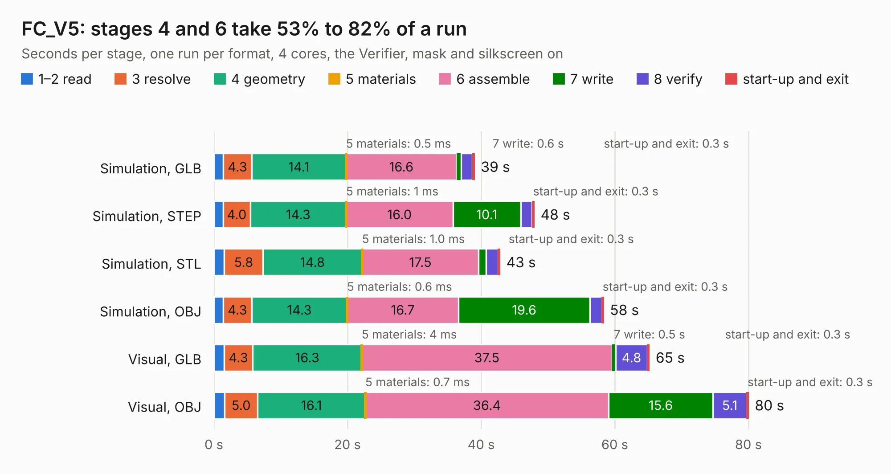

# 2309. FC_V5

Board 2,309 of the 3,122 of [Corpus Testing](../Corpus-Testing.md), on [Corpus Page 22](../CorpusTestingPages/Corpus-Testing-22.md#2309-fc_v5).

| Mode and format | 1–2 read | 3 resolve | 4 geometry | 5 materials | 6 assemble | 7 write | 8 verify | start-up and exit | Total |
|---|---:|---:|---:|---:|---:|---:|---:|---:|---:|
| Simulation, GLB | 1.4 | 4.3 | 14.1 | 0.5&nbsp;ms | 16.6 | 0.6 | 1.7 | 0.3 | 39.0 |
| Simulation, STEP | 1.4 | 4.0 | 14.3 | 1&nbsp;ms | 16.0 | 10.1 | 1.7 | 0.3 | 47.9 |
| Simulation, STL | 1.6 | 5.8 | 14.8 | 1.0&nbsp;ms | 17.5 | 1.1 | 1.8 | 0.3 | 42.8 |
| Simulation, OBJ | 1.4 | 4.3 | 14.3 | 0.6&nbsp;ms | 16.7 | 19.6 | 1.8 | 0.3 | 58.3 |
| Visual, GLB | 1.5 | 4.3 | 16.3 | 4&nbsp;ms | 37.5 | 0.5 | 4.8 | 0.3 | 65.2 |
| Visual, OBJ | 1.6 | 5.0 | 16.1 | 0.7&nbsp;ms | 36.4 | 15.6 | 5.1 | 0.3 | 80.0 |

<table align="center"><tr><td valign="top">

| Board | Repo: [proveskit/flight_controller_board](https://github.com/proveskit/flight_controller_board) Board: `FC_V5.kicad_pcb` |
|---|---|
| Folder | Deprecated Versions / FC_V5 |
| Complexity | 400&nbsp;/&nbsp;1000 (size&nbsp;270, features&nbsp;130) |
| KESE&nbsp;features | through vias, slotted holes, custom pads, rounded, trapezoid or chamfered pads, filled zones, copper drawings, copper text, curved board outline, stack-up, dielectric εr and tanδ |
| Tested | 9th November 2026 |
| Copper&nbsp;layers | 4 |
| File&nbsp;format | KiCad 8 (20240108) |
| Parts,&nbsp;tracks,&nbsp;vias | 207, 2,147, 323 |
| Triangles,&nbsp;simulation | 3,476,500 in 221 parts |
| Verifier | PASS in all six runs |

</td><td valign="top">

<table>
<tr><th>File type</th><th>File size</th><th>Peak memory used</th></tr>
<tr><th colspan="3" align="left">Simulation</th></tr>
<tr><td>GLB</td><td align="right">121&nbsp;MB</td><td align="right">1.1&nbsp;GB</td></tr>
<tr><td>STEP</td><td align="right">620&nbsp;MB</td><td align="right">1.4&nbsp;GB</td></tr>
<tr><td>STL</td><td align="right">174&nbsp;MB</td><td align="right">1.1&nbsp;GB</td></tr>
<tr><td>OBJ</td><td align="right">379&nbsp;MB</td><td align="right">2.4&nbsp;GB</td></tr>
<tr><th colspan="3" align="left">Visual</th></tr>
<tr><td>GLB</td><td align="right">83&nbsp;MB</td><td align="right">1.4&nbsp;GB</td></tr>
<tr><td>OBJ</td><td align="right">261&nbsp;MB</td><td align="right">1.8&nbsp;GB</td></tr>
</table>

</td></tr></table>

| Previous | Next |
|:---|---:|
| [2308. FC_V4c_Express](b2308b_flight-controller-board_FC-V4c-Express.md) | [2310. FC_V5a](b2310b_flight-controller-board_FC-V5a.md) |
