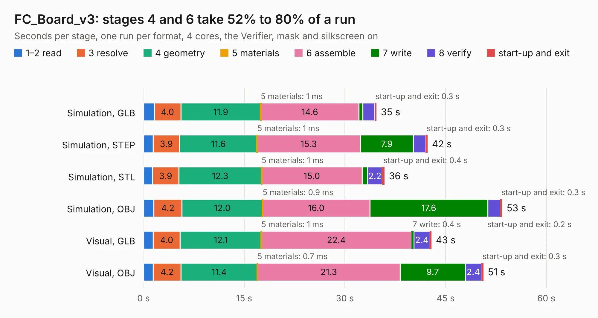

# 2310. FC_Board_v3

Board 2,310 of the 3,130 of [Corpus Testing](../Corpus-Testing.md), on [Corpus Page 22](../CorpusTestingPages/Corpus-Testing-22.md#2310-fc_board_v3).

| Mode and format | 1–2 read | 3 resolve | 4 geometry | 5 materials | 6 assemble | 7 write | 8 verify | start-up and exit | Total |
|---|---:|---:|---:|---:|---:|---:|---:|---:|---:|
| Simulation, GLB | 1.6 | 4.0 | 11.9 | 1&nbsp;ms | 14.6 | 0.5 | 1.8 | 0.3 | 34.7 |
| Simulation, STEP | 1.4 | 3.9 | 11.6 | 1&nbsp;ms | 15.3 | 7.9 | 1.8 | 0.3 | 42.3 |
| Simulation, STL | 1.4 | 3.9 | 12.3 | 1&nbsp;ms | 15.0 | 0.8 | 2.2 | 0.4 | 35.9 |
| Simulation, OBJ | 1.5 | 4.2 | 12.0 | 0.9&nbsp;ms | 16.0 | 17.6 | 1.8 | 0.3 | 53.5 |
| Visual, GLB | 1.4 | 4.0 | 12.1 | 1&nbsp;ms | 22.4 | 0.4 | 2.4 | 0.2 | 42.9 |
| Visual, OBJ | 1.4 | 4.2 | 11.4 | 0.7&nbsp;ms | 21.3 | 9.7 | 2.4 | 0.3 | 50.6 |

<table align="center"><tr><td valign="top">

| Board | Repo: [proveskit/flight_controller_board](https://github.com/proveskit/flight_controller_board) Board: `FC_Board_v3.kicad_pcb` |
|---|---|
| Folder | Deprecated Versions / FC_External_v3 |
| Complexity | 348&nbsp;/&nbsp;1000 (size&nbsp;243, features&nbsp;105) |
| KESE&nbsp;features | through vias, slotted holes, rounded, trapezoid or chamfered pads, filled zones, copper text, curved board outline, stack-up, dielectric εr and tanδ |
| Tested | 9th November 2026 |
| Copper&nbsp;layers | 4 |
| File&nbsp;format | KiCad 6 (20211014) |
| Parts,&nbsp;tracks,&nbsp;vias | 75, 1,107, 233 |
| Triangles,&nbsp;simulation | 2,602,548 in 123 parts |
| Verifier | PASS in all six runs |

</td><td valign="top">

<table>
<tr><th>File type</th><th>File size</th><th>Peak memory used</th></tr>
<tr><th colspan="3" align="left">Simulation</th></tr>
<tr><td>GLB</td><td align="right">95&nbsp;MB</td><td align="right">834&nbsp;MB</td></tr>
<tr><td>STEP</td><td align="right">492&nbsp;MB</td><td align="right">1.1&nbsp;GB</td></tr>
<tr><td>STL</td><td align="right">130&nbsp;MB</td><td align="right">827&nbsp;MB</td></tr>
<tr><td>OBJ</td><td align="right">294&nbsp;MB</td><td align="right">1.8&nbsp;GB</td></tr>
<tr><th colspan="3" align="left">Visual</th></tr>
<tr><td>GLB</td><td align="right">56&nbsp;MB</td><td align="right">1.0&nbsp;GB</td></tr>
<tr><td>OBJ</td><td align="right">173&nbsp;MB</td><td align="right">1.2&nbsp;GB</td></tr>
</table>

</td></tr></table>

| Previous | Next |
|:---|---:|
| [2309. inhibit_diagram](b2309b_battery-board_inhibit-diagram.md) | [2311. FC_V4a](b2311b_flight-controller-board_FC-V4a.md) |
