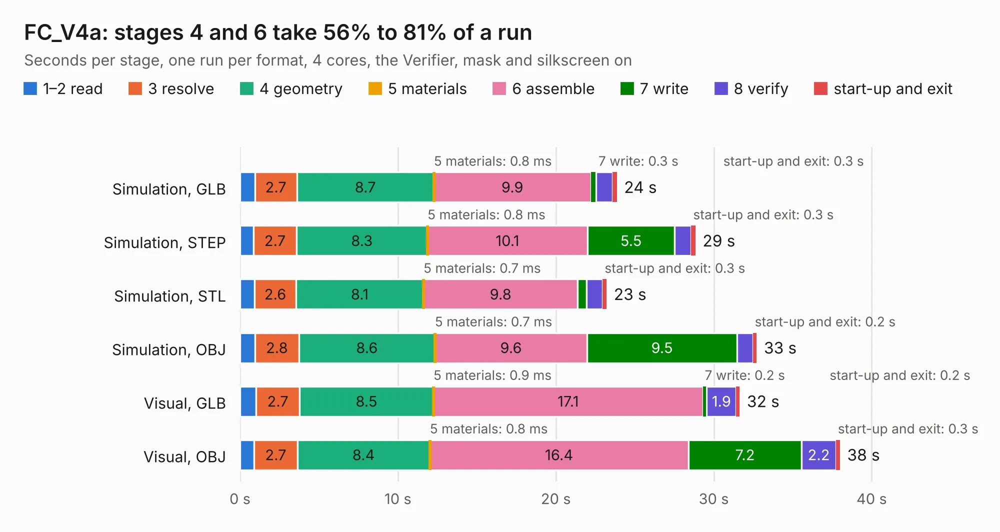

# 2310. FC_V4a

Board 2,310 of the 3,129 of [Corpus Testing](../Corpus-Testing.md), on [Corpus Page 22](../CorpusTestingPages/Corpus-Testing-22.md#2310-fc_v4a).

| Mode and format | 1–2 read | 3 resolve | 4 geometry | 5 materials | 6 assemble | 7 write | 8 verify | start-up and exit | Total |
|---|---:|---:|---:|---:|---:|---:|---:|---:|---:|
| Simulation, GLB | 0.9 | 2.7 | 8.7 | 0.8&nbsp;ms | 9.9 | 0.3 | 1.0 | 0.3 | 23.9 |
| Simulation, STEP | 0.9 | 2.7 | 8.3 | 0.8&nbsp;ms | 10.1 | 5.5 | 1.0 | 0.3 | 28.8 |
| Simulation, STL | 0.9 | 2.6 | 8.1 | 0.7&nbsp;ms | 9.8 | 0.6 | 1.0 | 0.3 | 23.2 |
| Simulation, OBJ | 0.9 | 2.8 | 8.6 | 0.7&nbsp;ms | 9.6 | 9.5 | 1.0 | 0.2 | 32.7 |
| Visual, GLB | 1.0 | 2.7 | 8.5 | 0.9&nbsp;ms | 17.1 | 0.2 | 1.9 | 0.2 | 31.6 |
| Visual, OBJ | 0.9 | 2.7 | 8.4 | 0.8&nbsp;ms | 16.4 | 7.2 | 2.2 | 0.3 | 38.0 |

<table align="center"><tr><td valign="top">

| Board | Repo: [proveskit/flight_controller_board](https://github.com/proveskit/flight_controller_board) Board: `FC_V4a.kicad_pcb` |
|---|---|
| Folder | Deprecated Versions / FC_V4a |
| Complexity | 397&nbsp;/&nbsp;1000 (size&nbsp;252, features&nbsp;145) |
| KESE&nbsp;features | through vias, slotted holes, custom pads, rounded, trapezoid or chamfered pads, arc tracks, filled zones, copper drawings, copper text, curved board outline, stack-up, dielectric εr and tanδ |
| Tested | 9th November 2026 |
| Copper&nbsp;layers | 4 |
| File&nbsp;format | KiCad 8 (20240108) |
| Parts,&nbsp;tracks,&nbsp;vias | 91, 1,205, 211 |
| Triangles,&nbsp;simulation | 1,962,322 in 130 parts |
| Verifier | PASS in all six runs |

</td><td valign="top">

<table>
<tr><th>File type</th><th>File size</th><th>Peak memory used</th></tr>
<tr><th colspan="3" align="left">Simulation</th></tr>
<tr><td>GLB</td><td align="right">69&nbsp;MB</td><td align="right">734&nbsp;MB</td></tr>
<tr><td>STEP</td><td align="right">335&nbsp;MB</td><td align="right">891&nbsp;MB</td></tr>
<tr><td>STL</td><td align="right">98&nbsp;MB</td><td align="right">752&nbsp;MB</td></tr>
<tr><td>OBJ</td><td align="right">211&nbsp;MB</td><td align="right">1.4&nbsp;GB</td></tr>
<tr><th colspan="3" align="left">Visual</th></tr>
<tr><td>GLB</td><td align="right">50&nbsp;MB</td><td align="right">986&nbsp;MB</td></tr>
<tr><td>OBJ</td><td align="right">153&nbsp;MB</td><td align="right">1.1&nbsp;GB</td></tr>
</table>

</td></tr></table>

| Previous | Next |
|:---|---:|
| [2309. FC_Board_v3](b2309b_flight-controller-board_FC-Board-v3.md) | [2311. FC_V4b](b2311b_flight-controller-board_FC-V4b.md) |
