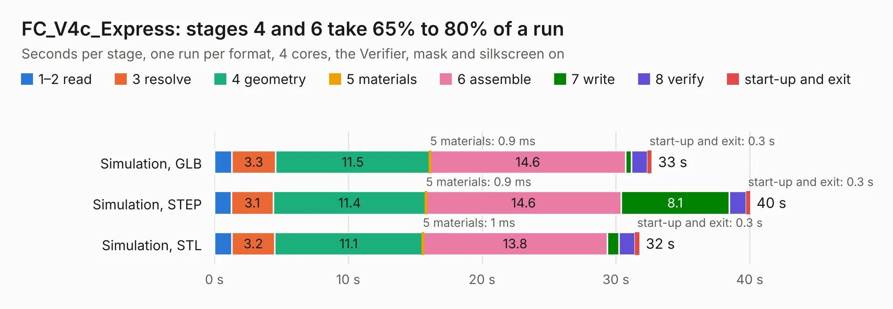

# 2310. FC_V4c_Express

Board 2,310 of the 3,124 of [Corpus Testing](../Corpus-Testing.md), on [Corpus Page 22](../CorpusTestingPages/Corpus-Testing-22.md#2310-fc_v4c_express).

| Mode and format | 1–2 read | 3 resolve | 4 geometry | 5 materials | 6 assemble | 7 write | 8 verify | start-up and exit | Total |
|---|---:|---:|---:|---:|---:|---:|---:|---:|---:|
| Simulation, GLB | 1.3 | 3.3 | 11.5 | 0.9&nbsp;ms | 14.6 | 0.4 | 1.2 | 0.3 | 32.7 |
| Simulation, STEP | 1.3 | 3.1 | 11.4 | 0.9&nbsp;ms | 14.6 | 8.1 | 1.3 | 0.3 | 40.0 |
| Simulation, STL | 1.3 | 3.2 | 11.1 | 1&nbsp;ms | 13.8 | 0.9 | 1.2 | 0.3 | 31.8 |
| Simulation, OBJ | 1.2 | 3.2 | 11.0 | 0.9&nbsp;ms | 13.9 | 14.3 | 1.2 | 0.3 | 45.2 |
| Visual, GLB | 1.3 | 3.2 | 11.1 | 0.8&nbsp;ms | 22.8 | 0.3 | 2.9 | 0.3 | 41.9 |
| Visual, OBJ | 1.2 | 3.1 | 11.1 | 0.8&nbsp;ms | 22.9 | 10.7 | 3.0 | 0.3 | 52.3 |

<table align="center"><tr><td valign="top">

| Board | Repo: [proveskit/flight_controller_board](https://github.com/proveskit/flight_controller_board) Board: `FC_V4c_Express.kicad_pcb` |
|---|---|
| Folder | Deprecated Versions / FC_V4c_Express |
| Complexity | 406&nbsp;/&nbsp;1000 (size&nbsp;261, features&nbsp;145) |
| KESE&nbsp;features | through vias, slotted holes, custom pads, rounded, trapezoid or chamfered pads, arc tracks, filled zones, copper drawings, copper text, curved board outline, stack-up, dielectric εr and tanδ |
| Tested | 9th November 2026 |
| Copper&nbsp;layers | 4 |
| File&nbsp;format | KiCad 8 (20240108) |
| Parts,&nbsp;tracks,&nbsp;vias | 139, 1,608, 276 |
| Triangles,&nbsp;simulation | 2,462,246 in 150 parts |
| Verifier | PASS in all six runs |

</td><td valign="top">

<table>
<tr><th>File type</th><th>File size</th><th>Peak memory used</th></tr>
<tr><th colspan="3" align="left">Simulation</th></tr>
<tr><td>GLB</td><td align="right">86&nbsp;MB</td><td align="right">850&nbsp;MB</td></tr>
<tr><td>STEP</td><td align="right">423&nbsp;MB</td><td align="right">1.1&nbsp;GB</td></tr>
<tr><td>STL</td><td align="right">123&nbsp;MB</td><td align="right">869&nbsp;MB</td></tr>
<tr><td>OBJ</td><td align="right">266&nbsp;MB</td><td align="right">1.8&nbsp;GB</td></tr>
<tr><th colspan="3" align="left">Visual</th></tr>
<tr><td>GLB</td><td align="right">62&nbsp;MB</td><td align="right">1.2&nbsp;GB</td></tr>
<tr><td>OBJ</td><td align="right">192&nbsp;MB</td><td align="right">1.4&nbsp;GB</td></tr>
</table>

</td></tr></table>

| Previous | Next |
|:---|---:|
| [2309. FC_V4b](b2309b_flight-controller-board_FC-V4b.md) | [2311. FC_V5](b2311b_flight-controller-board_FC-V5.md) |
