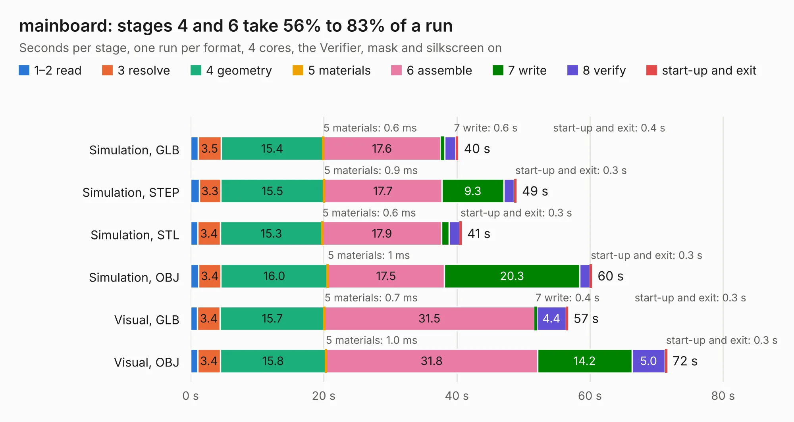

# 2310. mainboard

Board 2,310 of the 3,106 of [Corpus Testing](../Corpus-Testing.md), on [Corpus Page 22](../CorpusTestingPages/Corpus-Testing-22.md#2310-mainboard).

| Mode and format | 1–2 read | 3 resolve | 4 geometry | 5 materials | 6 assemble | 7 write | 8 verify | start-up and exit | Total |
|---|---:|---:|---:|---:|---:|---:|---:|---:|---:|
| Simulation, GLB | 1.1 | 3.5 | 15.4 | 0.6&nbsp;ms | 17.6 | 0.6 | 1.7 | 0.4 | 40.2 |
| Simulation, STEP | 1.3 | 3.3 | 15.5 | 0.9&nbsp;ms | 17.7 | 9.3 | 1.6 | 0.3 | 48.9 |
| Simulation, STL | 1.1 | 3.4 | 15.3 | 0.6&nbsp;ms | 17.9 | 1.1 | 1.6 | 0.3 | 40.7 |
| Simulation, OBJ | 1.2 | 3.4 | 16.0 | 1&nbsp;ms | 17.5 | 20.3 | 1.5 | 0.3 | 60.3 |
| Visual, GLB | 1.0 | 3.4 | 15.7 | 0.7&nbsp;ms | 31.5 | 0.4 | 4.4 | 0.3 | 56.7 |
| Visual, OBJ | 1.0 | 3.4 | 15.8 | 1.0&nbsp;ms | 31.8 | 14.2 | 5.0 | 0.3 | 71.6 |

<table align="center"><tr><td valign="top">

| Board | Repo: [pycubed/hardware](https://github.com/pycubed/hardware) Board: `mainboard.kicad_pcb` |
|---|---|
| Folder | mainboard-v04 |
| Complexity | 326&nbsp;/&nbsp;1000 (size&nbsp;261, features&nbsp;65) |
| KESE&nbsp;features | through vias, slotted holes, rounded, trapezoid or chamfered pads, filled zones, curved board outline |
| Tested | 9th November 2026 |
| Copper&nbsp;layers | 4 |
| File&nbsp;format | KiCad 5 (20171130) |
| Parts,&nbsp;tracks,&nbsp;vias | 150, 1,339, 325 |
| Triangles,&nbsp;simulation | 3,637,308 in 213 parts |
| Verifier | PASS in all six runs |

</td><td valign="top">

<table>
<tr><th>File type</th><th>File size</th><th>Peak memory used</th></tr>
<tr><th colspan="3" align="left">Simulation</th></tr>
<tr><td>GLB</td><td align="right">127&nbsp;MB</td><td align="right">1.1&nbsp;GB</td></tr>
<tr><td>STEP</td><td align="right">535&nbsp;MB</td><td align="right">1.4&nbsp;GB</td></tr>
<tr><td>STL</td><td align="right">182&nbsp;MB</td><td align="right">1.1&nbsp;GB</td></tr>
<tr><td>OBJ</td><td align="right">397&nbsp;MB</td><td align="right">2.4&nbsp;GB</td></tr>
<tr><th colspan="3" align="left">Visual</th></tr>
<tr><td>GLB</td><td align="right">85&nbsp;MB</td><td align="right">1.4&nbsp;GB</td></tr>
<tr><td>OBJ</td><td align="right">271&nbsp;MB</td><td align="right">1.8&nbsp;GB</td></tr>
</table>

</td></tr></table>

| Previous | Next |
|:---|---:|
| [2309. mainboard](b2309b_hardware_mainboard-v02_mainboard.md) | [2311. mainboard](b2311b_hardware_mainboard-v05_mainboard.md) |
