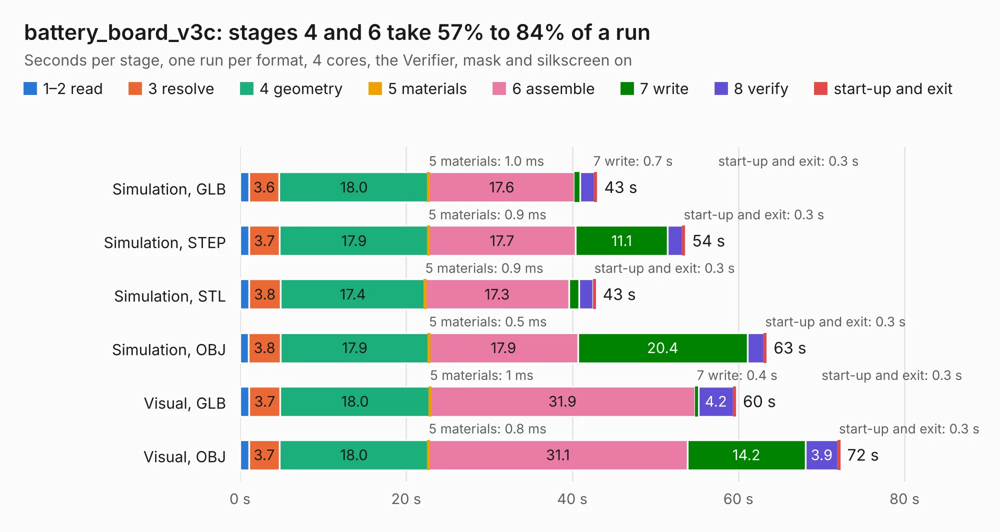

# 2311 battery_board_v3c

Board 2,311 of the 3,138 of [Corpus Testing](../Corpus-Testing.md), on [Corpus Page 22](../CorpusTestingPages/Corpus-Testing-22.md#2311-battery_board_v3c).

| Mode and format | 1–2 read | 3 resolve | 4 geometry | 5 materials | 6 assemble | 7 write | 8 verify | start-up and exit | Total |
|---|---:|---:|---:|---:|---:|---:|---:|---:|---:|
| Simulation, GLB | 1.1 | 3.6 | 18.0 | 1.0&nbsp;ms | 17.6 | 0.7 | 1.7 | 0.3 | 43.0 |
| Simulation, STEP | 1.1 | 3.7 | 17.9 | 0.9&nbsp;ms | 17.7 | 11.1 | 1.8 | 0.3 | 53.6 |
| Simulation, STL | 1.1 | 3.8 | 17.4 | 0.9&nbsp;ms | 17.3 | 1.2 | 1.7 | 0.3 | 42.8 |
| Simulation, OBJ | 1.0 | 3.8 | 17.9 | 0.5&nbsp;ms | 17.9 | 20.4 | 2.0 | 0.3 | 63.4 |
| Visual, GLB | 1.1 | 3.7 | 18.0 | 1&nbsp;ms | 31.9 | 0.4 | 4.2 | 0.3 | 59.7 |
| Visual, OBJ | 1.1 | 3.7 | 18.0 | 0.8&nbsp;ms | 31.1 | 14.2 | 3.9 | 0.3 | 72.2 |

<table align="center"><tr><td valign="top">

| Board | Repo: [proveskit/battery_board](https://github.com/proveskit/battery_board) Board: `battery_board_v3c.kicad_pcb` |
|---|---|
| Folder | battery_board_v3c |
| Complexity | 409&nbsp;/&nbsp;1000 (size&nbsp;274, features&nbsp;135) |
| KESE&nbsp;features | through vias, slotted holes, custom pads, rounded, trapezoid or chamfered pads, arc tracks, filled zones, copper drawings, curved board outline, stack-up, dielectric εr and tanδ |
| Tested | 9th November 2026 |
| Copper&nbsp;layers | 4 |
| File&nbsp;format | KiCad 8 (20240108) |
| Parts,&nbsp;tracks,&nbsp;vias | 196, 1,953, 284 |
| Triangles,&nbsp;simulation | 3,202,732 in 180 parts |
| Verifier | PASS in all six runs |

</td><td valign="top">

<table>
<tr><th>File type</th><th>File size</th><th>Peak memory used</th></tr>
<tr><th colspan="3" align="left">Simulation</th></tr>
<tr><td>GLB</td><td align="right">111&nbsp;MB</td><td align="right">1.2&nbsp;GB</td></tr>
<tr><td>STEP</td><td align="right">546&nbsp;MB</td><td align="right">1.4&nbsp;GB</td></tr>
<tr><td>STL</td><td align="right">160&nbsp;MB</td><td align="right">1.1&nbsp;GB</td></tr>
<tr><td>OBJ</td><td align="right">346&nbsp;MB</td><td align="right">2.1&nbsp;GB</td></tr>
<tr><th colspan="3" align="left">Visual</th></tr>
<tr><td>GLB</td><td align="right">81&nbsp;MB</td><td align="right">1.4&nbsp;GB</td></tr>
<tr><td>OBJ</td><td align="right">255&nbsp;MB</td><td align="right">1.7&nbsp;GB</td></tr>
</table>

</td></tr></table>

| Previous | Next |
|:---|---:|
| [2310 battery_board_v3b](b2310b_battery-board_battery-board-v3b.md) | [2312 battery_pack_v1](b2312b_battery-board_battery-pack-v1.md) |
