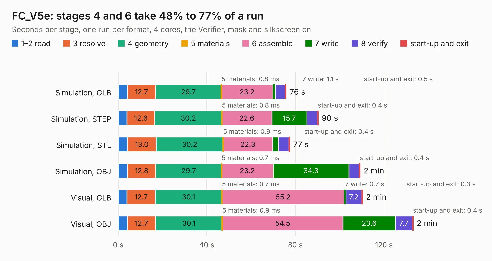

# 2312. FC_V5e

Board 2,312 of the 3,116 of [Corpus Testing](../Corpus-Testing.md), on [Corpus Page 22](../CorpusTestingPages/Corpus-Testing-22.md#2312-fc_v5e).

| Mode and format | 1–2 read | 3 resolve | 4 geometry | 5 materials | 6 assemble | 7 write | 8 verify | start-up and exit | Total |
|---|---:|---:|---:|---:|---:|---:|---:|---:|---:|
| Simulation, GLB | 4.2 | 12.7 | 29.7 | 0.8&nbsp;ms | 23.2 | 1.1 | 4.5 | 0.5 | 75.8 |
| Simulation, STEP | 4.0 | 12.6 | 30.2 | 0.8&nbsp;ms | 22.6 | 15.7 | 4.8 | 0.4 | 90.3 |
| Simulation, STL | 4.2 | 13.0 | 30.2 | 0.9&nbsp;ms | 22.3 | 2.6 | 4.8 | 0.4 | 77.4 |
| Simulation, OBJ | 4.2 | 12.8 | 29.7 | 0.7&nbsp;ms | 23.2 | 34.3 | 4.6 | 0.4 | 109.2 |
| Visual, GLB | 4.0 | 12.7 | 30.1 | 0.7&nbsp;ms | 55.2 | 0.7 | 7.2 | 0.3 | 110.3 |
| Visual, OBJ | 4.2 | 12.7 | 30.1 | 0.9&nbsp;ms | 54.5 | 23.6 | 7.7 | 0.4 | 133.2 |

<table align="center"><tr><td valign="top">

| Board | Repo: [proveskit/flight_controller_board](https://github.com/proveskit/flight_controller_board) Board: `FC_V5e.kicad_pcb` |
|---|---|
| Folder | FC_V5e |
| Complexity | 425&nbsp;/&nbsp;1000 (size&nbsp;280, features&nbsp;145) |
| KESE&nbsp;features | through vias, slotted holes, custom pads, rounded, trapezoid or chamfered pads, filled zones, copper drawings, copper text, curved board outline, knockout text, stack-up, dielectric εr and tanδ |
| Tested | 9th November 2026 |
| Copper&nbsp;layers | 4 |
| File&nbsp;format | KiCad 10 (20260206) |
| Parts,&nbsp;tracks,&nbsp;vias | 246, 2,780, 477 |
| Triangles,&nbsp;simulation | 5,281,252 in 234 parts |
| Verifier | PASS in all six runs |

</td><td valign="top">

<table>
<tr><th>File type</th><th>File size</th><th>Peak memory used</th></tr>
<tr><th colspan="3" align="left">Simulation</th></tr>
<tr><td>GLB</td><td align="right">187&nbsp;MB</td><td align="right">1.9&nbsp;GB</td></tr>
<tr><td>STEP</td><td align="right">1.0&nbsp;GB</td><td align="right">2.1&nbsp;GB</td></tr>
<tr><td>STL</td><td align="right">264&nbsp;MB</td><td align="right">2.0&nbsp;GB</td></tr>
<tr><td>OBJ</td><td align="right">587&nbsp;MB</td><td align="right">3.6&nbsp;GB</td></tr>
<tr><th colspan="3" align="left">Visual</th></tr>
<tr><td>GLB</td><td align="right">133&nbsp;MB</td><td align="right">2.2&nbsp;GB</td></tr>
<tr><td>OBJ</td><td align="right">420&nbsp;MB</td><td align="right">2.8&nbsp;GB</td></tr>
</table>

</td></tr></table>

| Previous | Next |
|:---|---:|
| [2311. FC_V5d_Production_Rev2](b2311b_flight-controller-board_FC-V5d-Production-Rev2.md) | [2313. FC_V5e_Production_Rev1](b2313b_flight-controller-board_FC-V5e-Production-Rev1.md) |
