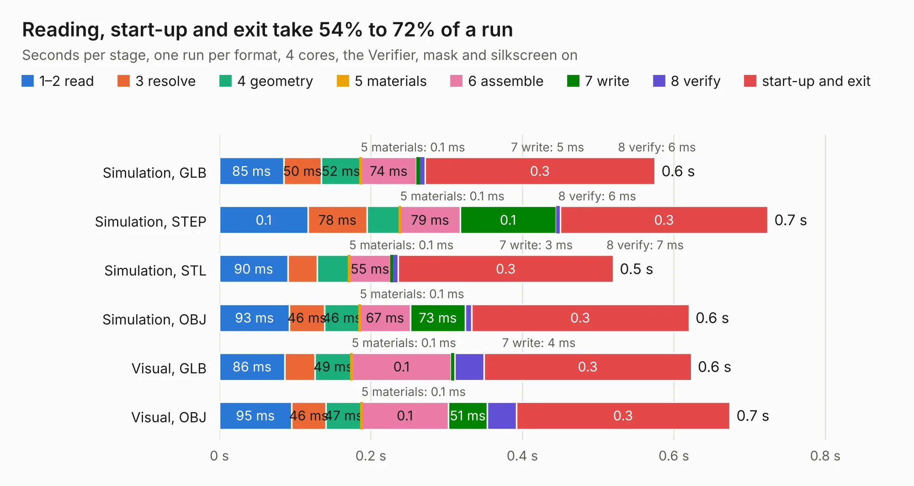

# 2313. ACU5EV_Carrier_Base

Board 2,313 of the 3,102 of [Corpus Testing](../Corpus-Testing.md), on [Corpus Page 22](../CorpusTestingPages/Corpus-Testing-22.md#2313-acu5ev_carrier_base).

| Mode and format | 1–2 read | 3 resolve | 4 geometry | 5 materials | 6 assemble | 7 write | 8 verify | start-up and exit | Total |
|---|---:|---:|---:|---:|---:|---:|---:|---:|---:|
| Simulation, GLB | 85&nbsp;ms | 50&nbsp;ms | 52&nbsp;ms | 0.1&nbsp;ms | 74&nbsp;ms | 5&nbsp;ms | 6&nbsp;ms | 0.3 | 0.6 |
| Simulation, STEP | 0.1 | 78&nbsp;ms | 44&nbsp;ms | 0.1&nbsp;ms | 79&nbsp;ms | 0.1 | 6&nbsp;ms | 0.3 | 0.7 |
| Simulation, STL | 90&nbsp;ms | 39&nbsp;ms | 42&nbsp;ms | 0.1&nbsp;ms | 55&nbsp;ms | 3&nbsp;ms | 7&nbsp;ms | 0.3 | 0.5 |
| Simulation, OBJ | 93&nbsp;ms | 46&nbsp;ms | 46&nbsp;ms | 0.1&nbsp;ms | 67&nbsp;ms | 73&nbsp;ms | 8&nbsp;ms | 0.3 | 0.6 |
| Visual, GLB | 86&nbsp;ms | 40&nbsp;ms | 49&nbsp;ms | 0.1&nbsp;ms | 0.1 | 4&nbsp;ms | 39&nbsp;ms | 0.3 | 0.6 |
| Visual, OBJ | 95&nbsp;ms | 46&nbsp;ms | 47&nbsp;ms | 0.1&nbsp;ms | 0.1 | 51&nbsp;ms | 39&nbsp;ms | 0.3 | 0.7 |

<table align="center"><tr><td valign="top">

| Board | Repo: [raonslab2/fcboardkicad](https://github.com/raonslab2/fcboardkicad) Board: `ACU5EV_Carrier_Base.kicad_pcb` |
|---|---|
| Folder | out / carrier_acu5ev |
| Complexity | 17&nbsp;/&nbsp;1000 (size&nbsp;17, features&nbsp;0) |
| Tested | 9th November 2026 |
| Copper&nbsp;layers | 2 |
| File&nbsp;format | KiCad 9 (20241229) |
| Parts,&nbsp;tracks,&nbsp;vias | 0, 0, 0 |
| Triangles,&nbsp;simulation | 8,288 in 4 parts |
| Note | no components |
| Verifier | PASS in all six runs |

</td><td valign="top">

<table>
<tr><th>File type</th><th>File size</th><th>Peak memory used</th></tr>
<tr><th colspan="3" align="left">Simulation</th></tr>
<tr><td>GLB</td><td align="right">293&nbsp;kB</td><td align="right">61&nbsp;MB</td></tr>
<tr><td>STEP</td><td align="right">1.0&nbsp;MB</td><td align="right">61&nbsp;MB</td></tr>
<tr><td>STL</td><td align="right">415&nbsp;kB</td><td align="right">60&nbsp;MB</td></tr>
<tr><td>OBJ</td><td align="right">794&nbsp;kB</td><td align="right">62&nbsp;MB</td></tr>
<tr><th colspan="3" align="left">Visual</th></tr>
<tr><td>GLB</td><td align="right">289&nbsp;kB</td><td align="right">84&nbsp;MB</td></tr>
<tr><td>OBJ</td><td align="right">737&nbsp;kB</td><td align="right">86&nbsp;MB</td></tr>
</table>

</td></tr></table>

| Previous | Next |
|:---|---:|
| [2312. qmtech-minimig](b2312b_qmtech-minimig_qmtech-minimig.md) | [2314. AmplifierHat](b2314b_artixdevboard_AmplifierHat.md) |
